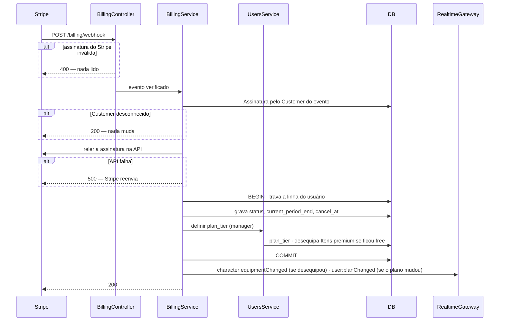
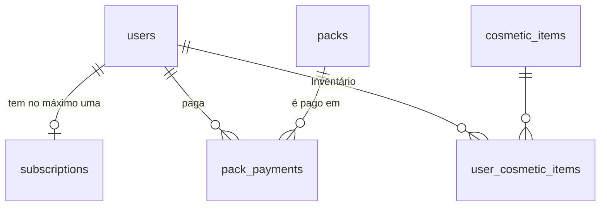
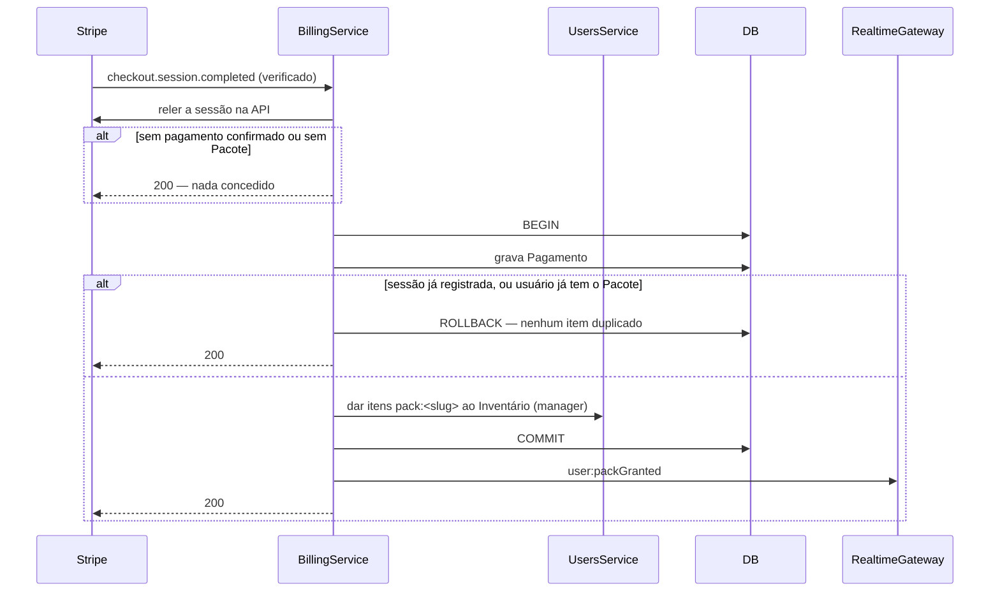

# Assinatura premium e Pacotes com Stripe

> Plan from this document. Each slice below carries its own shape - copy it, do not re-derive it.
> Status: confirmed by Guilherme Luan (pedido do professor da disciplina), 2026-11-08. Pacotes incluídos e aprovados no mesmo dia.

## Situation

- Project: in active construction. Fase 1 entregue em staging, sem usuários pagantes e sem publicação nas lojas (ADR-008).
- Decision: committed by Guilherme Luan em 08/11/2026, a pedido do professor. Revisa o ADR-007, que proibia código de cobrança na Fase 1.
- In flight: reaproveita o `plan_tier` e a checagem de Item premium ✦ em Equipar (ADR-007), a Loja com as seções Missões e Itens (ADR-012) e o padrão da equipagem de emitir eventos realtime só depois do commit. A validação de preço e empacotamento (issue #7) continua aberta e fora deste documento.
- At stake: barato de errar. Roda só em modo de teste do Stripe e nenhum dinheiro real circula. O que custa caro é a demo de 13/11 falhar ao vivo.

## Problem

O professor pediu que o Wise Warrior demonstre monetização funcionando. Hoje o premium existe só como coluna. O `plan_tier` nunca muda, a tela Plano diz "premium em breve" e o único Item premium ✦ é um Título de nível 15, então nem a flag tem o que mostrar. Não existe nenhum modo de pagar com dinheiro.

A demo precisa de dois modelos:
- uma assinatura recorrente, que dá acesso enquanto está ativa;
- uma compra única de cosméticos, que fica com a pessoa para sempre.

Sem esta peça, o Pitch freemium continua sem contrapartida técnica, como o PRD já registra na seção 3.6. O prazo é a apresentação de sexta, 13/11/2026.

## Success

- Worked if: na apresentação de 13/11, os dois fluxos rodam ao vivo na Web, com cartão de teste e sem intervenção no banco:
  - **Assinatura:** assinar, ver o plano virar Premium e equipar um Item premium ✦. Depois cancelar e, quando a Assinatura termina, ver o item desequipado e o plano de volta a Free.
  - **Pacote:** comprar o "Pacote do Dragão" na Loja e equipar os itens dele sendo `free`.
- Going wrong:
  - Até quarta, 11/11, o webhook no staging ainda não muda o `plan_tier`: cortar a fatia Portal e demonstrar o cancelamento pelo painel do Stripe.
  - Até quarta, a Assinatura não está pronta de ponta a ponta: os Pacotes saem da demo e ficam para depois.
- Review: 13/11, depois da apresentação. Quem revisa: Guilherme Luan.

## Boundary

In:
- Assinatura mensal única (R$ 9,90/mês, cartão, BRL) com Checkout e Portal do cliente hospedados pelo Stripe.
- Um Pacote, "Pacote do Dragão", por R$ 4,90 em pagamento único, vendido na Loja numa seção "Pacotes".
- Webhook que sincroniza a Assinatura e registra o Pagamento dos Pacotes.
- 3 Itens premium ✦ e 3 itens do Pacote.
- Tela `/configuracao/plano` e a seção Pacotes em `/mercado`.
- Revisão do ADR-007 no `docs/PRD.md`, termos Assinatura, Pacote e Pagamento no `CONTEXT.md`, definição de Loja ajustada e contratos em `docs/api/openapi.yaml` e `docs/api/asyncapi.yaml`.
- Endpoint de webhook registrado no Stripe (modo de teste) apontando para o staging. Localmente, via `stripe listen`.

Out:
- Cobrança real (modo live): sair do teste é trocar chaves, segredo do webhook e Price ID da Assinatura, recriar o produto no modo live e ativar a conta com CPF ou CNPJ. Não tem código novo.
- Compra in-app no iOS e no Android: obrigatória para bens digitais vendidos nas lojas, que não estão no escopo (ADR-008).
- PIX e boleto: só cartão, que confirma na hora.
- Impostos, nota fiscal, reembolso e suporte: só existem com dinheiro real.
- Trial, plano anual, mais de um plano e desconto de Pacote para quem é premium.
- Mais de um Pacote à venda: a tabela aceita outros, mas só um é criado.
- Pagamento em dobro por corrida:
  - duas Assinaturas abertas em checkouts simultâneos;
  - o mesmo Pacote pago em dois checkouts.

  Aceito em modo de teste. Fica no log e não gera reembolso.
- Raids avançadas e perfil destacado do Pitch: não existem como recurso.
- Vender Moedas com dinheiro: daria vantagem paga nas Raids (ADR-012).
- Preço e empacotamento validados com usuários: issue #7.

Unchanged:
- `users.plan_tier` e seus valores `free` e `premium`.
- A recusa de Equipar um Item premium para quem é `free`, com a mensagem atual.
- Moedas, Extrato e a Compra por Moedas nas seções Missões e Itens da Loja: o dinheiro não entra no Extrato nem gera Moedas.
- Itens premium e itens de Pacote continuam fora de venda por Moedas.

## Prior art

- Checkout hospedado, Portal do cliente e webhook que concede e retira o acesso é o fluxo de assinatura documentado pelo Stripe. Adotamos o mesmo Checkout em modo de pagamento único para os Pacotes.
- O Stripe orienta conceder o acesso pelo estado da assinatura, não pelo redirecionamento de sucesso, e reler o objeto na API em vez de confiar no payload do evento. O evento pode chegar repetido ou fora de ordem e é reenviado por até 3 dias. É o que sustenta a Key decision 1.
- Na API atual (`2026-10-28.endive`) o fim do período mudou para os itens da assinatura, e, no billing mode flexible, o cancelamento agendado preenche `cancel_at` com `cancel_at_period_end` em `false`. É o motivo do alerta da Key decision 5.
- Stripe Entitlements resolve vários planos com vários recursos. Não adotamos: há um plano e um recurso.

## Shape

Os registros novos são a Assinatura (`subscriptions`, uma por usuário), o Pacote (`packs`) e o Pagamento de um Pacote (`pack_payments`), todos do novo `BillingModule`. O webhook é o único escritor: ele deriva o `plan_tier` da Assinatura e põe os itens do Pacote no Inventário quando o Pagamento se confirma. Checkout e Portal são páginas do Stripe; o app só cria a sessão e redireciona para ela. O que é difícil de mudar depois é o webhook ser o único escritor, a regra de derivação de estado para plano e a posse permanente dos itens pagos; sair do modo de teste é só configuração.

A alternativa pesada é um checkout embutido no app (Stripe Elements ou Payment Sheet nativo) com Stripe Entitlements. Ela só ganha com mais de um plano ou com pagamento dentro do app nativo publicado nas lojas, e nenhuma das duas condições vale hoje.

## Key decisions

1. **O Stripe é a fonte da verdade, e o webhook é o único caminho que concede algo.** A assinatura do Stripe é verificada sobre o corpo bruto antes de qualquer leitura, e a rota não usa JWT nem o rate limiting do app. Cada evento só identifica o que mudou: o backend relê a assinatura ou a sessão de checkout na API e grava o estado atual, então eventos repetidos ou fora de ordem chegam ao mesmo resultado. O redirecionamento de sucesso não concede nada. Os eventos são `checkout.session.completed`, `customer.subscription.created`, `customer.subscription.updated`, `customer.subscription.deleted`, `invoice.paid` e `invoice.payment_failed`.
2. **Premium se, e somente se, o status da assinatura for `active`, `trialing` ou `past_due`.** Os status `canceled`, `unpaid`, `incomplete`, `incomplete_expired` e `paused`, ou a falta de assinatura, dão `free`. `past_due` mantém o premium enquanto o Stripe tenta cobrar de novo. Uma Assinatura cancelada para o fim do período continua `active` até lá.
3. **O `BillingModule` é dono de `subscriptions`, `packs` e `pack_payments`, e de nada mais (ADR-001).** `plan_tier` e o Inventário só mudam pelo `UsersService`, chamado com o `EntityManager` da transação do billing. O `BillingModule` importa o `UsersModule`, e o `UsersModule` não importa nada dele.
4. **Gravar a Assinatura, mudar o `plan_tier` e desequipar os Itens premium ✦ acontecem em uma transação só.** Quando a pessoa volta para `free`, cada Item premium equipado sai, e a categoria volta ao Item inicial dela quando ele existir; senão fica vazia. Itens de Pacote nunca são desequipados. `character:equipmentChanged`, `user:planChanged` e `user:packGranted` saem só depois do commit, para todos os dispositivos (ADR-009).
5. **O modo é configuração.** `STRIPE_SECRET_KEY`, `STRIPE_WEBHOOK_SECRET`, `STRIPE_PRICE_PREMIUM` e `APP_URL` (a origem do frontend, de onde saem as URLs de volta) vêm do ambiente. Nenhum ID do Stripe aparece em código ou migration. O preço do Pacote fica em `packs` e vai para o Checkout como valor avulso, sem Price no Stripe.

   Sem `STRIPE_SECRET_KEY`, a cobrança fica indisponível e o resto do app funciona: CI e e2e não dependem do Stripe. Com a cobrança configurada, `COSMETICS_PREMIUM_FOR_ALL` é ignorado e o premium é exigido de verdade. A versão da API fica fixada no cliente, e o fim do período é lido do item da assinatura, não da assinatura.
6. **Cada usuário tem no máximo um Customer no Stripe**, criado no primeiro checkout de qualquer tipo e reutilizado depois. A sessão é ligada ao usuário pelo `client_reference_id`, com o id do usuário, nunca pelo e-mail.
7. **Há no máximo um Pagamento por usuário e Pacote, e registrar o Pagamento e dar os itens ao Inventário acontecem em uma transação só.** Um evento repetido não cria um segundo Pagamento nem duplica itens. Um segundo checkout pago do mesmo Pacote fica no log e não concede nada de novo.
8. **Itens pagos seguem regras fixas de posse.**
   - **Item premium ✦:** nunca é Item inicial, mesmo com Condição `level:1`. Entra desequipado no Inventário de todo Character, inclusive dos que já existem, e só Equipar exige premium.
   - **Item de Pacote:** tem a Condição `pack:<slug>` e nunca é premium, Item inicial ou À venda por Moedas. Qualquer plano o equipa, e ele fica com quem pagou para sempre, mesmo que o Pacote saia de venda.

   A regra de Item inicial passa a ser "nível 1 e não premium", e o `CONTEXT.md` muda junto.

## Work

| Slice | Delivers | Status |
|---|---|---|
| [Itens premium](#itens-premium) | 3 Itens premium ✦ no Inventário de todo Character, bloqueados para `free` | open — 2 defaults taken |
| [Subscription](#subscription) | Tabela `subscriptions` e webhook que muda o `plan_tier` e desequipa | clear |
| [Checkout](#checkout) | `POST /billing/checkout` devolve a URL do Checkout da Assinatura | clear |
| [Portal](#portal) | `POST /billing/portal` devolve a URL do Portal do cliente | clear |
| [Plano](#plano) | Tela `/configuracao/plano` com Assinar, Gerenciar e todos os estados | open — 3 defaults taken |
| [Pack](#pack) | Tabela `packs`, o "Pacote do Dragão" com 3 itens e `GET /billing/packs` | open — 1 default taken |
| [Pack Payment](#pack-payment) | Checkout do Pacote e webhook que registra o Pagamento e dá os itens | clear |
| [Pacotes](#pacotes) | Seção "Pacotes" na Loja, em `/mercado` | open — 2 defaults taken |

Order: Itens premium ∥ Subscription → Checkout → Portal → Plano, com a Assinatura pronta até quarta, 11/11. Depois, Pack → Pack Payment → Pacotes. Plano e Pacotes podem começar com dados falsos assim que os contratos estiverem no OpenAPI. Se a Assinatura não fechar até quarta, as três fatias de Pacote ficam para depois da demo.

Already handled by existing code:
- `free` tenta equipar Item premium: recusa em Equipar e alerta "Item exclusivo do plano premium" na tela Personagem.
- Item premium no Inventário de quem é `free`: aparece como "Plano premium" na gaveta de equipamento.
- Item de Pacote adquirido: a gaveta de equipamento o mostra como qualquer item do Inventário.

Derivable from the repository, left to the plan:
- Respostas de erro no formato Problem e mensagens em pt-BR, como o `HttpExceptionFilter`.
- Validação de ambiente no boot, como o `environment.validation`, e variáveis documentadas em `.env.example`.
- Rate limiting das rotas autenticadas, como `RATE_LIMIT_SHOP_*`.
- Seeds com ids fixos, como a migration do Catálogo inicial.
- Eventos em tempo real depois do commit, como na equipagem.
- Abas e cartões da Loja, como as seções Missões e Itens.
- Formatação de dinheiro em pt-BR (R$ 4,90).
- Contratos em `docs/api`.

### Itens premium

**Delivers** três Cosmetic Items com `requires_premium` e Condição `level:1`: um Avatar, uma Arma e um Título, dados a todo Character (Key decision 8). **Status: open.**

| State | What should happen | Caller sees |
|---|---|---|
| Character novo | Recebe os Itens iniciais equipados e os 3 Itens premium desequipados | Itens premium com o selo "Plano premium" |
| Character existente | A migration dá os 3 itens desequipados; nada do que estava equipado muda | O mesmo |
| `premium` equipa um Item premium | Equipa como qualquer item | Herói muda em todos os dispositivos |
| `free` equipa um Item premium | Recusado, sem mudança | `403` "Item exclusivo do plano premium" (já existe) |

Table `cosmetic_items`: três linhas novas com ids fixos, `requires_premium = 1`, `unlock_condition = 'level:1'` e `for_sale = 0`. Table `user_cosmetic_items`: uma linha por Character para cada item, com `equipped = 0`. Nenhuma coluna muda.

Open, default taken:
1. Nomes. Padrão: "Manto Estelar" (Avatar), "Lâmina Arcana" (Arma) e "Arquimago" (Título).
2. Sprites. Padrão: reaproveitar sprites existentes do Avatar e da Arma, com o selo ✦, até que haja arte própria.

### Subscription

**Delivers** a Assinatura de cada usuário sincronizada pelo webhook, e o `plan_tier` derivado dela. **Status: clear.** É a parte difícil de mudar depois (Key decisions 1, 2 e 4).

| State | What should happen | Caller sees |
|---|---|---|
| Assinatura do webhook inválida ou ausente | Nada é lido nem gravado | `400` |
| Tipo de evento fora da lista | Nada muda | `200` |
| Evento de um Customer que não é de nenhum usuário | Nada muda; fica no log | `200`, para o Stripe parar de reenviar |
| Assinatura passa a `active` ou `trialing` | `plan_tier = premium`; grava status e fim do período | `200`; o usuário recebe `user:planChanged` |
| Cancelamento agendado para o fim do período | Continua premium; grava `cancel_at` | `200`; Plano mostra "Premium até dd/mm" |
| Pagamento recusado na renovação (`past_due`) | Continua premium | `200`; Plano mostra "pagamento pendente" |
| Assinatura termina (`canceled`, `unpaid`, `incomplete_expired`) | `plan_tier = free`; desequipa os Itens premium | `200`; `character:equipmentChanged` por categoria, depois `user:planChanged` |
| Evento repetido ou fora de ordem | Relê a assinatura, o resultado é o mesmo | `200` |
| API do Stripe falha ao reler | Nada é gravado | `500`; o Stripe reenvia |

`POST /api/v1/billing/webhook` corpo bruto do evento + cabeçalho `Stripe-Signature` → `200` `{ "received": true }`

O mesmo endpoint atende a fatia Pack Payment.

Evento realtime novo na room `user:{id}`: `user:planChanged` `{ "planTier": "free" | "premium" }`.

Table `subscriptions`; no existing table changes.

| Column | Type | Null | References | Note |
|---|---|---|---|---|
| `id` | uuid | no | | PK |
| `user_id` | uuid | no | `users.id` | único; `ON DELETE CASCADE` |
| `stripe_customer_id` | varchar(255) | no | | único; criado no primeiro checkout de qualquer tipo (Key decision 6) |
| `stripe_subscription_id` | varchar(255) | yes | | único; null até um checkout de Assinatura terminar |
| `status` | varchar(32) | yes | | o status do Stripe, sem tradução; null antes da primeira assinatura |
| `current_period_end` | datetime | yes | | data de renovação, lida do item da assinatura |
| `cancel_at` | datetime | yes | | fim agendado; null quando a Assinatura não está cancelada |
| `created_at` | datetime | no | | |
| `updated_at` | datetime | no | | escrito a cada sincronização |

A linha de `subscriptions` também guarda o Customer de quem só comprou Pacotes. Nesse caso, `stripe_subscription_id` e `status` ficam null.

Alternatives considered: confiar no payload do evento sem reler a API. Ganha só se o volume de eventos fizer as chamadas extras custarem, o que não acontece em modo de teste.

### Checkout

**Delivers** a abertura do Checkout hospedado pelo Stripe para assinar o premium. **Status: clear.**

| State | What should happen | Caller sees |
|---|---|---|
| `free` sem Customer | Cria o Customer e a linha de `subscriptions`, depois a sessão de checkout | `201` com a URL |
| `free` com Customer (comprou Pacote, assinatura anterior terminou ou checkout abandonado) | Reutiliza o Customer e cria uma sessão nova | `201` com a URL |
| Já premium | Nada é criado | `409` "Você já tem o plano premium" |
| Cobrança não configurada | Nada é criado | `503` "Assinatura indisponível no momento" |
| Stripe falha | Nada fica gravado, nem o Customer | `502` "Não foi possível abrir o pagamento" |
| Pessoa paga | Nada aqui; a fatia Subscription concede o premium | O Stripe redireciona para `/configuracao/plano?checkout=success` |
| Pessoa desiste no Checkout | Nada muda | O Stripe redireciona para `/configuracao/plano?checkout=cancel` |

`POST /api/v1/billing/checkout` `{}` → `201` `{ "url": string }`

### Portal

**Delivers** a abertura do Portal do cliente do Stripe para cancelar, reativar e trocar o cartão. **Status: clear.** O Portal é configurado no painel do Stripe (modo de teste) para cancelar no fim do período.

| State | What should happen | Caller sees |
|---|---|---|
| Usuário com Assinatura | Cria a sessão do Portal | `201` com a URL; a volta é para `/configuracao/plano` |
| Usuário sem Assinatura (nunca assinou ou só comprou Pacote) | Nada é criado | `409` "Nenhuma assinatura para gerenciar" |
| Cobrança não configurada | Nada é criado | `503` "Assinatura indisponível no momento" |
| Cancela no Portal | Nada aqui; a fatia Subscription grava `cancel_at` | Plano mostra "Premium até dd/mm" |

`POST /api/v1/billing/portal` `{}` → `201` `{ "url": string }`

### Plano

**Delivers** a tela `/configuracao/plano` com o estado da Assinatura e as ações Assinar e Gerenciar. **Status: open.** Não há tela desenhada para o Plano. Ela segue o padrão visual das outras seções da Configuração.

| State | What should happen | Caller sees |
|---|---|---|
| `free`, cobrança disponível | Mostra o Premium, R$ 9,90/mês e os Itens ✦ | Botão "Assinar premium" |
| `free`, cobrança indisponível | Fica como hoje | "Free · premium em breve", sem botão |
| Toca em Assinar | Abre o Checkout. Na Web, na mesma aba; no app nativo, no navegador do sistema | Botão ocupado até a URL chegar |
| Volta com `?checkout=success` e o webhook ainda não chegou | Espera `user:planChanged` e reconsulta o perfil | "Confirmando sua assinatura…"; depois de 30 s, "Pagamento recebido. O plano atualiza em instantes." |
| Volta com `?checkout=cancel` | Nada muda | Tela `free`, sem erro |
| Premium ativo | | "Premium · renova em dd/mm" e "Gerenciar assinatura" |
| Premium com cancelamento agendado | | "Premium até dd/mm" e "Gerenciar assinatura" |
| Premium com pagamento pendente (`past_due`) | | "Premium · pagamento pendente" e "Atualizar cartão" (abre o Portal) |
| Plano muda em outro dispositivo | Reconsulta ao receber `user:planChanged` | A tela atualiza sozinha |
| `502`, `503` ou `409` ao abrir Checkout ou Portal | Nada muda | Aviso com a mensagem do servidor |

`GET /api/v1/billing/subscription` → `200` `{ "available": boolean, "planTier": "free" | "premium", "status": string | null, "renewsAt": string | null, "premiumUntil": string | null }`

O rótulo "Plano atual" na lista e no menu da Configuração passa a mostrar só o nome do plano quando a cobrança está disponível.

Open, default taken:
1. Texto da oferta. Padrão: "Premium · R$ 9,90/mês. Libera os Itens premium ✦ do Herói."
2. Volta ao app nativo. Padrão: sem deep link. A tela atualiza por `user:planChanged` quando o app volta ao primeiro plano.
3. Espera pela confirmação. Padrão: 30 s, depois a mensagem de pagamento recebido.

### Pack

**Delivers** o Pacote como registro vendável, o "Pacote do Dragão" com seus 3 itens e a listagem para a Loja (Key decision 8). **Status: open.**

| State | What should happen | Caller sees |
|---|---|---|
| Pacote à venda, usuário não tem | Listado com preço e itens | `owned: false` |
| Pacote já pago pelo usuário | Listado como adquirido | `owned: true` |
| Pacote fora de venda, usuário pagou | Continua listado para ele, como adquirido | `owned: true` |
| Pacote fora de venda, usuário não pagou | Não aparece | Ausente da lista |
| Cobrança não configurada | Lista vazia | `available: false`, `packs: []` |
| Alguém tenta pôr item de Pacote À venda por Moedas | Recusado pela mesma regra que já protege Itens premium | Erro da regra de À venda |

`GET /api/v1/billing/packs` → `200` `{ "available": boolean, "packs": [{ "slug": string, "name": string, "description": string, "priceCents": number, "currency": "brl", "items": [{ "id": string, "name": string, "category": string }], "owned": boolean }] }`

Table `packs`; `cosmetic_items` ganha linhas com `unlock_condition = 'pack:<slug>'` e nenhuma coluna nova.

| Column | Type | Null | References | Note |
|---|---|---|---|---|
| `id` | uuid | no | | PK, id fixo no seed |
| `slug` | varchar(64) | no | | único; o mesmo da Condição `pack:<slug>` |
| `name` | varchar(80) | no | | "Pacote do Dragão" |
| `description` | varchar(255) | no | | |
| `price_cents` | int | no | | 490; maior que zero |
| `currency` | char(3) | no | | `brl` |
| `for_sale` | boolean | no | | falso tira o Pacote da Loja sem tirar de quem pagou |
| `created_at` | datetime | no | | |

Os itens de um Pacote são os Cosmetic Items com Condição `pack:<slug>`, como as Recompensas de Raid são os de `raid:<slug>`. Não há tabela de ligação.

Open, default taken:
1. Itens do Pacote do Dragão. Padrão: "Elmo de Escamas" (Avatar), "Presa do Dragão" (Arma) e "Amuleto de Brasa" (Acessório), com sprites reaproveitados até que haja arte própria.

### Pack Payment

**Delivers** a compra de um Pacote pelo Checkout do Stripe em pagamento único e a entrada dos itens no Inventário pelo webhook (Key decisions 1 e 7). **Status: clear.**

| State | What should happen | Caller sees |
|---|---|---|
| Pede checkout de Pacote à venda que não tem | Reutiliza ou cria o Customer e abre a sessão com o preço de `packs` | `201` com a URL |
| Pede checkout de Pacote que já tem | Nada é criado | `409` "Você já tem este Pacote" |
| Pacote inexistente ou fora de venda | Nada é criado | `404` "Pacote não encontrado" |
| Cobrança não configurada | Nada é criado | `503` "Pagamento indisponível no momento" |
| Stripe falha ao criar a sessão | Nada fica gravado | `502` "Não foi possível abrir o pagamento" |
| Webhook: checkout de Pacote concluído e pago | Relê a sessão; grava o Pagamento e dá os 3 itens desequipados | `200`; o usuário recebe `user:packGranted` |
| Webhook: o mesmo evento de novo | Já existe Pagamento para a sessão; nada muda | `200` |
| Webhook: segundo checkout pago do mesmo Pacote | Nada é concedido; fica no log | `200` |
| Webhook: sessão concluída sem pagamento confirmado | Nada é concedido | `200` |
| Pessoa paga e volta | Nada aqui; o webhook concede | O Stripe redireciona para `/mercado?secao=pacotes&checkout=success` |
| Pessoa desiste | Nada muda | O Stripe redireciona para `/mercado?secao=pacotes&checkout=cancel` |

`POST /api/v1/billing/packs/:slug/checkout` `{}` → `201` `{ "url": string }`

Evento realtime novo na room `user:{id}`: `user:packGranted` `{ "slug": string, "cosmeticItemIds": string[] }`.

Table `pack_payments`; no existing table changes.

| Column | Type | Null | References | Note |
|---|---|---|---|---|
| `id` | uuid | no | | PK |
| `user_id` | uuid | no | `users.id` | `ON DELETE CASCADE` |
| `pack_id` | uuid | no | `packs.id` | |
| `stripe_checkout_session_id` | varchar(255) | no | | único; torna o evento repetido inofensivo |
| `amount_cents` | int | no | | o valor pago, lido da sessão |
| `currency` | char(3) | no | | |
| `paid_at` | datetime | no | | |

Índice único (`user_id`, `pack_id`): um Pagamento por usuário e Pacote (Key decision 7).

### Pacotes

**Delivers** a terceira seção da Loja, "Pacotes", ao lado de Missões e Itens, com preço em reais. **Status: open.** Não há tela desenhada. Ela segue os cartões das seções Missões e Itens.

| State | What should happen | Caller sees |
|---|---|---|
| Cobrança disponível, Pacote à venda | Cartão com nome, itens, preço em R$ e Prévia no Herói | Botão "Comprar por R$ 4,90" |
| Pacote já adquirido | | Selo "Adquirido", sem botão |
| Cobrança indisponível | A seção não aparece | Só Missões e Itens |
| Toca em Comprar | Abre o Checkout. Na Web, na mesma aba; no app nativo, no navegador do sistema | Botão ocupado até a URL chegar |
| Volta com `checkout=success` e o webhook ainda não chegou | Espera `user:packGranted` e reconsulta | "Confirmando seu pagamento…"; depois de 30 s, "Pagamento recebido. Os itens chegam em instantes." |
| `user:packGranted` chega | Reconsulta Pacotes, Inventário e Catálogo | "Adquirido" e aviso "Itens do Pacote do Dragão no seu Inventário" |
| Volta com `checkout=cancel` | Nada muda | Seção Pacotes, sem erro |
| `404`, `409`, `502` ou `503` | Nada muda | Aviso com a mensagem do servidor |

O texto de abertura da Loja deixa de dizer só "Troque as Moedas do seu foco" e passa a cobrir também os Pacotes. O saldo de Moedas não aparece na seção Pacotes.

Open, default taken:
1. Prévia. Padrão: a Prévia que a seção Itens já usa, aplicada aos 3 itens de uma vez.
2. Aba inicial. Padrão: `?secao=pacotes` abre a seção Pacotes; sem o parâmetro, a Loja continua abrindo em Missões.

## Sources

- `docs/PRD.md`: ADR-001 (Service do módulo dono), ADR-007 (`plan_tier`, revisado por este documento), ADR-008 (sem publicação nas lojas), ADR-009 (eventos para todos os dispositivos) e ADR-012 (Moedas e Loja).
- `CONTEXT.md`: Item premium, Item inicial, Condição de desbloqueio, Inventário, Loja, Compra e À venda.
- Issue #7 "Validar monetização e desenho freemium": continua aberta para preço e empacotamento.
- Stripe, webhooks de assinatura: https://docs.stripe.com/billing/subscriptions/webhooks
- Stripe, Portal do cliente e cancelamento: https://docs.stripe.com/customer-management e https://docs.stripe.com/customer-management/cancellation-page
- Stripe, billing modes e `cancel_at`: https://docs.stripe.com/billing/subscriptions/billing-mode/compare
- Stripe, versões da API (`2026-10-28.endive`): https://docs.stripe.com/upgrades
- Pacote npm `stripe`, versão 23.1.0.
