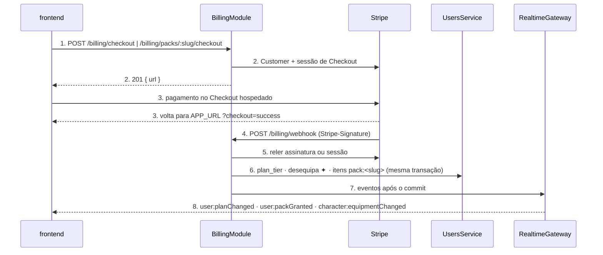
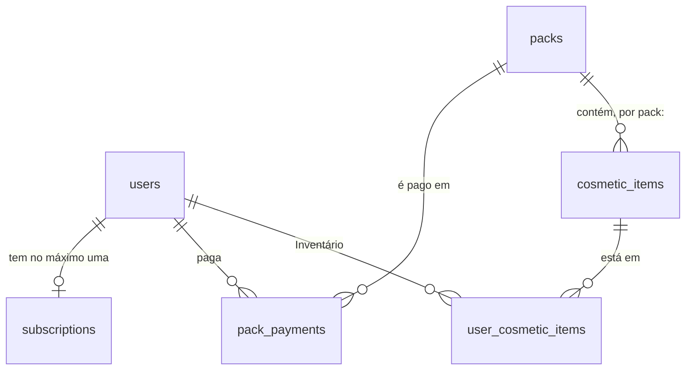
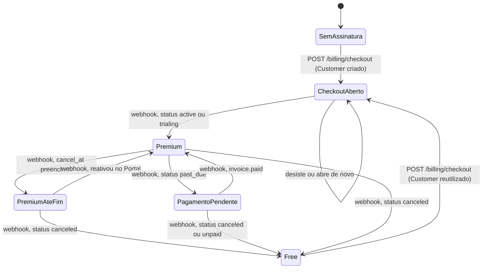

# Assinatura premium e Pacotes com Stripe

**Approved**: 2026-11-08 - user: "Aprovado, cada \"S\" é uma tarefa?"

> Build this with **tlc-implement**. Every criterion becomes a check with a proof; nothing under
> the open questions is settled while building.

## Problem

O professor da disciplina pediu que o Wise Warrior demonstre monetização funcionando na apresentação de sexta, 13/11/2026. Hoje não existe nenhum modo de pagar.
- O `plan_tier` de todo usuário é `free` e nada o muda.
- A tela `/configuracao/plano` diz "Free · premium em breve".
- O único Item premium ✦ é o Título "Mestre da Aurora", de nível 15.
- `COSMETICS_PREMIUM_FOR_ALL=true` libera até esse item para todos.

Quem avalia o produto na banca vê o freemium do Pitch só como um selo. Não há números de uso: o produto não tem usuários pagantes e roda em staging.

Quando isso estiver pronto, uma pessoa poderá, na Web e com cartão de teste:
- assinar o premium e equipar Itens premium ✦ que mudam o Herói;
- cancelar e, quando a Assinatura terminar, ver os itens desequipados e o plano de volta a Free;
- comprar o "Pacote do Dragão" na Loja e ficar com os itens para sempre, em qualquer plano.

## Shape

Reaproveita o `plan_tier`, a recusa de Equipar Item premium, o Inventário e a regra de À venda do `UsersService`, a Loja de `/mercado` e a room `user:{id}` do `RealtimeGateway`. Nada disso é duplicado: o `BillingModule` só mexe em `plan_tier` e Inventário pelo `UsersService`, passando o `EntityManager` da sua transação (ADR-001).

As regras que mudam o que o usuário vê ficam em funções puras do domínio de billing, testadas em unitário: status do Stripe para `plan_tier`, quem pode abrir checkout ou portal, e que Pacotes aparecem e com qual `owned`. A ordem de gravação e de eventos fica no `BillingService`, coberta pelos testes de integração com MySQL e um cliente Stripe falso.

1. A pessoa toca em "Assinar premium" ou "Comprar por R$ 4,90" no `frontend` (exists) → `POST /billing/checkout` ou `POST /billing/packs/:slug/checkout`.
2. `BillingModule` (new), com `BillingController` e `BillingService`, decide se pode abrir o checkout, reutiliza ou cria o Customer e persiste a linha de `subscriptions` (door 1). Pede a sessão de Checkout ao Stripe pelo cliente `stripe` (door 4) e devolve `{ url }`.
3. O frontend redireciona para o Checkout do Stripe, fora do app. A pessoa paga ou desiste e volta para `APP_URL` com `?checkout=success` ou `cancel` (door 7).
4. O Stripe envia o evento para `POST /billing/webhook`. `BillingController` verifica a assinatura do Stripe sobre o corpo bruto (door 5) e entrega o evento verificado ao `BillingService`.
5. `BillingService` relê a assinatura ou a sessão na API do Stripe e, numa transação, grava `subscriptions` ou `pack_payments` (doors 1 e 2). Pela mesma transação chama o `UsersService` (exists).
6. `UsersService` (exists) grava `plan_tier`, desequipa os Itens premium ✦ quando o plano vira `free` ou dá ao Inventário os itens `pack:<slug>` (door 3).
7. Depois do commit, `RealtimeGateway` (exists) emite `character:equipmentChanged`, `user:planChanged` e `user:packGranted` para os dispositivos do usuário (door 6).
8. Saída: o `frontend` (exists), nas telas Plano e Loja, reconsulta `GET /billing/subscription`, `GET /billing/packs` e o Catálogo.

**Changes underneath**

| Front | What changes |
| --- | --- |
| domain | **Item inicial** era "Condição `level:1`" e passa a ser "Condição `level:1` e não premium". Quem decide isso hoje: o `grantStarterInventory` do `UsersService` no cadastro e o rótulo "inicial" do `catalog.ts` no frontend. |
| domain | **Loja** era "o único lugar onde o usuário gasta Moedas" e passa a vender também Pacotes por dinheiro. Missões e Itens não mudam. |
| domain | **Condição de desbloqueio** ganha a forma `pack:<slug>`. Quem lê: `parseUnlockCondition`, a regra de À venda, o rótulo do `catalog.ts` e o contrato do Catálogo. |
| domain | `COSMETICS_PREMIUM_FOR_ALL` era a única chave do premium e passa a ser ignorado quando `STRIPE_SECRET_KEY` está definido. Quem lê: o Equipar do `UsersService`. |
| stored data | Backfill: os 3 Itens premium e os 3 itens do Pacote entram em `cosmetic_items` com ids fixos. Os 3 Itens premium entram desequipados no Inventário de todo Character existente. `plan_tier` existente não muda, porque todos são `free`. |
| readers | Gaveta de equipamento, tela Personagem, Catálogo (`GET /users/me/cosmetics`), Loja seção Itens (não pode listar itens premium nem de Pacote), tela Plano e menu da Configuração. |

New: `subscriptions`, `packs`, `pack_payments` e as relações users→subscriptions, users→pack_payments e packs→pack_payments. A relação packs→cosmetic_items é por valor (`unlock_condition = pack:<slug>`), sem chave estrangeira. One-way constraints:
- `subscriptions.user_id` e `subscriptions.stripe_customer_id`: únicos (door 1).
- `pack_payments.stripe_checkout_session_id` e o par (`user_id`, `pack_id`): únicos (door 2).
- `packs.slug`: único (door 2).

`SemAssinatura` e `Free` dão `plan_tier = free`. `Premium`, `PremiumAteFim` e `PagamentoPendente` dão `plan_tier = premium`.

## Surface

| Route | In | Out | Status | Who |
| --- | --- | --- | --- | --- |
| `GET /api/v1/billing/subscription` | — | `available`, `planTier`, `status`, `renewsAt`, `premiumUntil` | `200`, `401` | usuário autenticado; sem token, `401` |
| `POST /api/v1/billing/checkout` | `{}` | `url` | `201`, `409`, `502`, `503`, `401` | usuário autenticado; sem token, `401` |
| `POST /api/v1/billing/portal` | `{}` | `url` | `201`, `409`, `502`, `503`, `401` | usuário autenticado; sem token, `401` |
| `GET /api/v1/billing/packs` | — | `available`, `packs[]` com `slug`, `name`, `description`, `priceCents`, `currency`, `items[]`, `owned` | `200`, `401` | usuário autenticado; sem token, `401` |
| `POST /api/v1/billing/packs/:slug/checkout` | `{}` | `url` | `201`, `404`, `409`, `502`, `503`, `401` | usuário autenticado; sem token, `401` |
| `POST /api/v1/billing/webhook` | corpo bruto do evento + `Stripe-Signature` | `received: true` | `200`, `400`, `500` | anyone - rota pública; sem assinatura válida do Stripe, `400` (S2.1) |

## Landing

| One-way door | Literal shape | Alternative rejected |
| --- | --- | --- |
| 1. Tabela `subscriptions` | `id` uuid PK; `user_id` uuid not null, único, FK `users.id` `ON DELETE CASCADE`; `stripe_customer_id` varchar(255) not null, único; `stripe_subscription_id` varchar(255) null, único; `status` varchar(32) null (status do Stripe, sem tradução); `current_period_end` datetime null; `cancel_at` datetime null; `created_at`; `updated_at` | Colunas do Stripe em `users`: misturaria dono de módulo (ADR-001) e espalharia nulls pelo registro mais lido do sistema |
| 2. Tabelas `packs` e `pack_payments` | `packs`: `id` uuid PK, `slug` varchar(64) único, `name` varchar(80), `description` varchar(255), `price_cents` int > 0, `currency` char(3), `for_sale` boolean, `created_at`. `pack_payments`: `id` uuid PK, `user_id` FK `users.id` `ON DELETE CASCADE`, `pack_id` FK `packs.id`, `stripe_checkout_session_id` varchar(255) único, `amount_cents` int, `currency` char(3), `paid_at` datetime; único (`user_id`, `pack_id`) | Um Price do Stripe por Pacote: colocaria IDs do Stripe em migration e exigiria recriá-los no modo live |
| 3. Condição de desbloqueio `pack:<slug>` e regra de Item inicial | `unlock_condition = 'pack:dragao'`. Item inicial ⇔ `level:1` e `requires_premium = 0`. Seed com ids fixos: Itens premium "Manto do Arquimago" (avatar), "Cajado Astral" (weapon) e "Lenda do Foco" (title), com `level:1` e `requires_premium = 1`. Pacote `dragao` "Pacote do Dragão", 490 `brl`, com "Elmo de Escamas" (avatar), "Presa do Dragão" (weapon) e "Amuleto de Brasa" (accessory) | Condição nova `premium` que concede os itens ao assinar: exigiria decidir o que acontece com o Inventário ao cancelar, e não cabe até 13/11 |
| 4. Dependência `stripe` | `stripe@23.1.0` no `apps/backend`, com `apiVersion: '2026-10-28.endive'` fixada no cliente; fim do período lido do item da assinatura | `fetch` direto na API REST: refaria a verificação de assinatura do webhook e a tipagem |
| 5. Corpo bruto no bootstrap | `NestFactory.create(AppModule, { rawBody: true })` em `main.ts` e no app dos testes; o webhook lê o corpo bruto da requisição | Middleware `express.raw` só na rota: precisaria ficar antes do parser JSON global e quebra fácil quando a ordem dos middlewares muda |
| 6. Contratos consumidos | As 6 rotas da Surface sob `/api/v1/billing`. Eventos `user:planChanged` `{ planTier }` e `user:packGranted` `{ slug, cosmeticItemIds }`. `unlockCondition` do Catálogo ganha `{ type: 'pack', slug }`. Tudo documentado em `docs/api/openapi.yaml` e `docs/api/asyncapi.yaml` | Pôr o estado da Assinatura em `GET /users/me`: misturaria dono de módulo e obrigaria o perfil a consultar o billing |
| 7. Variáveis de ambiente | `STRIPE_SECRET_KEY`, `STRIPE_WEBHOOK_SECRET`, `STRIPE_PRICE_PREMIUM`, `APP_URL`. Sem `STRIPE_SECRET_KEY`, a cobrança fica indisponível. Com ela definida, as outras três são obrigatórias no boot | Uma URL de volta por fluxo (`BILLING_RETURN_URL`, `BILLING_SHOP_RETURN_URL`): duplicaria a mesma origem |

- Nothing else in this change is hard to reverse

## Criteria

### S1: Itens premium no Inventário de todo Character (P1)

Os 3 Itens premium ✦ estão no Inventário de todos, desequipados e bloqueados para `free`.

**Acceptance Criteria**

1. WHEN um usuário se cadastra THEN o sistema SHALL dar a ele "Manto do Arquimago", "Cajado Astral" e "Lenda do Foco" com `equipped = false`, e SHALL equipar só os Itens iniciais não premium.
   - Cadastro novo: Título equipado "Aprendiz", nunca "Lenda do Foco". Avatar equipado "Capuz do Erudito", nunca "Manto do Arquimago".
2. WHEN a migration roda sobre um banco com Characters existentes THEN o sistema SHALL dar os 3 Itens premium desequipados a cada Character, sem mudar nenhum item equipado.
   - Character de nível 20 com "Mestre da Aurora" equipado: continua com ele equipado e ganha os 3 itens desequipados.
3. WHILE `STRIPE_SECRET_KEY` estiver definido, IF um usuário `free` equipar um Item premium THEN o sistema SHALL responder `403` "Item exclusivo do plano premium" mesmo com `COSMETICS_PREMIUM_FOR_ALL=true`.
   - Cobrança configurada e flag `true`: `403`. Sem cobrança e flag `true`: equipa, como hoje. Cobrança configurada e usuário `premium`: equipa.
4. The system SHALL recusar pôr À venda por Moedas um item premium ou de Condição `pack:<slug>`, com a mesma regra que já protege Itens premium.
5. WHEN a gaveta de equipamento lista os Itens premium para quem é `free` THEN o sistema SHALL mostrá-los com o selo "Plano premium", nunca com o rótulo "inicial".
6. WHEN um item premium ou de Pacote é exibido THEN o sistema SHALL usar o sprite próprio dele, diferente do sprite padrão da categoria.
   - "Manto do Arquimago" equipado: a camada de Avatar do Herói é diferente da do "Capuz do Erudito".

### S2: Webhook sincroniza a Assinatura e o plano (P1)

O Stripe muda a Assinatura e o `plan_tier` segue, sem ninguém tocar no banco.

**Acceptance Criteria**

1. IF `POST /billing/webhook` chegar sem `Stripe-Signature` ou com assinatura inválida THEN o sistema SHALL responder `400` sem ler nem gravar nada.
2. WHEN chega um evento verificado de tipo fora de `checkout.session.completed`, `customer.subscription.created`, `customer.subscription.updated`, `customer.subscription.deleted`, `invoice.paid` e `invoice.payment_failed` THEN o sistema SHALL responder `200` sem gravar nada.
3. IF o Customer do evento não está em nenhuma linha de `subscriptions` THEN o sistema SHALL responder `200`, sem gravar nada, e registrar o id do evento no log.
4. WHEN chega um evento de assinatura verificado THEN o sistema SHALL reler a assinatura na API do Stripe e gravar `status`, `current_period_end` e `cancel_at` com o que a API devolveu, não com o payload.
   - O payload diz `active` e a API diz `canceled`: grava `canceled` e o plano vira `free`.
5. The system SHALL derivar `plan_tier = premium` dos status `active`, `trialing` e `past_due`, e `plan_tier = free` de `canceled`, `unpaid`, `incomplete`, `incomplete_expired`, `paused` e da falta de assinatura.
   - `past_due` → `premium`; `incomplete` → `free`; `active` com `cancel_at` no futuro → `premium`.
6. WHEN o `plan_tier` de um usuário muda THEN o sistema SHALL emitir `user:planChanged` `{ planTier }` na room `user:{id}`, depois do commit e uma única vez por mudança.
7. WHEN o `plan_tier` vira `free` THEN o sistema SHALL, na mesma transação, desequipar cada Item premium equipado e equipar o Item inicial daquela categoria quando o usuário tiver um. Depois do commit, SHALL emitir `character:equipmentChanged` por categoria afetada.
   - "Lenda do Foco" equipado: o Título volta a "Aprendiz". "Cajado Astral" equipado: a categoria fica no Item inicial de Arma, se houver; senão, vazia. "Elmo de Escamas" (Pacote) equipado: continua equipado.
8. IF o mesmo evento chegar duas vezes, ou dois eventos chegarem fora de ordem THEN o sistema SHALL terminar com o mesmo estado e não emitir uma segunda `user:planChanged` para um plano que não mudou.
   - Releitura na API em vez de ordem de entrega: o estado final é o que a API devolve, qualquer que seja a ordem.
   - Evento atrasado de uma Assinatura antiga e já encerrada (outro `stripe_subscription_id` que o da linha, com plano `free`) não grava nada: não derruba a Assinatura que a pessoa fez depois.
   - Dois eventos ao mesmo tempo: o `BillingService` trava o usuário (`UsersService.lockForUpdate`) antes de ler qualquer coisa na transação, inclusive a releitura na API do Stripe. Os eventos se serializam, o último a gravar é o último a reler, e só o primeiro vê o plano mudar e emite.
9. IF a API do Stripe falhar ao reler THEN o sistema SHALL responder `500` sem gravar nada, para o Stripe reenviar.
10. IF a gravação falhar depois de o plano mudar THEN o sistema SHALL desfazer `subscriptions`, `plan_tier` e a equipagem juntos, sem emitir evento nenhum.
   - Implementação: `UsersService.applyPlanTier(manager, userId, planTier)` grava `plan_tier` e a equipagem na transação do `BillingService`, que emite só depois do commit.

### S3: Assinar pelo Checkout (P1)

Uma pessoa `free` abre o Checkout do Stripe para o premium.

**Acceptance Criteria**

1. WHEN um usuário `free` sem linha em `subscriptions` chama `POST /billing/checkout` THEN o sistema SHALL criar um Customer no Stripe, gravar a linha de `subscriptions` com o `stripe_customer_id` e responder `201` com a `url` da sessão.
   - A sessão é criada com o modo de assinatura, o Price `STRIPE_PRICE_PREMIUM`, `client_reference_id` igual ao id do usuário, `success_url` em `APP_URL` + `/configuracao/plano?checkout=success` e `cancel_url` em `APP_URL` + `/configuracao/plano?checkout=cancel`.
2. WHEN um usuário `free` que já tem `stripe_customer_id` chama `POST /billing/checkout` THEN o sistema SHALL reutilizar esse Customer e responder `201`, sem criar outro.
   - Duas chamadas seguidas: um único Customer no Stripe e uma única linha em `subscriptions`.
3. IF um usuário `premium` chama `POST /billing/checkout` THEN o sistema SHALL responder `409` "Você já tem o plano premium" sem chamar o Stripe.
4. IF `STRIPE_SECRET_KEY` não estiver definido THEN `POST /billing/checkout` SHALL responder `503` "Assinatura indisponível no momento".
5. IF o Stripe falhar ao criar o Customer ou a sessão THEN o sistema SHALL responder `502` "Não foi possível abrir o pagamento" e não deixar linha nova em `subscriptions`.
6. WHEN o webhook recebe `checkout.session.completed` de uma sessão de assinatura THEN o sistema SHALL gravar o `stripe_subscription_id` na linha do usuário do `client_reference_id` e sincronizar como em S2.4.

### S4: Gerenciar pelo Portal (P1)

Quem tem Assinatura abre o Portal do Stripe para cancelar, reativar ou trocar o cartão.

**Acceptance Criteria**

1. WHEN um usuário com `stripe_subscription_id` chama `POST /billing/portal` THEN o sistema SHALL responder `201` com a `url` de uma sessão do Portal cujo retorno é `APP_URL` + `/configuracao/plano`.
2. IF o usuário não tem `stripe_subscription_id` THEN `POST /billing/portal` SHALL responder `409` "Nenhuma assinatura para gerenciar".
   - Nunca abriu checkout → `409`. Só comprou Pacote → `409`.
3. IF `STRIPE_SECRET_KEY` não estiver definido THEN `POST /billing/portal` SHALL responder `503` "Assinatura indisponível no momento".
4. IF o Stripe falhar ao criar a sessão THEN o sistema SHALL responder `502` "Não foi possível abrir o pagamento".
5. WHEN a pessoa cancela no Portal e o webhook traz `cancel_at` THEN o sistema SHALL manter `plan_tier = premium` e devolver `premiumUntil` igual a `cancel_at` em `GET /billing/subscription`.
   - Construído na S4 (#357): a rota `GET /billing/subscription` e a função pura `subscriptionView` (o lado de backend de S5.1), porque `premiumUntil` não é observável sem ela. A tela Plano e os demais critérios de S5 ficam na S5.

### S5: Tela Plano (P1)

`/configuracao/plano` mostra o estado da Assinatura e leva a assinar ou gerenciar.

**Acceptance Criteria**

1. WHEN um usuário chama `GET /billing/subscription` THEN o sistema SHALL responder `200` com:
   - `available`: `true` só com `STRIPE_SECRET_KEY` definido;
   - `planTier`;
   - `status` do Stripe, ou `null`;
   - `renewsAt` igual a `current_period_end` quando não há `cancel_at`, senão `null`;
   - `premiumUntil` igual a `cancel_at`, ou `null`.
2. WHILE `available` for `false` the system SHALL mostrar "Free · premium em breve" na tela Plano, na lista e no menu da Configuração, sem botão.
3. WHILE o usuário for `free` e `available` for `true`, the system SHALL mostrar "Premium · R$ 9,90/mês. Libera os Itens premium ✦ do Herói." e o botão "Assinar premium" (texto substituído pela S10).
4. WHEN a pessoa toca em "Assinar premium" THEN o sistema SHALL marcar o botão como ocupado, chamar `POST /billing/checkout` e abrir a `url`: na Web, na mesma aba; no app nativo, no navegador do sistema.
5. WHEN a tela abre com `?checkout=success` e o `planTier` ainda é `free` THEN o sistema SHALL mostrar "Confirmando sua assinatura…" e reconsultar ao receber `user:planChanged`. Depois de 30 s sem mudança, SHALL mostrar "Pagamento recebido. O plano atualiza em instantes."
6. WHEN a tela abre com `?checkout=cancel` THEN o sistema SHALL mostrar o estado `free` sem mensagem de erro.
7. WHILE o usuário for `premium` sem `premiumUntil`, the system SHALL mostrar "Premium · renova em dd/mm" e o botão "Gerenciar assinatura".
8. WHILE o usuário for `premium` com `premiumUntil`, the system SHALL mostrar "Premium até dd/mm" e o botão "Gerenciar assinatura".
9. WHILE o `status` for `past_due`, the system SHALL mostrar "Premium · pagamento pendente" e o botão "Atualizar cartão".
10. WHEN a pessoa toca em "Gerenciar assinatura" ou "Atualizar cartão" THEN o sistema SHALL chamar `POST /billing/portal` e abrir a `url` como em S5.4.
11. IF `POST /billing/checkout` ou `POST /billing/portal` responder `409`, `502` ou `503` THEN o sistema SHALL mostrar a mensagem do servidor, liberar o botão e não mudar o estado da tela.
12. WHEN chega `user:planChanged` em qualquer dispositivo do usuário THEN o sistema SHALL reconsultar `GET /billing/subscription` e o perfil, e a tela Plano e a gaveta de equipamento SHALL mostrar o plano novo sem recarregar.
13. WHILE `available` for `true`, the system SHALL mostrar na lista e no menu da Configuração só o nome do plano, "Free" ou "Premium", sem "premium em breve".

### S6: Pacote do Dragão listado (P2)

O Pacote aparece para a Loja com preço, itens e se o usuário já o tem.

**Acceptance Criteria**

1. WHEN um usuário chama `GET /billing/packs` com cobrança disponível THEN o sistema SHALL responder `200`:
   - `available: true`;
   - os Pacotes com `for_sale = true`, ordenados por `name`;
   - em cada um, `priceCents: 490`, `currency: "brl"`, os 3 itens `pack:dragao` em `items` e `owned` do usuário.
2. IF o usuário já pagou um Pacote que saiu de venda THEN o sistema SHALL listá-lo com `owned: true`. IF não pagou THEN o Pacote fora de venda SHALL ficar fora da lista.
3. IF `STRIPE_SECRET_KEY` não estiver definido THEN `GET /billing/packs` SHALL responder `200` `{ "available": false, "packs": [] }`.
4. WHEN o Catálogo (`GET /users/me/cosmetics`) devolve um item de Pacote THEN o sistema SHALL trazer `unlockCondition` `{ "type": "pack", "slug": "dragao" }`, e o frontend SHALL rotular o item adquirido como "Do Pacote do Dragão".
5. The system SHALL manter os itens de Pacote e os Itens premium fora da seção Itens da Loja.

### S7: Pagar o Pacote (P2)

Pagar no Checkout do Stripe põe os 3 itens no Inventário uma única vez.

**Acceptance Criteria**

1. WHEN um usuário sem o Pacote chama `POST /billing/packs/dragao/checkout` THEN o sistema SHALL reutilizar ou criar o Customer e responder `201` com a `url`.
   - A sessão é criada em pagamento único, com valor 490 em `brl` lido de `packs`, `client_reference_id` igual ao id do usuário, o slug do Pacote nos metadados e as voltas em `APP_URL` + `/mercado?secao=pacotes&checkout=success` e `&checkout=cancel`.
2. IF o usuário já tem Pagamento desse Pacote THEN o sistema SHALL responder `409` "Você já tem este Pacote" sem chamar o Stripe.
3. IF o slug não existe ou o Pacote está fora de venda THEN o sistema SHALL responder `404` "Pacote não encontrado".
4. IF `STRIPE_SECRET_KEY` não estiver definido THEN o sistema SHALL responder `503` "Pagamento indisponível no momento"; IF o Stripe falhar THEN SHALL responder `502` "Não foi possível abrir o pagamento".
5. WHEN o webhook recebe `checkout.session.completed` de uma sessão de Pacote THEN o sistema SHALL reler a sessão na API. Se ela estiver paga, SHALL, numa transação, gravar o Pagamento com `amount_cents` e `currency` da sessão e dar os 3 itens desequipados ao Inventário. Depois do commit, SHALL emitir `user:packGranted` `{ slug, cosmeticItemIds }`.
6. IF a sessão relida não está paga THEN o sistema SHALL responder `200` sem gravar nada.
7. IF o mesmo `checkout.session.completed` chega de novo THEN o sistema SHALL responder `200` com um único Pagamento e sem itens duplicados no Inventário, e SHALL não emitir `user:packGranted` de novo.
8. IF um segundo checkout pago do mesmo Pacote chega para o mesmo usuário THEN o sistema SHALL responder `200`, manter um único Pagamento e registrar o id da sessão no log.
9. WHILE o usuário for `free`, WHEN ele equipar um item de Pacote que pagou THEN o sistema SHALL equipar normalmente.
   - `free` com "Presa do Dragão" → equipa; o mesmo usuário vira `free` depois de ter sido `premium` → o item continua equipado.

### S8: Seção Pacotes na Loja (P2)

`/mercado` ganha a terceira seção, "Pacotes", com preço em reais.

**Acceptance Criteria**

1. WHILE `available` for `true`, the system SHALL mostrar a aba "Pacotes" depois de "Missões" e "Itens". WHILE for `false`, SHALL mostrar só "Missões" e "Itens".
2. WHEN a Loja abre com `?secao=pacotes` THEN o sistema SHALL abrir na seção Pacotes. Sem `secao`, SHALL abrir em Missões, como hoje.
3. WHILE o Pacote não for do usuário, the system SHALL mostrar o cartão com nome, descrição, os 3 itens e o botão "Comprar por R$ 4,90". WHILE for, SHALL mostrar o selo "Adquirido" sem botão.
4. WHEN a pessoa usa a Prévia do Pacote THEN o sistema SHALL aplicar os 3 itens ao Herói de uma vez, sem persistir nada, como a Prévia da seção Itens.
5. WHEN a pessoa toca em "Comprar por R$ 4,90" THEN o sistema SHALL marcar o botão como ocupado, chamar `POST /billing/packs/dragao/checkout` e abrir a `url`: na Web, na mesma aba; no app nativo, no navegador do sistema.
6. WHEN a Loja abre com `checkout=success` e o Pacote ainda não é `owned` THEN o sistema SHALL mostrar "Confirmando seu pagamento…". Depois de 30 s sem `user:packGranted`, SHALL mostrar "Pagamento recebido. Os itens chegam em instantes."
7. WHEN chega `user:packGranted` THEN o sistema SHALL reconsultar Pacotes, perfil e Catálogo, mostrar "Adquirido" e o aviso "Itens do Pacote do Dragão no seu Inventário".
8. WHEN a Loja abre com `checkout=cancel` THEN o sistema SHALL mostrar a seção Pacotes sem mensagem de erro.
9. IF `POST /billing/packs/:slug/checkout` responder `404`, `409`, `502` ou `503` THEN o sistema SHALL mostrar a mensagem do servidor e liberar o botão.
10. The system SHALL não mostrar o saldo de Moedas na seção Pacotes, e o texto de abertura da Loja SHALL cobrir Moedas e Pacotes.

### S9: Contratos, glossário e ADR (P1)

Quem lê a documentação encontra a cobrança como ela está no código.

**Acceptance Criteria**

1. The system SHALL documentar as 6 rotas da Surface em `docs/api/openapi.yaml`, com os mesmos statuses, e `npm run lint:openapi` SHALL terminar com código 0.
2. The system SHALL documentar `user:planChanged` e `user:packGranted` em `docs/api/asyncapi.yaml`, com os payloads da Surface.
3. The system SHALL registrar no `CONTEXT.md`:
   - os termos Assinatura, Pacote e Pagamento;
   - a nova definição de Item inicial ("nível 1 e não premium");
   - a Loja vendendo também Pacotes;
   - a Condição `pack:<slug>`.
4. The system SHALL mudar o status do ADR-007 no `docs/PRD.md` para "revisado pela ADR-015". Na tabela de status, "Gateway de pagamento" SHALL deixar de aparecer como "Adiado", e na tabela MoSCoW "Cobrança/assinatura premium" SHALL deixar de aparecer como "Won't".
5. The system SHALL documentar `STRIPE_SECRET_KEY`, `STRIPE_WEBHOOK_SECRET`, `STRIPE_PRICE_PREMIUM` e `APP_URL` em `apps/backend/.env.example`, e o boot SHALL recusar subir com `STRIPE_SECRET_KEY` definido e qualquer uma das outras três ausente, citando só o nome da variável.
6. The system SHALL descrever no `README.md` como rodar a cobrança localmente com `stripe listen` encaminhando para `/api/v1/billing/webhook`.

### S10: Redesenho da tela Plano conforme o Figma (P2)

A tela `/configuracao/plano` segue o Figma "App v2 · 11 · Monetização" sem mudar a cobrança. Issue #380 (critérios P1 a P10); os textos de S5.2, S5.3, S5.7, S5.8 e S5.9 passam a ser os abaixo, e o comportamento de S5.4 a S5.6, S5.10 a S5.12 não muda. Só frontend: nenhuma rota, tabela, variável ou `imports` novos.

**Acceptance Criteria**

1. The system SHALL mostrar o cartão "Plano atual" com cabeçalho "◈ PLANO ATUAL" e "Cobrança pelo Stripe", um selo `diamond-outline`, o nome do plano em Cinzel, a situação em JetBrains Mono, a pill de estado quando houver e a ação (P1).
2. WHILE `available` for `true` e o plano for `free`, the system SHALL mostrar "Free", "SEM ASSINATURA", "Você joga com tudo o que conquista no foco. O premium libera 3 Itens premium ✦ para o seu herói por R$ 9,90/mês." e "Assinar premium"; a oferta (herói com Manto do Arquimago e Cajado Astral, "Premium ✦", "R$ 9,90/mês", os 3 Itens premium do Catálogo com "✦ PREMIUM", outro "Assinar premium" e a nota do Stripe) ao lado no desktop (392 px) e abaixo no celular; e o cartão "Como funciona" (3 passos) abaixo do "Plano atual" só no desktop (P2).
2. WHILE o plano for `premium` sem `premiumUntil` e sem `past_due`, the system SHALL mostrar "Premium ✦", "R$ 9,90/MÊS · RENOVA EM dd/mm", a pill "ATIVO", "Gerenciar assinatura" (secundário) e, abaixo, o cartão "Seus Itens premium ✦" com o herói equipado e os 3 itens "Liberado" (P3).
3. WHILE `status` for `past_due` (com precedência sobre `premiumUntil`: a cobrança que falhou é o que pede ação), the system SHALL mostrar a pill "PENDENTE", a situação "R$ 9,90/MÊS · PAGAMENTO PENDENTE" em `feedbackDanger`, a mensagem de erro dentro do cartão e "Atualizar cartão" (primário) (P4).
4. WHILE houver `premiumUntil`, the system SHALL mostrar a pill "ATÉ dd/mm", "NÃO RENOVA", o aviso dos Itens premium ✦ desequipados e "Gerenciar assinatura" (P5).
5. WHILE `available` for `false`, the system SHALL mostrar "Free", "PREMIUM EM BREVE" e o texto "A assinatura premium ainda não está disponível. Seus itens e moedas continuam iguais.", sem botão e sem oferta (P6).
6. The system SHALL manter acima do cartão as mensagens de confirmação e de falha de abertura do Stripe, com os textos e regras de S5.5 e S5.11 (P7).
7. WHILE o plano for `premium` e `available` for `true`, the system SHALL mostrar "PREMIUM ✦" em `accentPrimary` no item Plano do menu da Configuração; nos outros casos, o rótulo de hoje (P8).
8. The system SHALL manter os testIDs e os rótulos de acessibilidade dos botões, e SHALL funcionar a 1440 px e a 390 px sem rolagem horizontal, com o alvo mínimo de toque dos botões (P9, P10).

## Out of scope

| Excluded | Why |
| --- | --- |
| Cobrança real (modo live) | Pedido do professor é demonstração; ir para live é configuração e ativação da conta (ADR-015) |
| Compra in-app no iOS e no Android | Obrigatória só para app publicado nas lojas, o que não está no escopo (ADR-008) |
| PIX e boleto | Só cartão, que confirma na hora e serve para recorrência |
| Impostos, nota fiscal, reembolso e suporte | Só existem com dinheiro real |
| Trial, plano anual, mais de um plano e desconto de Pacote para premium | Um plano e um preço bastam para a demo |
| Mais de um Pacote à venda | A tabela aceita outros; só o "Pacote do Dragão" é criado |
| Reembolso automático de Assinatura ou Pacote pagos em dobro por corrida | Aceito em modo de teste; o segundo pagamento fica no log (S7.8) |
| Deep link de volta ao app nativo | O app atualiza por evento em tempo real; decidido pelo usuário |
| Vender Moedas por dinheiro | Daria vantagem paga nas Raids da Guild (ADR-012) |
| Raids avançadas e perfil destacado do Pitch | Não existem como recurso |
| Configuração da conta Stripe (produto, Price, Portal, endpoint do webhook no staging) | Feita no painel do Stripe, fora do repositório; está nas perguntas abertas |
| Validar preço e empacotamento com usuários | Issue #7, que continua aberta |

## Assumptions

| Assumption | Chosen default | Rationale | Confirmed? |
| --- | --- | --- | --- |
| Modo de cobrança | Só modo de teste do Stripe | user: "Professor pediu, vamos para o modo teste então" | y |
| O que a Assinatura vende | Premium mensal que muda `plan_tier` e libera Itens premium ✦ | Recomendação aceita: "Concordo" | y |
| Item premium equipado quando a Assinatura termina | Desequipa; a categoria volta ao Item inicial quando houver | user: "Vamos desequipar" | y |
| Fim do premium depois de cancelar | No fim do período pago | Recomendação não contestada no turno seguinte | y |
| Preço e meio de pagamento | R$ 9,90/mês, só cartão, BRL | Padrão apresentado e não contestado | y |
| Itens premium visíveis na demo | 3 itens novos (Avatar, Arma, Título), Condição `level:1` | user: "vamos criar novos itens premium. Vamos deixar a partir do nível 1." | y |
| Nomes dos itens novos | Premium: "Manto do Arquimago", "Cajado Astral", "Lenda do Foco". Pacote: "Elmo de Escamas", "Presa do Dragão", "Amuleto de Brasa" | Escolhido pelo usuário (lista nova) | y |
| Arte dos 6 itens | Sprites novos desenhados por Claude no Figma, na página "Sprites (pixel art)", revisados pelo usuário antes de exportar. "Manto do Arquimago" aprovado e exportado em 2026-11-08, no estilo dos magos de The Witcher 3 (capuz escuro com borda de prata, gola alta, forro carmesim, corpete de couro, fecho de ouro); os 3 do Pacote do Dragão foram aprovados e exportados na S6 (#360) | Escolhido pelo usuário ("Eu (Claude) desenho no Figma"); Manto: user "Aprovado!" | y |
| Fallback da arte | Sem sprites aprovados até 11/11, o build usa recoloração dos sprites existentes e troca a arte depois | user: "Aprovado" (resposta ao pedido de aprovação com fallback) | y |
| Pacote: onde, preço, posse | Seção "Pacotes" na Loja; R$ 4,90; posse permanente, qualquer plano equipa; sem desconto para premium | user: "Aprovado" | y |
| Entra na demo de sexta | Sim, depois da Assinatura; sai da demo se a Assinatura não fechar até 11/11 | user: "Aprovado" | y |
| Textos e espera das telas Plano e Pacotes | Textos de S5 e S8, espera de 30 s, sem deep link, Prévia dos 3 itens, `?secao=pacotes` | Escolhido pelo usuário ("Aceito todos") | y |
| Ordem dos Pacotes em `GET /billing/packs` | Por `name` | Só existe um Pacote; qualquer ordem estável serve | n |
| Descrição do Pacote do Dragão (`packs.description`) | "Elmo, presa e amuleto forjados no fogo de um dragão. Ficam com você para sempre, em qualquer plano." | user, ao implementar S6 (#360): escolheu a opção recomendada | y |
| Item de Pacote sem posse na gaveta de equipamento | Mesma legenda "Do Pacote do Dragão", bloqueado; ordena e se descreve com os itens À venda ("comprados na Loja") | user, ao implementar S6 (#360): "Mesmo rótulo" | y |
| Stripe nos testes | Os testes de integração trocam o cliente Stripe por um falso, e o webhook é assinado com um segredo de teste. Nenhum teste chama a rede | CI e e2e não podem depender do Stripe (ADR-015) | n |
| Checkout do Pacote (S7) | Sessão só com cartão (`allowed_payment_method_types: ['card']`); slug em `metadata.packSlug`; quem já pagou um Pacote fora de venda recebe `409`, não `404`; evento pago de Pacote que saiu de venda ainda concede os itens | Detalhes internos que seguem a ADR-015 (só cartão) e o S7.2/S7.3 sem decidir produto novo | n |
| Larguras de tela | As mesmas da Configuração e da Loja (sidebar no desktop, navegação inferior no celular) | Sem captura; segue o design system (ADR-008) | n |
| Detalhes da seção Pacotes (S8) | Texto de abertura da Loja cita os Pacotes só com `available: true`; a Prévia é o botão "Prévia no herói" do cartão, que abre o palco com o Herói e os 3 itens; o aviso "Itens do Pacote do Dragão no seu Inventário" aparece quando a posse vira `owned` com a Loja aberta; se `GET /billing/packs` falhar, a aba some e Missões e Itens seguem; `?secao=pacotes` sem cobrança abre Missões; a espera de `checkout=success` vale enquanto algum Pacote não for `owned`, o que supõe um Pacote à venda (a volta do Checkout não traz o slug) | Detalhes de tela que seguem S8.1, S8.3, S8.4, S8.7 e S8.10 sem decidir produto novo | n |
| Detalhes do redesenho do Plano (S10) | Os 3 Itens premium da oferta são os do Catálogo com `requiresPremium` e Condição de nível 1 ou menos, o que deixa de fora o Título "Mestre da Aurora" (premium, nível 15); a oferta mostra sempre o herói com Manto do Arquimago e Cajado Astral; o cartão "Seus Itens premium ✦" aparece em todo estado premium (ativo, pendente e cancelado) e no celular vem abaixo do "Plano atual", pois o Figma só desenha o desktop; o nome "Plano" e a descrição "O plano da sua conta." saem do cartão da seção, como no Figma | Detalhes de tela que seguem P1 a P10 da #380 sem decidir produto novo | n |

**Open questions:** one remains, listed below; nothing else is open.
- `blocks go-live` — Conta Stripe em modo de teste:
  - produto e Price de R$ 9,90/mês criados;
  - Portal do cliente configurado para cancelar no fim do período;
  - endpoint do webhook registrado na URL pública do staging;
  - chaves no ambiente do staging.

  Recomendação: o usuário cria a conta e autoriza o MCP do Stripe (`/mcp` → `stripe`), e Claude cria o Price e o endpoint por ele.

## Differences from the source

Plano (S10): o Figma só desenha o desktop com o plano Free ativo, o desktop Premium e o celular Free. O celular Premium, o desktop e o celular de `past_due`, cancelado e "em breve" seguem os componentes `Plano/Resumo` e `Monetização/Item` do mesmo Figma, empilhados, sem tela própria. Fora isso, o produto confere com a fonte. A fonte das demais fatias é o design doc `.design/assinatura-premium.md`; os nomes dos itens mudaram em relação aos padrões dele por colisão com o Catálogo, a pedido do usuário.

## Sources

- Figma "App v2" · "11 · Monetização", https://www.figma.com/design/L2UVGCbN4EiSgyHybb2r3S/ nós `567:118306` (desktop Free), `567:118879` (desktop Premium), `567:122140` (celular Free), `565:117284` (Plano/Resumo), `566:119651` (Plano/Oferta premium), `563:117207` (Monetização/Item), `567:124387` (mensagens) - binding - tela Plano da S10 (#380; link recebido na issue)
- Figma "Wise — App (Personagem + Guilda em pixel art)", página "Sprites (pixel art)" (node `18:26`), https://www.figma.com/design/L2UVGCbN4EiSgyHybb2r3S - binding - onde os 6 sprites novos são desenhados e de onde são exportados para `sprites.ts` (link recebido em 2026-11-08)
- `.design/assinatura-premium.md` - binding - shape, Key decisions e estados por fatia (confirmado em 2026-11-08)
- `docs/PRD.md` ADR-015 - binding - decisão de cobrança em modo de teste, revisando a ADR-007
- `docs/PRD.md` ADR-001, ADR-008, ADR-009, ADR-012 - binding - dono de módulo, sem lojas, eventos para todos os dispositivos, Moedas e Loja
- `CONTEXT.md` - binding - Item premium, Item inicial, Condição de desbloqueio, Loja, Compra, À venda
- https://docs.stripe.com/billing/subscriptions/webhooks - non-binding - user: referência técnica, não pedida - eventos e reler a assinatura
- https://docs.stripe.com/customer-management - non-binding - user: referência técnica, não pedida - Portal e cancelamento no fim do período
- https://docs.stripe.com/upgrades - non-binding - user: referência técnica, não pedida - versão da API `2026-10-28.endive`
