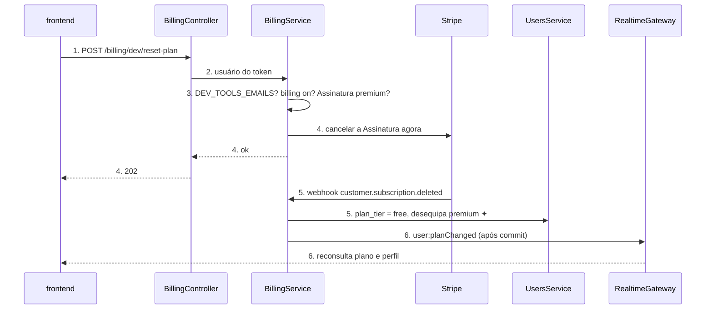
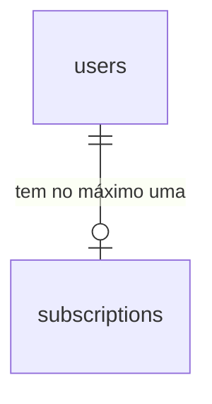
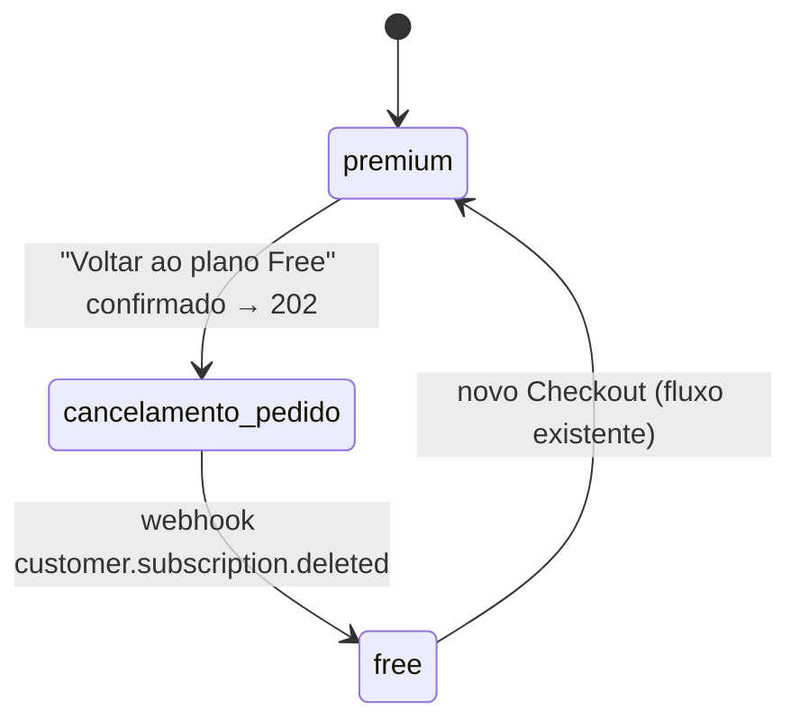

# Seção Desenvolvedor: voltar ao plano Free

**Approved**: <pendente>

> Build this with **tlc-implement**. Every criterion becomes a check with a proof; nothing under
> the open questions is settled while building.

## Problem

No staging, a conta de testes do Guilherme assina o premium pelo Checkout (modo de teste do Stripe) para ensaiar a demo. Para repetir o fluxo "assinar → premium", a conta precisa voltar a `free`, e hoje só há dois caminhos:
- o Portal (`POST /billing/portal`), que agenda o cancelamento para o fim do período (`cancel_at`), então o plano fica premium por até um mês;
- cancelar à mão no painel do Stripe, fora do app.

Cada ensaio custa sair do app e operar o painel do Stripe. O fluxo de cancelamento já existe e funciona: quando chega `customer.subscription.deleted`, o webhook grava `plan_tier = free`, desequipa os Itens premium ✦ e emite `user:planChanged`. Não há números além disso; é uma ferramenta de uma pessoa.

Quando isso estiver pronto, uma conta cujo e-mail está em `DEV_TOOLS_EMAILS` verá a seção "Desenvolvedor" em Configuração e, com um botão e uma confirmação, cancelará a Assinatura na hora e verá o plano voltar a Free. Nenhuma outra conta vê a seção nem consegue chamar a rota.

## Shape

Reaproveita o webhook de billing inteiro: a rota nova só pede ao Stripe o cancelamento imediato, e quem grava `plan_tier`, desequipa e emite `user:planChanged` continua sendo o `BillingService` ao processar `customer.subscription.deleted`. A regra "este usuário pode usar as ferramentas de desenvolvedor" é uma só função pura, testada em unitário, lida tanto por `GET /users/me` quanto pela rota nova; o caminho da rota fica coberto por teste de integração com MySQL e o cliente Stripe falso, como `billing-portal.integration.test.ts`.

1. O dono da conta toca em "Voltar ao plano Free" em `/configuracao/dev` no `frontend` (exists) e confirma no `WiseDialog` → `POST /billing/dev/reset-plan`.
2. `BillingController` (exists), no `BillingModule`, autentica pelo `JwtAuthGuard` e entrega ao `BillingService` o usuário do token.
3. `BillingService` (exists) recusa com `404` quem não está em `DEV_TOOLS_EMAILS` (door 1), antes de qualquer outra leitura; depois `503` sem cobrança configurada e `409` sem Assinatura que dê premium.
4. `BillingService` (exists) pede ao Stripe o cancelamento imediato da `stripe_subscription_id` da linha de `subscriptions` e responde `202`. Não grava nada.
5. O Stripe envia `customer.subscription.deleted` para `POST /billing/webhook`; o `BillingService` (exists) relê a Assinatura (`canceled`), grava `subscriptions.status`, e o `UsersService` (exists) grava `plan_tier = free` e desequipa os Itens premium ✦.
6. Saída: depois do commit, o `RealtimeGateway` (exists) emite `user:planChanged`; o `frontend` (exists) reconsulta `GET /billing/subscription` e `GET /users/me`, e a seção mostra "Free".

**Changes underneath**

| Front | What changes |
| --- | --- |
| domain | nada muda de sentido; "voltar ao Free" é o mesmo cancelamento que o Portal agenda, só que imediato |
| stored data | nada a migrar; nenhuma coluna nova. A linha de `subscriptions` e o `stripe_customer_id` ficam, e o próximo Checkout os reaproveita |
| readers | `GET /users/me` e `PATCH /users/me` ganham `devTools`; o menu e a lista de Configuração filtram a seção por ele |
| config | variável nova `DEV_TOOLS_EMAILS`, repassada no `docker-compose.yml` e documentada em `apps/backend/.env.example` |

New: nothing - a rota só lê `users.email` e `subscriptions`; a escrita é do webhook que já existe.

## Surface

| Route | In | Out | Status | Who |
| --- | --- | --- | --- | --- |
| `POST /billing/dev/reset-plan` | nada (corpo vazio) | sem corpo | `202`; `401` sem token; `404` fora de `DEV_TOOLS_EMAILS`; `503` cobrança não configurada; `409` sem Assinatura premium; `502` falha no Stripe | só usuários cujo e-mail está em `DEV_TOOLS_EMAILS`; os demais recebem `404` |
| `GET /users/me` e `PATCH /users/me` | sem mudança | + `devTools: boolean` | `200`; `401` sem token (inalterados) | o próprio usuário autenticado |

## Landing

| One-way door | Literal shape | Alternative rejected |
| --- | --- | --- |
| 1. Liberação por variável de ambiente | `DEV_TOOLS_EMAILS=guilherme@exemplo.com,outra@exemplo.com`: e-mails separados por vírgula, comparados sem espaços e sem diferença de maiúsculas com `users.email`. Vazia ou ausente libera ninguém. Não é validada no boot | Lista de ids de usuário: ilegível no `.env` e muda a cada recriação do banco de staging. Coluna `is_dev` em `users`: exige migration e um jeito de gravá-la |
| 2. Contrato consumido pelo app | campo `devTools: boolean` no perfil de `GET /users/me`; rota `POST /billing/dev/reset-plan` | Rota separada `GET /dev/enabled`: uma requisição a mais em toda abertura de Configuração para um booleano que cabe no perfil |
| 3. Método novo no contrato `StripeApi` | `subscriptions.cancel(id)`, que cancela na hora (status `canceled`) e dispara `customer.subscription.deleted` | `subscriptions.update(id, { cancel_at_period_end: true })`: é o que o Portal faz e deixa o premium até o fim do período |

- Nothing else in this change is hard to reverse

## Criteria

### S1: Rota de reset liberada só por `DEV_TOOLS_EMAILS` (P1)

Uma conta liberada cancela a Assinatura no Stripe com uma chamada; qualquer outra recebe `404`.

**Acceptance Criteria**

1. The system SHALL considerar um usuário liberado quando `users.email`, sem espaços e em minúsculas, é igual a algum item de `DEV_TOOLS_EMAILS` separado por vírgula, sem espaços e em minúsculas
   - `DEV_TOOLS_EMAILS=" Dev@Ex.com , b@ex.com"` e e-mail `dev@ex.com` → liberado; e-mail `devx@ex.com` → não liberado; `DEV_TOOLS_EMAILS=""` → ninguém liberado; `DEV_TOOLS_EMAILS=","` → ninguém liberado; variável ausente → ninguém liberado
2. IF o usuário do token não está liberado THEN `POST /billing/dev/reset-plan` SHALL responder `404` sem chamar o Stripe, inclusive quando a cobrança não está configurada e quando ele tem Assinatura ativa
3. IF a requisição não tem token válido THEN `POST /billing/dev/reset-plan` SHALL responder `401`
4. IF o usuário está liberado e `STRIPE_SECRET_KEY` não está definido THEN a rota SHALL responder `503` com `detail` "Assinatura indisponível no momento"
5. IF o usuário está liberado e não tem linha em `subscriptions`, ou a linha não tem `stripe_subscription_id`, ou o `status` dela não dá premium (`planTierForStatus` devolve `free`) THEN a rota SHALL responder `409` com `detail` "Nenhuma assinatura para cancelar" sem chamar o Stripe
   - sem linha → 409; linha só com Customer (Checkout aberto ou só Pacote) → 409; `status = canceled` → 409; `status = past_due` → segue para o cancelamento
6. WHEN o usuário está liberado e tem Assinatura com `status` `active`, `trialing` ou `past_due` THEN a rota SHALL pedir ao Stripe o cancelamento imediato da `stripe_subscription_id` dele e responder `202` sem corpo
7. WHEN a rota responde `202` THEN ela SHALL não ter alterado `users.plan_tier`, `subscriptions` nem o equipamento; a mudança chega pelo webhook
8. IF o Stripe falha ao cancelar THEN a rota SHALL responder `502` com `detail` "Não foi possível cancelar a assinatura" e registrar o erro no log com o id do usuário
9. WHEN, depois do `202`, o webhook recebe `customer.subscription.deleted` dessa Assinatura THEN o usuário SHALL ficar com `plan_tier = free`, sem Itens premium ✦ equipados, e receber `user:planChanged` (comportamento existente, provado de novo neste fluxo)

### S2: `devTools` no perfil (P1)

O app sabe, pelo perfil, se deve mostrar a seção.

**Acceptance Criteria**

10. WHEN um usuário liberado chama `GET /users/me` THEN a resposta SHALL ter `devTools: true`
11. WHEN um usuário não liberado chama `GET /users/me` THEN a resposta SHALL ter `devTools: false`
12. WHEN um usuário liberado chama `PATCH /users/me` THEN a resposta SHALL ter `devTools: true`, no mesmo formato de `GET /users/me`

### S3: Seção Desenvolvedor em Configuração (P1)

O dono da conta liberada vê a seção, confirma e vê o plano voltar a Free.

**Acceptance Criteria**

13. WHILE o perfil tem `devTools: true` the system SHALL mostrar a seção "Desenvolvedor", descrição "Ferramentas de teste desta conta.", endereço `/configuracao/dev`, por último no menu do desktop (antes de "Sair da conta") e por último na lista agrupada do celular
14. WHILE o perfil tem `devTools: false` ou ainda não carregou the system SHALL não mostrar "Desenvolvedor" no menu nem na lista
15. IF uma conta com `devTools: false` abre `/configuracao/dev` THEN o app SHALL levá-la para `/configuracao`
16. WHILE o plano é premium the system SHALL mostrar na seção a linha "Plano atual" com o mesmo texto da seção Plano e o botão "Voltar ao plano Free"
17. WHILE o plano é free the system SHALL mostrar "Plano atual" com "Free" e não mostrar o botão "Voltar ao plano Free"
18. WHEN o dono da conta toca em "Voltar ao plano Free" THEN o app SHALL abrir um `WiseDialog` com o título "Cancelar a assinatura agora?", o texto "A assinatura de teste é cancelada no Stripe na hora e os Itens premium ✦ são desequipados." e os botões "Cancelar assinatura" e "Voltar", sem chamar a rota
19. WHEN ele toca em "Voltar" no diálogo THEN o app SHALL fechar o diálogo sem chamar a rota
20. WHEN ele toca em "Cancelar assinatura" THEN o app SHALL chamar `POST /billing/dev/reset-plan`, mostrar o botão em carregamento e, com `202`, fechar o diálogo e mostrar a mensagem informativa "Assinatura cancelada. O plano volta a Free em instantes."
21. WHEN chega `user:planChanged` THEN a seção SHALL mostrar "Plano atual" com "Free" sem recarregar a página (o `applyPlanChanged` existente já reconsulta plano e perfil)
22. IF a rota responde `409`, `502` ou `503` THEN o app SHALL fechar o diálogo e mostrar a mensagem de erro com o `detail` do servidor; outro erro mostra "Não foi possível cancelar a assinatura. Tente de novo."
23. WHILE o plano está carregando the system SHALL mostrar o mesmo indicador de carregamento da seção Plano; IF o plano falha ao carregar THEN a seção SHALL mostrar o mesmo erro e "Tentar novamente" da seção Plano

### S4: Configuração e contratos (P1)

**Acceptance Criteria**

24. The system SHALL repassar `DEV_TOOLS_EMAILS: ${DEV_TOOLS_EMAILS:-}` ao serviço do backend em `docker-compose.yml`, ao lado das variáveis do Stripe
25. The system SHALL documentar `DEV_TOOLS_EMAILS` em `apps/backend/.env.example` com uma linha dizendo que vazia libera ninguém e que é só para staging
26. The system SHALL descrever `POST /billing/dev/reset-plan` no contrato OpenAPI em docs/api com `202`, `401`, `404`, `409`, `502` e `503`, e `devTools` no schema do perfil de `GET /users/me`; o lint do Redocly sobre esse arquivo SHALL passar

## Out of scope

| Excluded | Why |
| --- | --- |
| Zerar o Pacote do Dragão (apagar o Pagamento e tirar os itens) | usuário escolheu "Só a assinatura"; mexe em Inventário e equipamento de outros módulos |
| Gravar `plan_tier = free` direto na rota, sem esperar o webhook | usuário escolheu "Cancelar no Stripe" e deixar o webhook gravar; gravar nos dois lugares cria dois escritores do plano |
| Reembolso ou fatura proporcional no cancelamento | modo de teste, sem dinheiro real |
| Outras ferramentas na seção (dar Moedas, XP, resetar Crônicas) | não pedidas; a seção nasce com uma ação só |
| Liberar por papel de admin ou coluna no banco | a liberação pedida é pelo `.env` |
| Avisar quando o webhook não chega no staging | o webhook de staging é configuração do Stripe, fora do código |

## Assumptions

| Assumption | Chosen default | Rationale | Confirmed? |
| --- | --- | --- | --- |
| Mecanismo do reset | cancelar no Stripe na hora e deixar o webhook gravar o plano | user: "Cancelar no Stripe (Recomendado)" | y |
| Escopo | só a Assinatura; Pacote fica | user: "Só a assinatura (Recomendado)" | y |
| Nome da seção | "Desenvolvedor", id `dev`, `/configuracao/dev` | user: "Desenvolvedor (Recomendado)" | y |
| Confirmação | `WiseDialog` antes de cancelar | user: "Pedir confirmação (Recomendado)" | y |
| Identificar a conta | por e-mail, não por id | o pedido diz "liberar apenas para minha conta, pelo .env"; e-mail é legível e sobrevive à recriação do banco | n |
| Status para quem não está liberado | `404`, não `403` | não revela que a rota existe em produção | n |
| Grupo na lista do celular | grupo próprio "Desenvolvedor", por último | segue o padrão de uma seção por grupo da lista atual | n |
| Ícone no menu | `construct-outline` (Ionicons, como os demais) | qualquer ícone de ferramenta serve; troca é trivial | n |

**Open questions:** none - all resolved or logged above.

## Differences from the source

None - no binding source; o pedido veio por texto.

## Sources

- Pedido do usuário nesta conversa - binding - seção em Configuração, liberada pelo `.env` só para a conta dele, que volta ao free e perde a assinatura
- `.specs/features/assinatura-premium/plan.md` - binding - webhook, `planTierForStatus`, `user:planChanged` e as mensagens `detail` de billing que este plano reaproveita
- Stripe API, Cancel a subscription (`DELETE /v1/subscriptions/:id`, `stripe.subscriptions.cancel`) - https://docs.stripe.com/api/subscriptions/cancel - cancelamento imediato que gera `customer.subscription.deleted`; SDK `stripe` 23.1.0 em `apps/backend/package.json`
