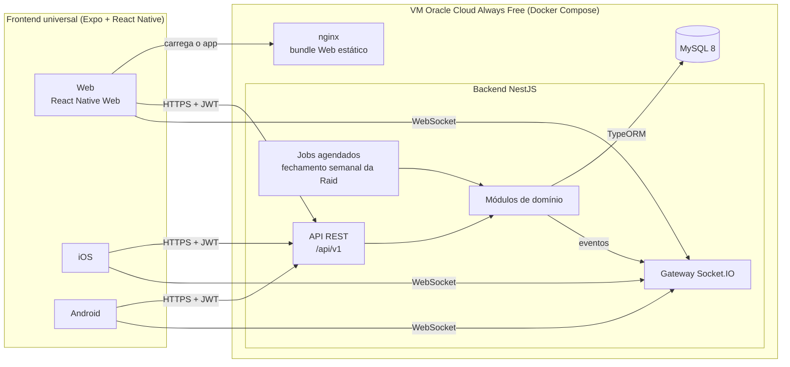
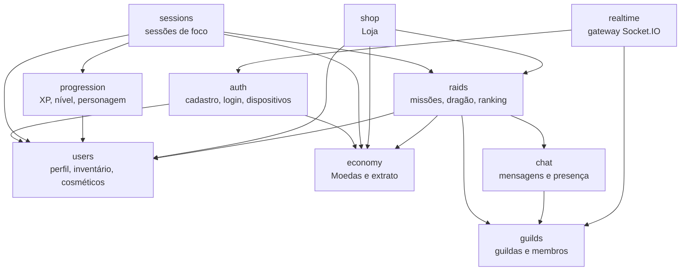
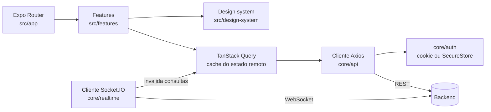
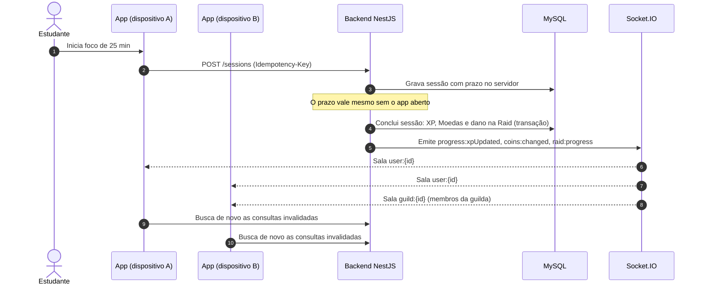

# ⚔️ Wise

> Plataforma de foco e produtividade gamificada e colaborativa


Wise transforma a rotina de estudos em uma jornada de RPG cooperativa.
Estudantes, universitários e concurseiros fazem sessões de foco
cronometradas, ganham XP e Moedas, evoluem o personagem e se juntam a guildas
para derrotar o dragão da Raid semanal.

## Sumário

- [Funcionalidades](#funcionalidades)
- [Arquitetura](#arquitetura)
- [Estrutura do repositório](#estrutura-do-repositório)
- [Início rápido com Docker](#início-rápido-com-docker)
- [Desenvolvimento local](#desenvolvimento-local)
- [Testes e gates de qualidade](#testes-e-gates-de-qualidade)
- [Migrations do banco](#migrations-do-banco)
- [Documentação](#documentação)
- [Sobre o projeto](#sobre-o-projeto)

---

## Funcionalidades

| Funcionalidade | Descrição | Prioridade |
|---|---|---|
| ⏱ Sessão de foco | Ciclos de 15/25/50 min com timer no servidor, controlável de qualquer dispositivo | Crítico |
| 🎮 Progressão RPG | XP, níveis e itens cosméticos desbloqueáveis | Crítico |
| 🛡 Guildas e Raids | Missões cooperativas semanais em que o foco de cada membro causa dano ao dragão | Crítico |
| 🪙 Moedas e Mercado | Moedas ganhas com foco e Raids, gastas em missões e itens da Loja | Importante |
| 🏆 Ranking de contribuição | Classificação dos membros dentro da guilda | Importante |
| 💬 Chat da guilda | Mensagens e presença em tempo real via Socket.IO | Importante |
| 👤 Personagem | Avatar, título, badges e acessórios equipáveis | Importante |

As regras de cada funcionalidade estão nos ADRs de [`docs/PRD.md`](docs/PRD.md)
e os termos do domínio em [`CONTEXT.md`](CONTEXT.md).

---

## Arquitetura

Wise é um **monólito modular** (ADR-001): um único backend NestJS, dividido em
módulos de domínio, atende um único frontend Expo que roda em Web, iOS e
Android (ADR-008). O MySQL é a única fonte de verdade. O REST altera e lê o
estado; o Socket.IO só avisa os clientes de que algo mudou.

### Visão geral



O access token JWT dura 15 minutos e vai no header `Authorization`. O refresh
token é rotativo: na Web fica em cookie `httpOnly`, no iOS/Android fica no
`expo-secure-store` (ADR-009).

### Módulos do backend

Cada módulo fica em `apps/backend/src/modules/` e só acessa as próprias
entidades. Chamadas entre módulos passam pelo Service exportado do módulo
dono do dado, inclusive dentro de transações. O diagrama mostra as dependências
principais; `realtime` é usado por quase todos os módulos para emitir eventos.



`auth`, `users` e `realtime` formam um ciclo resolvido com `forwardRef`. Código
compartilhado (filtros de erro RFC 7807, paginação por cursor, rate limit) fica
em `apps/backend/src/shared/`. As regras puras de cada módulo, como cálculo de
XP, antifraude e fúria do dragão, ficam em `domain/` e são testadas sem banco.

### Frontend



O TanStack Query guarda só o estado vindo do servidor. Um evento de tempo real
não altera o cache diretamente: ele invalida as consultas afetadas, que são
buscadas de novo pelo REST. Detalhes do design system, rotas e tokens estão em
[`apps/frontend/README.md`](apps/frontend/README.md).

### Fluxo de uma sessão de foco

Quando um foco termina, o backend aplica todas as recompensas numa transação e
avisa todos os dispositivos do usuário e a guilda.



Os contratos completos estão em [`docs/api/openapi.yaml`](docs/api/openapi.yaml)
(REST) e [`docs/api/asyncapi.yaml`](docs/api/asyncapi.yaml) (eventos Socket.IO).

### Stack

| Camada | Tecnologias |
|---|---|
| Frontend | Expo SDK 57, React Native 0.86, React 19, Expo Router, TanStack Query 5, Axios, Socket.IO client |
| Backend | Node.js ≥22.13, NestJS 10, TypeORM 0.3, Socket.IO 4, Passport JWT |
| Banco | MySQL 8.0 com migrations TypeORM |
| Testes | Jest 29, React Native Testing Library, Playwright 1.63 |
| Contratos | OpenAPI e AsyncAPI, validados com Redocly CLI |
| Infraestrutura | Docker Compose, nginx, GitHub Actions, Oracle Cloud Always Free (ADR-006) |

Koa.js e AWS, citados nos documentos acadêmicos originais, saíram do escopo
(ADR-002 e ADR-006).

---

## Estrutura do repositório

```text
.
├── apps/
│   ├── backend/          # API NestJS (REST + Socket.IO)
│   │   └── src/
│   │       ├── modules/  # módulos de domínio
│   │       ├── shared/   # filtros, paginação, rate limit
│   │       └── migrations/
│   └── frontend/         # app Expo universal (Web, iOS, Android)
│       ├── src/
│       └── e2e/          # testes Playwright
├── docs/
│   ├── PRD.md            # requisitos e ADRs
│   ├── api/              # OpenAPI e AsyncAPI
│   └── plans/            # planos de implementação
├── scripts/              # script do gate E2E
├── docker-compose.yml    # stack completa
├── docker-compose.e2e.yml
└── CONTEXT.md            # glossário do domínio
```

O repositório é um monorepo de npm workspaces. Instale as dependências sempre
pela raiz.

---

## Início rápido com Docker

Pré-requisito: Docker com o plugin Compose.

```bash
docker compose up --build
```

Quando os serviços estiverem saudáveis (`docker compose ps`):

| Serviço | Endereço |
|---|---|
| Frontend Web | http://localhost:8081 |
| API | http://localhost:3000/api/v1 |
| Healthcheck | http://localhost:3000/api/v1/health |

Para encerrar, use `docker compose down`. Os dados ficam no volume `mysql_data`.
Se você mudar usuário, senha ou nome do banco depois da primeira execução,
recrie o volume com `docker compose down --volumes`.

### Arquivos de ambiente

| Arquivo | Conteúdo | No Git? |
|---|---|---|
| `.env` | valores seguros para desenvolvimento local, carregados por padrão | sim |
| `.env.development` | override explícito de desenvolvimento | sim |
| `.env.production` | secrets do deploy | não |

Para escolher o ambiente, carregue o arquivo base seguido do override:

```bash
# Desenvolvimento
docker compose --env-file .env --env-file .env.development up --build

# Produção (preencha .env.production antes)
docker compose --env-file .env --env-file .env.production up --build -d
```

---

## Desenvolvimento local

Pré-requisito: Node.js ≥22.13 e npm (a CI usa Node 22).

```bash
npm ci                                   # instala todos os workspaces pelo lockfile
cp apps/backend/.env.example apps/backend/.env
cp apps/frontend/.env.example apps/frontend/.env

npm run dev:backend                      # sobe o MySQL no Docker e o NestJS em modo watch
npm run dev:frontend                     # inicia o Metro em http://localhost:8081
```

`dev:backend` sobe só o container `mysql` e roda a API em
`http://localhost:3000/api/v1`. Pelo terminal do Metro você abre a plataforma
desejada.

### Frontend: Web, iOS e Android

Requisitos por plataforma:

- **Web:** um navegador moderno.
- **iOS** (só macOS): Xcode com Command Line Tools, iOS Simulator e CocoaPods.
  Selecione o Xcode com
  `sudo xcode-select -s /Applications/Xcode.app/Contents/Developer` e aceite a
  licença antes da primeira compilação.
- **Android:** JDK 17, Android Studio, Android SDK Platform 36, Build Tools 36
  e `platform-tools` (`adb`). Com SDKMAN, rode `sdk env` na raiz para usar o
  JDK 17 do `.sdkmanrc`. No macOS, exponha o SDK no shell:

  ```bash
  export ANDROID_HOME="$HOME/Library/Android/sdk"
  export PATH="$ANDROID_HOME/platform-tools:$ANDROID_HOME/emulator:$PATH"
  ```

Configure `EXPO_PUBLIC_API_URL` em `apps/frontend/.env` com um endereço que a
plataforma alcance:

| Onde o app roda | `EXPO_PUBLIC_API_URL` |
|---|---|
| Web e iOS Simulator | `http://localhost:3000/api/v1` |
| Android Emulator | `http://10.0.2.2:3000/api/v1` |
| Dispositivo físico | IP da máquina na rede local, com aparelho e computador na mesma rede; prefira HTTPS |
| Release | sempre HTTPS |

Variáveis `EXPO_PUBLIC_*` são embutidas no bundle. Nunca coloque secrets nelas.
O projeto não libera cleartext global no Android nem desativa o App Transport
Security no iOS.

Comandos:

```bash
# Web no navegador
npm run web --workspace apps/frontend

# Primeira compilação nativa, ou depois de mudar dependências/config nativa
npm run ios --workspace apps/frontend
npm run android --workspace apps/frontend

# Dia a dia, com o binário nativo já instalado (Fast Refresh)
npm run dev:frontend
```

`ios` precisa de um Simulator aberto ou dispositivo conectado; `android`
precisa de um emulador aberto ou dispositivo listado em `adb devices`. Esses
comandos geram `apps/frontend/ios` ou `apps/frontend/android`, compilam o app de
debug, instalam e iniciam o Metro. Mudanças só em TypeScript não exigem
recompilar.

Depois de instalar ou atualizar um módulo nativo (como o `expo-secure-store`)
ou de alterar `app.json`, regenere os projetos nativos. O comando `android` já
faz um Prebuild limpo; para o iOS:

```bash
npm run prebuild:native --workspace apps/frontend
npm run ios --workspace apps/frontend
```

O Expo Go serve para uma checagem rápida enquanto o projeto usar só módulos
compatíveis, mas não substitui a compilação nativa. Diretórios nativos gerados,
`.expo`, `dist` e arquivos `.ipa`, `.apk` e `.aab` ficam fora do Git.

---

## Testes e gates de qualidade

| Comando | O que verifica |
|---|---|
| `npm test` | testes unitários de backend e frontend |
| `npm run lint` | ESLint nos dois workspaces |
| `npm run ci:backend` | build, lint, testes unitários e de integração do backend |
| `npm run ci:frontend` | tipos, lint, Jest, bundles das três plataformas e entrega Web em container |
| `npm run lint:openapi` | contrato OpenAPI |
| `npm run verify:quality` | todos os itens acima, como a CI |
| `npm run test:e2e` | fluxo Web completo com Playwright contra a stack em Docker |
| `npm run verify` | `verify:quality` + E2E |

Os testes de integração do backend precisam de um MySQL. Depois de mudar os
`imports` de um módulo, rode
`npm run test:auth:integration --workspace apps/backend`: ele sobe o
`AppModule` real e é o único teste que detecta um ciclo de módulos não
resolvido.

### Gate E2E

Antes da primeira execução, instale o Chromium:

```bash
npm run playwright:install --workspace apps/frontend
npm run test:e2e
```

O script usa `docker-compose.e2e.yml` num projeto Compose isolado, com portas
livres (ou `E2E_BACKEND_PORT` e `E2E_FRONTEND_PORT`), banco sem volume e
migrations aplicadas no boot do backend. Um gateway nginx com certificado
efêmero serve tudo em HTTPS para que o cookie `Secure` funcione no navegador.
Ao terminar, o script remove serviços e volumes. Relatórios, traces e vídeos
ficam em diretórios ignorados pelo Git.

### Outros comandos do frontend

```bash
npm run build --workspace apps/frontend            # só o bundle Web
npm run export:bundles --workspace apps/frontend   # bundles Metro de Web, iOS e Android
npm run expo:check --workspace apps/frontend       # matriz de versões do Expo SDK
npm run expo:doctor --workspace apps/frontend      # Expo Doctor
```

Uma exportação de bundle não gera um app instalável (`.app`, `.ipa`, `.apk`,
`.aab`). `expo:check` e `expo:doctor` ficam fora dos gates porque a Expo publica patches sem
aviso; o workflow semanal *Expo drift* roda as duas checagens.

---

## Migrations do banco

O schema é versionado por migrations TypeORM, com `synchronize: false` em todos
os ambientes. Em `NODE_ENV=production`, o backend aplica as migrations
compiladas antes de aceitar requisições. Em desenvolvimento e teste, rode-as à
mão a partir da raiz:

```bash
npm run migration:run --workspace apps/backend
npm run migration:revert --workspace apps/backend
```

Faça e valide um backup antes de reverter: `revert` desfaz o schema e pode
apagar dados.

A migration de idempotência de sessão cria triggers. Com binary log ativo, o
MySQL exige `log_bin_trust_function_creators=1` para criá-los sem dar `SUPER`
ao usuário da aplicação. O MySQL do Compose já sobe com essa opção; num MySQL
gerenciado, configure o parâmetro no servidor antes das migrations (veja a
[documentação do MySQL 8](https://dev.mysql.com/doc/refman/8.0/en/stored-programs-logging.html)).

Para validar as migrations num MySQL real (o teste cria um banco isolado,
aplica e reverte):

```bash
TEST_DB_HOST=127.0.0.1 TEST_DB_PORT=3306 \
TEST_DB_ADMIN_USERNAME=root TEST_DB_ADMIN_PASSWORD=change-me-root \
npm run migration:test --workspace apps/backend
```

Esse teste não faz parte de `npm test`; a CI o executa num job com MySQL 8.

---

## Documentação

| Documento | Conteúdo |
|---|---|
| [`docs/PRD.md`](docs/PRD.md) | requisitos, roadmap e registro de ADRs |
| [`CONTEXT.md`](CONTEXT.md) | glossário do domínio |
| [`docs/api/openapi.yaml`](docs/api/openapi.yaml) | contrato REST |
| [`docs/api/asyncapi.yaml`](docs/api/asyncapi.yaml) | eventos Socket.IO |
| [`apps/frontend/README.md`](apps/frontend/README.md) | design system, rotas e layout adaptativo |
| [`docs/plans/`](docs/plans/) | planos de implementação por marco |
| [`AGENTS.md`](AGENTS.md) | regras para contribuições e agentes |

---

## Sobre o projeto

**Público-alvo:** estudantes, universitários e concurseiros que enfrentam
procrastinação, isolamento e falta de constância na rotina de estudos.

**Equipe e custo estimado:** 4 desenvolvedores, prazo de 1 ano, estimativa de
R$ 550.000/ano (cerca de R$ 46.000/mês), cobrindo equipe, hospedagem, licenças,
marketing e margem de segurança.

**Referências:** [Focumon](https://www.focumon.com/),
[Habitica](https://habitica.com/), [GymRats](https://www.gymrats.app),
[Idle Habits](https://idlehabits.com).
