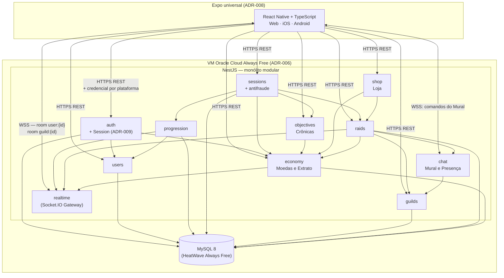

# Wise — PRD (Product Requirements Document)

**Versão:** 1.4
**Branch:** `develop`
**Autor:** Assistente técnico (Claude Code), a partir da síntese dos documentos orientadores do Grupo 2
**Data:** 21/08/2026 (v1.0), 21/08/2026 (v1.1), 03/09/2026 (v1.2, frontend universal), 17/09/2026 (v1.3, repriorização da Fase 1), 27/10/2026 (v1.4, reconciliação com o código, issue #5)
**Status:** Decisões de escopo e arquitetura fechadas. A migração universal terminou; o estado de cada item da Fase 1 está na seção 7.5.

### Qual fonte prevalece

Quando duas fontes discordam, vale a primeira desta lista:

1. O código e os testes da branch `develop`. Se um documento descreve algo diferente do que o código faz, o documento está desatualizado e deve ser corrigido, a menos que um ADR diga que o código é que precisa mudar.
2. Os ADRs deste PRD. Entre dois ADRs, vale o mais recente, e uma emenda vale sobre o texto original do ADR que ela altera.
3. Os contratos em `docs/api/openapi.yaml` e `docs/api/asyncapi.yaml`, e o glossário em `CONTEXT.md`.
4. O restante deste PRD e os planos em `docs/plans/`, que registram o que foi planejado na data de cada um.
5. Os documentos acadêmicos em `docs/`. O Documento de Visão, o Documento de Arquitetura e a Documentação de Interface foram atualizados para a versão 2.0 em 27/10/2026, com base no código, exceto pelas partes de infraestrutura e hospedagem, que seguem como na versão 1.0 até o time decidir a divergência registrada na issue #5. O Pitch e os Casos de Uso UC01 a UC04 continuam como foram entregues. As versões 1.0 estão no histórico do Git. Onde qualquer um deles diverge deste PRD, vale o PRD.

### Registro de decisões fechadas em 21/08/2026
| Ponto aberto | Decisão | ADR |
|---|---|---|
| Koa.js na stack | Removido — só NestJS | ADR-002 (Aceito) |
| Feature "Companheiro" | Adiada para Fase 2 | ADR-004 (Aceito) |
| Provedor de nuvem / hosting | Oracle Cloud Always Free, mantendo MySQL + NestJS | ADR-006 (Aceito) |
| Redis Adapter | Adiado — reforçado pelo limite de recursos do Oracle Always Free | ADR-003 (Aceito) |
| Modelo freemium | Flags de entitlement (`plan_tier`) entram já na Fase 1; gateway de pagamento continua fora | ADR-007 (Aceito) |

### Registro de decisão revisada em 03/09/2026

| Ponto aberto | Decisão | ADR |
|---|---|---|
| Web, iOS e Android | Uma aplicação Expo + Expo Router + React Native Web, sem publicação obrigatória nas lojas | ADR-008 (Revisado e aceito) |

### Registro de decisão fechada em 08/10/2026

| Ponto aberto | Decisão | ADR |
|---|---|---|
| Fonte do título do Character | O Título é o Cosmetic Item da categoria `title` equipado; `Character.title` deixa de ser fonte | ADR-010 (Aceito) |

### Registro de decisões fechadas em 15/10/2026

| Ponto aberto | Decisão | ADR |
|---|---|---|
| Taxa de XP e configurabilidade | 10 XP/min proporcional ao tempo; taxa e limites antifraude expostos como env vars | ADR-011 (Aceito) |
| Antifraude: descartar vs truncar | Sessões que atingem o limite contínuo (4h) ou diário (16h) são truncadas, não descartadas; sinal `capped_reason` no snapshot | ADR-011 (Aceito) |
| Limite diário para stops manuais | Stops manuais também verificam e truncam ao saldo diário restante | ADR-011 (Aceito) |

### Registro de decisões fechadas em 16/10/2026

| Ponto aberto | Decisão | ADR |
|---|---|---|
| Moeda do jogo: do usuário ou tesouro da Guild | Moeda por usuário, sem tesouro coletivo; Loja vende Missões e Cosmetic Items À venda | ADR-012 (Aceito) |
| Ganho e gasto de Moedas | 1 Moeda a cada 2 min de foco válido, +50 por Raid vencida, 90 no cadastro; Missões de 90 a 480, itens de 30 a 300; Badge nunca à venda | ADR-012 (Aceito) |
| Fúria do dragão | Chefe recupera 5% da meta por dia inteiro sem Contribuição, até a Meta batida, que passa a ser vida zero | ADR-012 (Aceito, emenda #145) |

### Registro de decisões fechadas em 21/10/2026

| Ponto aberto | Decisão | ADR |
|---|---|---|
| Como o Avatar aparece no Herói | Corpo base único com camadas de Avatar, Arma e Acessório; sem classe; Arma é nova categoria de Cosmetic Item | ADR-013 (Aceito) |

### Registro de decisões fechadas em 22/10/2026

| Ponto aberto | Decisão | ADR |
|---|---|---|
| Recompensa dos Objetivos de Crônicas | Moedas pagas automaticamente, nunca XP; lista fixa de 3 diários e 3 semanais, renovando no horário de São Paulo | ADR-014 (Aceito) |

> Este documento consolida e substitui as lacunas dos documentos orientadores (Documento de Visão, Documento de Arquitetura, Documentação de Interface, Pitch e Casos de Uso UC01–UC04), resolvendo inconsistências entre eles e propondo um caminho técnico único para a Fase 1 de desenvolvimento.

---

## 1. Sumário executivo

Wise é uma plataforma universal de produtividade gamificada para Web, iOS e Android: usuários realizam sessões de estudo temporizadas (Pomodoro), acumulam XP, evoluem de nível, customizam avatar/companheiro RPG e cooperam em guildas através de raids semanais. Este PRD partiu da leitura crítica dos documentos orientadores e agora registra também a evolução do frontend Web existente para uma aplicação Expo universal.

---

## 2. Estado atual — o que os documentos já decidiram

| Decisão | Fonte | Conteúdo |
|---|---|---|
| Domínio do produto | Documento de Visão | Sessões Pomodoro + XP/níveis + guildas + raids semanais + ranking + chat + perfil customizável |
| Estilo arquitetural | Doc. de Arquitetura v1.0 | Cliente-servidor + monólito modular em 4 camadas (Apresentação → Aplicação → Domínio → Infraestrutura), 8 módulos de backend |
| Stack backend | Doc. de Arquitetura | Node.js LTS, NestJS, TypeORM, Socket.IO + Redis Adapter, JWT (access+refresh) com Argon2id |
| Stack frontend | Doc. de Arquitetura + Doc. de Interface | React 18+, TypeScript, Vite e React Router v6 na implementação Web original; substituídos por Expo/Expo Router/React Native Web no ADR-008 revisado |
| Banco de dados | Todos os documentos | MySQL 8 (AWS RDS Multi-AZ) |
| Infraestrutura | Doc. de Arquitetura + Pitch | AWS ECS Fargate, ELB, CloudFront, CloudWatch, ElastiCache (Redis) |
| Design system | Doc. de Interface | Paleta dark-RPG (tokens de cor documentados), tipografia (Cinzel/Inter/JetBrains Mono), componentes (cards, botões, barra de XP), diretrizes de acessibilidade (WCAG AA, `prefers-reduced-motion`) |
| Regras de negócio já especificadas | UC01–UC04 | Fórmula de XP por nível (`xp_base × N^1.5`, `xp_base = 500`), detecção de fraude por tempo de sessão anômalo, exclusividade de itens cosméticos por raid concluída, contribuição de sessão só é válida dentro da janela oficial da raid |
| Modelo de negócio (aspiracional) | Pitch Deck | Freemium: grátis (timer, XP, guilda básica) vs. premium (cosméticos exclusivos, raids avançados, perfil destacado) |

---

## 3. Inconsistências e lacunas identificadas

Esta é a análise crítica solicitada — onde os documentos se contradizem, ficam incompletos ou criam risco técnico se seguidos ao pé da letra.

### 3.1 Conflito de stack: README vs. Documento de Arquitetura
O `README.md` do repositório descreve o frontend como **"HTML · CSS · JavaScript"** e lista **Koa.js** como parte do backend. O Documento de Arquitetura (mais recente, v1.0) descreve o frontend como **SPA React + TypeScript** e não atribui nenhuma responsabilidade concreta ao Koa.js — todos os módulos de backend (auth, users, sessions, progression, guilds, raids, chat, notifications, shared) são descritos exclusivamente em termos de NestJS.
**Decisão proposta:** o Documento de Arquitetura prevalece (é o artefato técnico mais recente e detalhado). Koa.js deve ser **removido do escopo** — não há caso de uso que justifique um segundo framework HTTP rodando junto ao NestJS; isso apenas adicionaria complexidade operacional sem benefício. O README deve ser atualizado na Fase 1 para refletir React/TypeScript e remover Koa.js.
**Situação em 27/10/2026:** resolvido (ADR-002). Nenhum `package.json` do monorepo depende de Koa.js, e o README descreve o frontend Expo e o backend NestJS.

### 3.2 Feature "Companheiro" (mascote RPG) não rastreada
O UC01 (Realizar Sessão de Estudo) descreve em detalhe um sistema de **companheiro/mascote pixel art** que acompanha o usuário, ganha XP próprio e evolui — isso não aparece no Documento de Visão (seção 4.1, resumo de funcionalidades), no Documento de Arquitetura (módulos de backend) nem no Documento de Interface (telas T01–T06 e paleta). É uma funcionalidade com especificação comportamental rica, mas sem dono formal no escopo.
**Decisão fechada (ADR-004):** adiada para a Fase 2. Não entra no código da Fase 1. Fica registrada como sub-feature do módulo `progression` no backlog, para não ser esquecida nem reintroduzida como retrabalho de última hora.

### 3.3 Seções em branco no Documento de Visão
As seções 5 (Precedência e Prioridades), 6 (Requisitos Não-Funcionais), 7 (Restrições Técnicas) e partes da 4.4 estão com templates vazios (`[`, tabelas sem linhas). Um documento de visão sem NFRs e sem priorização MoSCoW não é utilizável para planejamento de sprint.
**Decisão proposta:** este PRD preenche essas lacunas nas seções 7, 8 e 9 abaixo, e deve substituir essas seções no Documento de Visão quando ele for revisado.

### 3.4 Infraestrutura: o time quer deploy 100% gratuito, e isso não está em nenhum documento
O Documento de Arquitetura, o Documento de Visão (seção 4.4) e o Pitch assumem AWS (EC2/ELB/ECS/CloudFront/RDS/ElastiCache) — uma stack paga desde o primeiro dia (o free tier de 12 meses da AWS não cobre o ano inteiro de projeto nem o pós-graduação). Na prática, o time quer rodar o projeto **inteiramente de graça**, o que nenhum dos seis documentos previu.
**Decisão fechada (ADR-006):** deploy em **Oracle Cloud Always Free** (VM Ampere A1 sempre grátis + MySQL HeatWave Always Free), substituindo AWS como alvo de infraestrutura. Isso preserva a stack já documentada (NestJS + MySQL) — só troca o provedor. Risco conhecido e aceito: a Oracle cortou os limites do Always Free em junho/2026 (de 4 OCPU/24GB para 2 OCPU/12GB) e começou a terminar instâncias fora do novo limite em 18/08/2026 — ver ADR-006 para o plano de mitigação. O Documento de Visão e o Documento de Arquitetura precisam ser atualizados para refletir Oracle em vez de AWS.
**Decisão fechada (ADR-003):** Redis continua adiado — e agora por dois motivos: (1) só é obrigatório a partir de 2 réplicas, e (2) a VM Always Free (2 OCPU/12GB) tem margem apertada para rodar NestJS + MySQL + Redis ao mesmo tempo sem competir por recursos.

### 3.5 Antifraude especificado, mas sem desenho técnico
O UC03 menciona bloqueio de XP para "tempo de sessão que fuja dos padrões humanos" (ex.: 24h ininterruptas), mas nenhum documento define o limiar, onde a validação ocorre (client, servidor, ou ambos) ou como isso se relaciona com o `SessionRepository`/`ProgressionService`.
**Decisão proposta:** ver RN-ANTIFRAUDE na seção 6.3 e o endpoint de encerramento de sessão na seção 9 — validação server-side obrigatória, o cliente nunca é fonte de verdade para duração de sessão.

### 3.6 Modelo de negócio (freemium) sem contrapartida técnica
O Pitch descreve tiers gratuito/premium, mas nenhum módulo de backend, entidade de dados ou NFR trata de billing, entitlements ou feature flags. Como o projeto é acadêmico com prazo de 1 ano e equipe de 4 pessoas, monetização real está fora do horizonte técnico responsável para a Fase 1.
**Decisão fechada (ADR-007):** o MVP não implementa gateway de pagamento. Mas as **flags de entitlement entram já na Fase 1**: campo `plan_tier` no perfil do usuário (seção 9.1) e checagem de feature flag nos endpoints/telas que o Pitch marca como premium (cosméticos exclusivos, raids avançados, perfil destacado) — hoje sempre liberadas para todos, mas já checando a flag em vez de hardcoded, para não exigir migração de dados quando a cobrança real entrar pós-MVP.

### 3.7 Sem estratégia de testes, CI/CD, observabilidade ou contrato de API formal
Nenhum dos seis documentos define pipeline de build/deploy, cobertura mínima de testes, ou um contrato de API/WebSocket explícito entre front e back — apesar de o front e o back serem times/módulos que precisam desse contrato para trabalhar em paralelo. Isso é o maior risco de atraso de cronograma dado o prazo de 1 ano com 4 pessoas.
**Decisão proposta:** seções 10 (API), 11 (dados), 12 (infraestrutura/CI-CD) e 13 (confiabilidade e testes) deste PRD cobrem essas lacunas.

### 3.8 Frontend universal Web, iOS e Android
A decisão original limitava o produto a um SPA Web responsivo. Em 03/09/2026 o Product Owner ampliou o objetivo: preservar identidade, fluxos e funcionalidades, com experiência adequada em Web desktop e celulares iOS/Android. Tablets e publicação pública em lojas permanecem fora do aceite inicial.
**Decisão revisada (ADR-008):** substituir gradualmente o runtime Vite/React Router por uma única aplicação Expo + Expo Router + React Native Web em `apps/frontend`. O standalone orienta a UX, enquanto domínio e contratos reais prevalecem. Ver `docs/plans/2026-09-03-react-native-universal-design.md`.

### 3.9 Persistência de sessão multi-dispositivo não especificada
O usuário pediu que as informações se propaguem "no mesmo ambiente" por um sistema de credenciais — ou seja, login no celular e no notebook devem ver o mesmo progresso em tempo real. O Documento de Arquitetura já prevê JWT access+refresh, mas nenhum documento define: quantas sessões simultâneas por usuário, como revogar uma sessão específica (ex.: "sair de todos os dispositivos"), nem como eventos em tempo real (XP, level-up, raid) se propagam para todos os dispositivos logados do mesmo usuário ao mesmo tempo.
**Decisão fechada (ADR-009):** cada login gera uma sessão persistente própria (refresh token rotativo por dispositivo, tabela `Session` — seção 9), e o servidor propaga todo evento relevante do usuário pela room `user:{id}` do Socket.IO (seção 10), que recebe todas as conexões ativas desse usuário independentemente do dispositivo. Como o estado (XP, sessão, guilda) já é 100% server-side, a sincronização entre dispositivos é uma consequência natural da arquitetura — o que faltava era formalizar sessão multi-dispositivo e o fanout de eventos, o que este ADR resolve.

---

## 4. Caminho recomendado (visão conceitual)

1. **Confirmar a arquitetura de monólito modular em camadas** já descrita — é a escolha correta para equipe de 4 pessoas e prazo de 1 ano (ver ADR-001).
2. **Formalizar o contrato entre front e back antes de escrever código de tela** — usar o contrato de API da seção 10 como fonte única de verdade, permitindo front e back avançarem em paralelo com mocks.
3. **Tratar antifraude e cálculo de XP como regras de domínio puras, testáveis isoladamente** (camada de Domínio, sem I/O) — hoje elas só existem em prosa nos casos de uso.
4. **Adiar Redis para quando houver 2ª réplica real** — reduz custo e complexidade no MVP sem violar a arquitetura (Socket.IO funciona em réplica única sem adapter).
5. **Cortar cobrança/premium do escopo de código da Fase 1**, mantendo apenas os campos de dados que não bloqueiam essa evolução futura.
6. **Elevar "Companheiro"a item de backlog rastreado formalmente**, com prioridade definida pelo Product Owner (ver MoSCoW, seção 7).

---

## 5. Personas e stakeholders (herdado do Documento de Visão, sem alterações)

- **Usuário final** — estudantes, universitários, concurseiros.
- **Equipe de desenvolvimento** — 4 pessoas, prazo de 1 ano.
- **Product Owner** — prioriza backlog e valida entregas.

---

## 6. Escopo funcional — priorização MoSCoW (preenche a lacuna da seção 5 do Documento de Visão)

| Prioridade | Funcionalidade | Módulo | Observação |
|---|---|---|---|
| **Must** | Cadastro/login (JWT access+refresh) | `auth` | Base de tudo |
| **Must** | Timer Pomodoro com registro de sessão | `sessions` | Diferencial crítico (Documento de Visão) |
| **Must** | Cálculo de XP e nível | `progression` | Fórmula já definida no UC04 |
| **Must** | Guildas (criar/entrar) + ranking interno | `guilds` | Obrigatória na Fase 1; participação opcional e posterior ao núcleo de Study Session |
| **Must** | Raids semanais com meta coletiva | `raids` | Obrigatória na Fase 1; implementada depois de Guilda e antes de Perfil |
| **Must** | Validação server-side de sessão (antifraude) | `sessions`/`progression` | Gap da seção 3.5 |
| **Must** | Sessões persistentes multi-dispositivo (login em vários dispositivos, revogação, fanout de eventos) | `auth` | ADR-009 — pedido explícito do usuário |
| **Must** | Frontend universal Web, iOS e Android | frontend `shared` | ADR-008 revisado — aplicação Expo única |
| **Should** | Chat de guilda em tempo real | `chat` | Importante, mas depende de `guilds` estar estável |
| **Should** | Perfil com itens cosméticos e equipagem | `users` | Importante |
| **Should** | Notificações em tempo real (level-up, raid concluída, convite) | `notifications` | Importante |
| **Should** | Flags de entitlement (`plan_tier`) nos recursos marcados como premium no Pitch | `users`/`shared` | ADR-007 — sem gateway de pagamento, só a checagem de flag |
| **Could** | i18n multi-idioma (além de pt-BR) | frontend `shared` | Só pt-BR é necessário no MVP; o frontend não tem biblioteca de i18n instalada |
| **Won't (nesta fase)** | Companheiro/mascote RPG com XP próprio | `progression` (sub-feature) | ADR-004 — adiado para Fase 2 |
| **Won't (nesta fase)** | Cobrança/assinatura premium (gateway de pagamento) | — | ADR-007 — fora do horizonte técnico da Fase 1 |
| **Won't (nesta fase)** | Parcerias educacionais / integrações externas | — | Modelo de negócio, não requisito técnico do MVP |

### 6.1 Sequenciamento da Fase 1 após a M4

A classificação `Must` expressa o conteúdo obrigatório da Fase 1, não a ordem de
implementação nem a obrigatoriedade de participação do usuário. O fluxo individual
de Study Session precede as capacidades sociais. A ordem validada é:

1. Study Session essencial: solo, online e em primeiro plano, sem matéria, com
   presets de 15/25/50 minutos e 25 minutos selecionados inicialmente;
2. matéria da Study Session;
3. controle multidispositivo da Study Session;
4. resiliência em background e offline;
5. Pomodoro completo;
6. Guilda;
7. Raid;
8. Perfil.

A Study Session essencial já inclui pausa e retomada online, exclusividade global,
estados canônicos, comandos idempotentes, cancelamento antes de cinco minutos,
encerramento antecipado com XP proporcional e conclusão automática enquanto o
aplicativo estiver ativo. Controle entre dispositivos, matéria e resiliência não
fazem parte desse primeiro corte.

Em 27/10/2026 as oito etapas estavam entregues. Depois delas entraram a economia
de Moedas e a Loja (ADR-012), o Herói em camadas (ADR-013), o Foco livre
(emendas #273) e Crônicas (ADR-014).

---

## 7. Requisitos funcionais (formato EARS)

**Sessões de estudo**
- Quando o usuário aciona "Iniciar Sessão" com matéria e duração configuradas, o sistema shall iniciar um temporizador regressivo no modo selecionado (Pomodoro/Pausa Curta/Pausa Longa).
- Quando um ciclo de foco é concluído, o sistema shall creditar o XP do foco válido sem interromper a cadência Pomodoro. (O progresso do Companheiro previsto no UC01 está adiado pelo ADR-004.)
- Quando a sessão é encerrada pelo servidor como completa, o sistema shall registrar duração, matéria e XP total no histórico do usuário e shall contribuir a duração para a raid ativa da guilda, caso o modo seja Guilda.
- Se o foco válido de uma sessão exceder um limite antifraude (ver RN-ANTIFRAUDE), o sistema shall truncar a sessão ao limite, calcular XP sobre o tempo truncado e registrar o motivo em `capped_reason` (ADR-011, que substituiu o descarte previsto na v1.0).
- Onde a conexão de rede for perdida durante uma sessão solo, o sistema shall preservar o progresso local e sincronizar ao reconectar.

**Progressão (XP/Nível)**
- O sistema shall calcular o XP necessário para o nível N como `500 × N^1.5`.
- Quando o XP acumulado do usuário atinge o limiar do próximo nível, o sistema shall disparar level-up, desbloquear os itens cosméticos associados a esse nível e shall notificar o usuário em tempo real.

**Guildas e Raids**
- Quando um usuário confirma participação em uma raid ativa, o sistema shall registrá-lo como participante e shall passar a contabilizar suas sessões válidas como contribuição.
- Enquanto uma raid estiver ativa, o sistema shall atualizar o progresso coletivo em tempo real para todos os membros conectados via WebSocket.
- Se a raid selecionada já tiver expirado, o sistema shall impedir nova participação e shall retornar o usuário à lista de raids disponíveis.

**Perfil e customização**
- Quando o usuário equipa um item cosmético desbloqueado, o sistema shall persistir a alteração e shall refletir a mudança no perfil visível por outros membros da guilda.
- Onde um item exigir conclusão de raid específica, o sistema shall bloquear a equipagem até que essa condição seja satisfeita.

**Sessão persistente multi-dispositivo (novo — ADR-009)**
- Quando um usuário efetua login, o sistema shall criar uma nova sessão persistente (linha em `Session`) sem invalidar sessões ativas em outros dispositivos, até um limite de 5 sessões simultâneas — ao exceder, o sistema shall revogar automaticamente a sessão menos recentemente usada.
- Quando qualquer evento de progresso (XP, nível, raid, convite de guilda) ocorre, o sistema shall propagá-lo em tempo real para todas as conexões WebSocket ativas do mesmo usuário, independentemente do dispositivo.
- Onde o usuário revoga uma sessão específica ou aciona "encerrar os outros dispositivos", o sistema shall invalidar o(s) refresh token(s) correspondente(s) imediatamente, encerrando a conexão WebSocket associada, e shall preservar a sessão do dispositivo em uso.

**Experiência universal (ADR-008 revisado)**
- Onde o cliente for Web desktop, o sistema shall usar navegação lateral e composições amplas derivadas do standalone.
- Onde o cliente for iOS/Android em celular, o sistema shall usar navegação inferior, respeitar safe areas e manter o timer como conteúdo prioritário.
- O sistema shall garantir área de toque mínima de 44×44px em todo elemento interativo móvel e foco visível na Web.
- O sistema shall executar a mesma regra de negócio e os mesmos contratos nas três plataformas, permitindo adaptadores apenas para capacidades específicas.

*(Requisitos completos, com fluxos alternativos e de exceção, já estão detalhados nos UC01–UC04; este PRD não os duplica — apenas resolve as lacunas identificadas na seção 3.)*

### 7.3 Regra de negócio antifraude (RN-ANTIFRAUDE) — revisada em 15/10/2026 (ADR-011)

**Taxa de XP**
- O backend shall conceder `floor(segundosDeFocoVálidos / 60) × XP_PER_MINUTE` XP por sessão, onde `XP_PER_MINUTE` é uma env var (padrão `10`).
- A taxa é proporcional ao tempo para qualquer duração; abaixo de 5 minutos completos de foco, a sessão shall conceder zero XP e zero Contribuição para Raid.

**Limites e truncamento**
- Os limiares são configuráveis via env vars: `ANTIFRAUDE_MAX_CONTINUOUS_HOURS` (padrão `4`) e `ANTIFRAUDE_MAX_DAILY_HOURS` (padrão `16`).
- Quando o foco válido de uma sessão excede o limite contínuo, o backend shall **truncar** `durationValidSeconds` ao máximo permitido e calcular XP sobre esse valor truncado — a sessão não é descartada.
- Quando o foco válido somado ao total diário do usuário excede o limite diário, o backend shall **truncar** ao saldo restante do dia e calcular XP sobre ele — a sessão não é descartada.
- O truncamento shall se aplicar tanto a conclusões automáticas (`complete`) quanto a encerramentos antecipados manuais (`stop`); ambas as ações shall consultar a soma diária prévia do usuário antes de calcular o XP.
- O limite diário é aferido pelos segundos de foco válido de sessões `completed` e `stopped_early` não descartadas, iniciadas a partir de meia-noite do dia corrente (horário do servidor).
- Quando qualquer truncamento ocorrer, o snapshot de resposta e a entidade `StudySession` shall registrar o motivo em `cappedReason: 'continuous-limit' | 'daily-limit'`; sem truncamento, `cappedReason` é `null`.

**Fonte de verdade e visibilidade**
- A validação shall ocorrer exclusivamente no servidor, a partir de timestamps gerados pelo servidor — o cliente não é fonte de verdade.
- O tempo pausado shall ser excluído tanto do foco válido quanto dos limiares antifraude.
- Sessões `discarded` (estado legado, mantido para sessões de duração zero ou inválidas) shall permanecer visíveis ao usuário com um indicador de "não contabilizada", nunca silenciosamente removidas.
- Sessões truncadas shall exibir o `cappedReason` como contexto ao usuário ("XP limitado pelo teto diário" / "XP limitado ao máximo de sessão contínua").

### 7.4 Critérios de aceite — ADR-008 e ADR-009 (feature-forge)

**Experiência universal (ADR-008)**
- Dado um usuário autenticado no aplicativo iOS/Android, quando o shell carrega, então as quatro áreas funcionais aparecem na navegação inferior e os itens futuros ficam em “Mais”.
- Dado um usuário autenticado na Web desktop, quando o shell carrega, então a navegação aparece em sidebar sem divergir nas rotas ou regras de negócio.
- Dado qualquer botão ou link interativo em viewport mobile, quando renderizado, então sua área de toque é ≥44×44px.
- Dado `prefers-reduced-motion: reduce` ativo no sistema do usuário, quando qualquer animação (glow, level-up) ocorreria, então ela é substituída por uma transição de opacidade ou omitida.

**Sessão multi-dispositivo (ADR-009)**
- Dado um usuário já logado no notebook, quando ele faz login no celular, então a sessão do notebook permanece ativa e ambas aparecem em `GET /users/me/sessions`.
- Dado dois dispositivos logados do mesmo usuário, quando um deles ganha XP numa sessão de estudo, então o outro dispositivo recebe o evento `progress:xpUpdated` via WebSocket em até 1 segundo, sem recarregar a página.
- Dado um usuário com 5 sessões ativas, quando ele faz login num 6º dispositivo, então a sessão menos recentemente usada é revogada automaticamente.
- Dado um usuário que aciona "encerrar os outros dispositivos", quando a ação é confirmada, então toda sessão ativa exceto a do dispositivo em uso é revogada, cada dispositivo encerrado é desconectado do WebSocket na próxima tentativa de uso do access token expirado, e o dispositivo em uso continua logado.

### 7.5 Checklist de implementação da Fase 1

Situação conferida no código da branch `develop` em 27/10/2026. Os estados são:

- **Entregue:** o código existe, tem testes automatizados e cobre o que o PRD e os ADRs pedem.
- **Parcial:** parte do comportamento existe; a coluna Situação diz o que falta.
- **Não iniciado:** está no escopo e não há código.
- **Adiado:** um ADR tirou o item da Fase 1.

| Item | Estado | Situação |
|---|---|---|
| `auth`: cadastro, login, refresh rotativo e logout | Entregue | Rotas Web (cookie `httpOnly`) e nativas (`/auth/native/*`, SecureStore). Até 5 sessões por usuário (`MAX_SESSIONS_PER_USER`); a 6ª revoga a menos usada. Revogar uma sessão derruba o socket daquele dispositivo (ADR-009). |
| `users`: perfil, nome do guerreiro e Dispositivos conectados | Entregue | `GET/PATCH /users/me`, listagem e revogação de dispositivos e "Encerrar os outros dispositivos", com telas em Configuração. |
| Flags de entitlement `plan_tier` (ADR-007) | Parcial | A coluna `plan_tier` existe e bloqueia Equipar um Item premium para quem não é `premium`; `COSMETICS_PREMIUM_FOR_ALL` libera todos (padrão). "Raids avançados" e "perfil destacado", citados no Pitch, não existem como recurso, então não há o que checar. O desenho freemium segue em validação (#7). |
| `progression`: XP, Nível e desbloqueio por Nível | Entregue | Fórmula `500 × N^1.5` e taxa `XP_PER_MINUTE` em domínio puro, com testes. Subir de Nível desbloqueia itens. |
| `sessions`: Study Session, Pomodoro e antifraude | Entregue | Ciclos de 15/25/50 min, Foco livre, pausa e retomada, cancelamento, encerramento antecipado, prazo no servidor, `Idempotency-Key`, controle por qualquer dispositivo, recuperação após recarga e offline, histórico e matéria. Antifraude por truncamento com `capped_reason` (ADR-011). |
| `guilds`: criar, descobrir, entrar, sair, membros e Líder | Entregue | Uma Guild por usuário. A entrada é aberta pela descoberta; não existe convite. |
| `raids`: Raid semanal, Missões, Contribuição, Ranking, Fúria e Recompensa | Entregue | Fechamento semanal agendado, Nível da Guild, Raids anteriores, Golpe ao vivo, Fúria do dragão, escolha da Missão pelo Líder e cenas próprias para as 8 Missões (ADR-012). |
| `chat`: Mural da Guild e Presença | Entregue | Mensagens persistentes com `seq`, histórico paginado, recuperação na reconexão, limite de envio, filtro de termos, retenção das mensagens mais recentes e Avisos automáticos dos Golpes. Estava previsto para a Fase 2 e entrou na Fase 1. |
| Notificações em tempo real | Parcial | `notification:levelup`, `notification:raidComplete` e `progress:xpUpdated` chegam a todos os dispositivos e atualizam as telas. Falta um aviso visível ao usuário (o app só reconsulta os dados) e não existe `notification:guildInvite`, porque não há convite. Não há módulo `notifications` separado; os eventos saem de `progression` e `raids`. Push remoto está fora do aceite (ADR-008). |
| Cosmetic Items: Catálogo, Inventário, Equipar e Herói em camadas | Entregue | Desbloqueio por Nível, Raid, Compra e Marco; Prévia; categoria Arma; Herói em camadas sem classe (ADR-010, ADR-013). Estava previsto como "cosméticos completos" na Fase 2 e entrou na Fase 1. |
| `economy` e `shop`: Moedas, Extrato e Loja | Entregue | Ganho por foco, Raid vencida, cadastro e Objetivos; Loja de Missões e de itens À venda (ADR-012). |
| `objectives`: Crônicas com Objetivos, Marcos e Diário | Entregue | 3 Objetivos diários e 3 semanais pagos em Moedas, no horário de São Paulo (ADR-014). |
| `realtime`: gateway Socket.IO | Entregue | Rooms `user:{id}` e `guild:{id}`, atualizadas ao entrar ou sair da Guild sem reconectar. |
| Companheiro (mascote RPG) | Adiado | ADR-004. A issue #15 foi fechada sem implementação. A coluna `characters.companion_id` existe e não é usada. |
| Gateway de pagamento | Adiado | ADR-007. |
| Redis Adapter | Adiado | ADR-003. O backend roda em uma réplica com o `IoAdapter` padrão do Socket.IO. |
| i18n além de pt-BR | Não iniciado | Prioridade Could; nenhuma biblioteca de i18n instalada. |
| Frontend universal (ADR-008) | Entregue | Expo + Expo Router + React Native Web; registros de validação dos marcos M1, M2, M4 e M5 em `docs/validation/`. Mercado, Crônicas e Configuração já têm telas e não aparecem mais como "Em breve". |
| Validação de responsividade e acessibilidade das telas T01 a T06 | Não iniciado | Issue #23 aberta. As validações por marco em `docs/validation/` não substituem essa revisão. |
| Contrato REST (`docs/api/openapi.yaml`) | Entregue | As 53 rotas dos controllers estão no contrato, e `npm run lint:openapi` passa. |
| Contrato de eventos (`docs/api/asyncapi.yaml`) | Entregue | Cobre todos os eventos que o backend emite, incluindo `member:online`, e os comandos do Mural (`chat:join`, `chat:send`, `chat:history`, `chat:sync`) com seus acks. |
| Migrations TypeORM | Entregue | 33 migrations em `apps/backend/src/migrations`, com `synchronize: false`. `migration.integration.test.ts` aplica todas em ordem num MySQL real, reverte até o schema vazio e testa a transformação de dados das migrations que migram dados. |
| Testes de integração e E2E | Entregue | Job `backend` da CI contra MySQL 8.0 e job E2E com Playwright sobre o Docker Compose (seção 16). |
| Segurança: rate limiting, helmet e boot seguro (#13) | Entregue | Rate limit em login, cadastro e refresh, em `POST /sessions`, nas Compras da Loja e na escolha da Missão; o boot em produção recusa valores de exemplo (`change-me`) na configuração. |
| Provisionamento da VM Oracle Always Free (ADR-006) | Não iniciado | As issues #8 e #14 foram fechadas sem implementação. |

---

## 8. Arquitetura — decisões (ADRs)

### ADR-001: Manter monólito modular em camadas (confirmado)
**Status:** Aceito. **Contexto:** equipe de 4, prazo de 1 ano, domínio fortemente acoplado (sessão→XP→progressão→raid→guilda). **Decisão:** manter a arquitetura já descrita no Documento de Arquitetura v1.0 (4 camadas, 8 módulos, regra de que cross-module calls passam pelo Service público do módulo destino). **Consequência:** extração futura para microsserviços permanece viável sem reescrita, mas não é necessária agora.

### ADR-002: Remover Koa.js do escopo técnico
**Status:** Aceito (fechado com o time em 21/08/2026). **Contexto:** README lista Koa.js, mas nenhum módulo do Documento de Arquitetura usa Koa para algo que o NestJS não cubra. **Decisão:** eliminar Koa.js da stack. NestJS (REST + DI) e Socket.IO (tempo real) cobrem 100% dos casos de uso documentados. **Consequência:** menos uma dependência para manter, testar e monitorar; README e Pitch precisam ser atualizados.

### ADR-003: Adiar Redis Adapter até a 2ª réplica real
**Status:** Aceito. **Contexto:** Redis só é *obrigatório* (conforme o próprio Documento de Arquitetura) a partir de 2 réplicas do backend; o MVP acadêmico roda em 1 réplica na VM Oracle Always Free (ADR-006), cujo limite de 2 OCPU/12GB não sobra muita margem para um terceiro processo. **Decisão:** implementar o código já com a interface de adapter abstraída (para não travar a extração futura), mas não provisionar Redis no ambiente de MVP. Ativar Redis apenas quando houver 2ª réplica real e capacidade de máquina para isso. **Consequência:** reduz custo e pressão de recursos na VM Always Free, sem violar a arquitetura alvo.

### ADR-004: Adiar "Companheiro" para a Fase 2
**Status:** Aceito (decisão do PO em 21/08/2026). **Contexto:** especificado em detalhe no UC01, ausente do Documento de Visão e da Documentação de Interface. **Decisão:** não entra no código da Fase 1. Quando priorizada, será modelada como entidade filha do agregado `Character`/`progression` (sem módulo `companion` separado), reutilizando o motor de XP/nível existente. **Consequência:** UC01 precisa ser marcado como "parcialmente Fase 2" até a feature ser implementada, para não gerar expectativa de comportamento que ainda não existe; Documento de Visão e Documentação de Interface devem ser atualizados quando a feature for de fato priorizada.

### ADR-005: MySQL confirmado como armazenamento primário
**Status:** Aceito. **Contexto:** todos os seis documentos convergem em MySQL 8; o domínio é relacional com integridade referencial forte (usuário→sessões→XP→guilda→raid). **Decisão:** manter MySQL 8 via TypeORM — e a escolha de infraestrutura (ADR-006, Oracle MySQL HeatWave Always Free) reforça essa decisão em vez de contestá-la. PostgreSQL foi avaliado como alternativa (JSONB nativo, extensões como `pg_trgm`) mas não há requisito hoje que justifique migrar uma decisão já tomada e documentada em 4 artefatos distintos.

### ADR-006: Deploy em Oracle Cloud Always Free, substituindo AWS
**Status:** Aceito (decisão do time em 21/08/2026). **Contexto:** requisito de negócio do time — manter o projeto 100% gratuito, já que é um projeto acadêmico sem orçamento e sem certeza de continuidade pós-graduação. AWS (documentada em 3 dos 6 artefatos) não tem free tier permanente para o que a arquitetura exige (ECS/RDS/ElastiCache passam a cobrar após 12 meses). Entre as alternativas gratuitas pesquisadas (Oracle Always Free, Supabase, Render, Neon, Fly.io, Railway, PlanetScale), só a Oracle oferece VM sempre-ativa com WebSocket persistente e MySQL gerenciado sem custo — as demais ou dormem por inatividade (Render, Supabase pausa após 7 dias), ou não têm free tier real para carga de produção (Fly.io e Railway mataram o free tier em 2024), ou têm status incerto (PlanetScale). **Decisão:** hospedar o backend NestJS + MySQL em uma VM Oracle Cloud Always Free (Ampere A1). **Riscos aceitos e mitigação:**
- A Oracle cortou os recursos Always Free de 4 OCPU/24GB para 2 OCPU/12GB em junho/2026, e passou a terminar instâncias acima do novo limite a partir de 18/08/2026 — a equipe deve dimensionar a VM já dentro do novo limite (2 OCPU/12GB) e monitorar uso de CPU/RAM continuamente.
- Erros de "out of capacity" ao provisionar uma VM Always Free são comuns nessa modalidade — a equipe deve provisionar a VM o quanto antes na Fase 1 (não esperar para o fim do prazo) e documentar a região/shape que conseguiu.
- Deploy via Docker Compose (não Terraform/ECS) para manter portabilidade: se a Oracle mudar termos de novo ou terminar a instância, o mesmo `docker-compose.yml` sobe em qualquer VM (própria, de outro provedor, ou uma conta paga de emergência) sem reescrever a infraestrutura.
- Sem Multi-AZ, sem SLA formal — aceitável para um projeto acadêmico, mas deve ser comunicado como limitação conhecida se o produto for apresentado como "produção" em pitch/banca.
**Consequência:** o Documento de Visão (seção 4.4) e o Documento de Arquitetura (tabela de tecnologias) precisam ser atualizados para substituir as menções a AWS/EC2/ELB/ECS/CloudFront por Oracle Cloud Always Free.

### ADR-007: Flags de entitlement (freemium) entram na Fase 1, sem gateway de pagamento
**Status:** Aceito. **Contexto:** Pitch descreve tiers grátis/premium sem nenhuma contrapartida técnica nos outros documentos. **Decisão:** adicionar `plan_tier` ao perfil do usuário e checagem de feature flag nos recursos marcados como premium no Pitch (cosméticos exclusivos, raids avançados, perfil destacado) — todos liberados por padrão no MVP, mas já passando pela checagem de flag em vez de código hardcoded. **Consequência:** nenhuma migração de dados será necessária quando um gateway de pagamento real for integrado pós-MVP; nenhum código de cobrança (Stripe, PIX, etc.) entra na Fase 1.

### ADR-008: Frontend universal com Expo para Web, iOS e Android
**Status:** Revisado e aceito em 03/09/2026; substitui integralmente a versão “Web responsivo mobile-first, sem app nativo”. **Contexto:** o frontend Web responsivo já existe, mas o objetivo passou a exigir as mesmas capacidades em Web, iOS e Android. Não há versão pública a manter durante a migração, e o projeto acadêmico pode validar aplicativos localmente sem publicação nas lojas. **Decisão:** transformar `apps/frontend` numa única aplicação Expo com Expo Router e React Native Web. A UI usa primitivas React Native, `StyleSheet`, tokens TypeScript e componentes próprios; diferenças legítimas ficam em adaptadores ou arquivos específicos por plataforma. REST permanece canônico, TanStack Query gerencia somente estado remoto e Socket.IO invalida consultas. Web mantém refresh token em cookie protegido; iOS/Android usam credencial rotativa em armazenamento seguro. A compatibilidade segue a matriz oficial do Expo SDK fixado.

**Experiência:** Web desktop usa sidebar; celulares usam navegação inferior. O standalone é referência de identidade e UX, não implementação a incorporar. Tema Ouro/Índigo é o único exposto. Mercado Arcano, Crônicas e Configuração permanecem visíveis como “Em breve”. Tablets, áudio ambiente, push remoto, múltiplos temas e publicação nas lojas ficam fora do aceite inicial. *Situação em 27/10/2026:* Mercado (Loja e Extrato), Crônicas e Configuração já têm telas e saíram de "Em breve". O app toca um som ao fim de um foco ou de uma pausa (#241); isso não é o áudio ambiente excluído acima.

**Domínio relacionado:** no máximo uma Study Session ativa por usuário, controlável em qualquer dispositivo. Ela inicia online, sobrevive a perda de conexão, usa timestamps canônicos e comandos idempotentes. Pause/resume exige rede. Foco de 15/25/50 minutos conclui automaticamente; término antecipado após cinco minutos recebe 10 XP por minuto completo. Pausas Pomodoro de 5/15 minutos são locais e não concedem XP. **Emenda (#273):** além do Ciclo de 15/25/50 minutos, existe o Foco livre, uma Study Session sem duração planejada que conta para cima até o usuário parar; ele não avança a cadência Pomodoro e só conclui sozinho no teto do antifraude (ADR-011).

**Consequências:** Vite, React Router DOM, DOM/CSS direto e Vitest deixam de compor o frontend final; a migração ocorre incrementalmente com validação Web/iOS/Android. O backend e o OpenAPI recebem extensões retrocompatíveis para autenticação nativa, estados, concorrência e idempotência. Eventos Socket.IO ganham AsyncAPI. Detalhes, alternativas, testes e glossário: `docs/plans/2026-09-03-react-native-universal-design.md`.

### ADR-009: Sessão persistente multi-dispositivo com fanout de eventos por usuário
**Status:** Aceito. **Contexto:** pedido explícito do usuário — múltiplos dispositivos logados devem ver o mesmo progresso propagado em tempo real. **Decisão:**
- Cada login cria uma linha na tabela `Session` (seção 9), com um refresh token próprio (rotativo, hash armazenado — nunca o token em texto puro). Limite de 5 sessões simultâneas por usuário (configurável); ao exceder, a sessão mais antiga é revogada automaticamente.
- Refresh token entregue como cookie `httpOnly` + `Secure` + `SameSite=Lax` no client web (não em `localStorage`, para reduzir superfície de XSS); access token JWT de vida curta (15 min) usado no `Authorization` header.
- Todo evento relevante (XP ganho, level-up, progresso de raid, convite de guilda) é emitido pelo backend na room Socket.IO `user:{id}` (já prevista na seção 10) — cada dispositivo logado abre sua própria conexão de socket e entra automaticamente nessa room ao autenticar, recebendo o mesmo evento em paralelo.
- Endpoint de "encerrar os outros dispositivos" revoga de uma vez todas as linhas de `Session` do usuário exceto a do dispositivo em uso (identificada pelo access token); para sair também do dispositivo atual, o usuário usa o logout; endpoint de listagem de sessões ativas permite revogar um dispositivo específico (ex.: notebook antigo esquecido logado).
**Consequência:** nenhuma duplicação de estado entre dispositivos é necessária — o MySQL já é a fonte única de verdade (arquitetura já documentada); este ADR só formaliza como a autenticação e o tempo real acompanham múltiplos dispositivos do mesmo usuário.

### ADR-010: Título é o Cosmetic Item equipado da categoria `title`
**Status:** Aceito em 08/10/2026. **Contexto:** o modelo de dados tinha duas fontes de título: a coluna de texto `Character.title`, exibida pela tela Personagem, e a categoria `title` de Cosmetic Item, que o usuário equipa. Nada sincronizava as duas, e o UC03/UC04 tratam o título como algo conquistado e equipado. **Alternativas:** (a) usar só o Cosmetic Item equipado; (b) gravar o nome do item em `Character.title` ao equipar, duplicando o dado; (c) manter os dois conceitos separados. **Decisão:** (a). O Título exibido em qualquer lugar (Personagem, membros da Guilda, ranking) é o nome do Cosmetic Item `title` equipado. Sem item equipado, não há título. `Character.title` deixa de ser lido e pode ser removido por migration. Títulos entram no Inventário pelo mesmo Desbloqueio dos demais itens, incluindo um Item inicial no nível 1. **Consequência:** uma única regra de equipagem (no máximo um item por categoria, com possibilidade de desequipar) vale também para títulos; `GET /users/me` e as listagens que mostram título passam a ler o item equipado; o PRD de Guilda/Perfil e a seção 9 refletem a mudança. Glossário em `CONTEXT.md`.

### ADR-011: Economia de XP, antifraude por truncamento e configurabilidade
**Status:** Aceito em 15/10/2026. **Contexto:** issue #6 identificou quatro lacunas abertas: (1) UC01 define 100 XP por ciclo de 25 min, mas a implementação usava 10 XP/min (250 XP/ciclo) sem decisão formal do PO; (2) os dois limiares antifraude (contínuo de 4h e diário de 16h) descartavam sessões inteiras, penalizando estudantes legítimos; (3) encerramentos manuais não verificavam o limite diário, criando uma brecha de acumulação; (4) nenhum parâmetro de balanceamento era ajustável sem PR. **Alternativas avaliadas para o XP/ciclo:** UC01 (100 XP / 25 min = 4 XP/min) vs. implementação vigente (10 XP/min). A simulação para uso moderado (2h/dia) mostrou que 4 XP/min resulta em nível 9 após 1 mês e nível 29 após 6 meses; 10 XP/min resulta em nível 18 e nível 52, respectivamente — progressão mais frequente e coerente com o `xp_base=500` da fórmula de nível já calibrada. **Alternativas avaliadas para o antifraude:** descartar sessão inteira vs. truncar ao limite. Descartar pune estudantes legítimos com maratonas longas; truncar mantém o incentivo correto (mais foco = mais XP, mas com teto). **Decisões:**
1. Taxa canônica: **10 XP por minuto completo de foco válido**, proporcional a qualquer duração planejada. UC01 está incorreto neste ponto; este ADR prevalece.
2. Taxa e limiares configuráveis via env vars: `XP_PER_MINUTE` (padrão `10`), `ANTIFRAUDE_MAX_CONTINUOUS_HOURS` (padrão `4`), `ANTIFRAUDE_MAX_DAILY_HOURS` (padrão `16`).
3. Antifraude por **truncamento**: ao atingir o limite contínuo ou o saldo diário restante, o XP é calculado sobre o tempo truncado; a sessão não é descartada. O motivo é exposto em `capped_reason` no snapshot e na entidade.
4. Encerramentos manuais (`stop`) também verificam e truncam ao saldo diário, igualando o comportamento com conclusões automáticas.
5. Modo Guilda usa a mesma taxa de XP do modo solo; o XP concedido é simultaneamente a Contribuição para a Raid ativa.
6. O timer é server-side (`runDeadlineAt`); a sessão completa no prazo independentemente de heartbeat — o cliente não é fonte de verdade.
7. Tabela de recompensas de Raid (Cosmetic Item por Missão) ficou fora do escopo desta decisão — ver sub-issue de Missões.
**Consequência:** `xp-rate.ts` lê `XP_PER_MINUTE` do env; `session-validator.ts` lê os limiares do env e implementa truncamento; `applyStudySessionStop` passa a receber e aplicar `priorDailySeconds`; a entidade `StudySession` ganha a coluna `capped_reason nullable`. **Emenda (#273):** no Foco livre, `runDeadlineAt` é o teto, o menor entre o limite contínuo e o saldo diário restante, recalculado no início e na retomada; ao atingi-lo, a sessão conclui com `capped_reason`. Parar com pelo menos 5 minutos conclui o Foco livre (não há encerramento antecipado), e o início é recusado quando o saldo diário já está zerado.

### ADR-012: Economia de Moedas, Loja e Fúria do dragão
**Status:** Aceito em 16/10/2026. **Contexto:** a issue #159 fechou o que o ADR-011 deixou de fora: a moeda do jogo. A spec #145 propunha um tesouro coletivo da Guild e um mercado de missões comprado pelo Líder, o que contradizia o termo Loja do `CONTEXT.md`. **Alternativas:** (a) Moeda por usuário, gasta numa Loja pessoal; (b) tesouro da Guild alimentado pelas sessões dos membros. Para itens: (c) Compra como mais uma Condição de desbloqueio; (d) Compra como entrada separada no Inventário. **Decisão:** (a) e (c).
1. **Ganho:** cada Study Session rende `floor(minutosDeFocoVálidos / COINS_PER_FOCUS_MINUTES_DIVISOR)` Moedas (padrão `2`; 25 min = 12). Usa o foco válido do ADR-011, então herda o truncamento e o mínimo de 5 min. Raid vencida rende `RAID_WIN_COINS` (padrão `50`) a cada Participante com Contribuição, como parte da Recompensa de Raid, também quando a Missão se repete. Cadastro rende 90 Moedas; contas existentes recebem uma vez por migration.
2. **Gasto:** só na Loja, que tem um catálogo fixo com duas seções. Missões custam de 90 a 480 e itens À venda de 30 a 300, com o preço definido no seed. A Compra de um Cosmetic Item é uma Condição de desbloqueio: o item entra no Inventário pelo Desbloqueio idempotente existente. Não se compra o que já se tem. Recompensas de Raid, itens de nível e Itens premium nunca estão À venda. *Emenda de 16/10/2026 (#174):* Badges também nunca estão À venda, porque o Badge é sempre conquistado; o que foi comprado fica com o usuário mesmo que o item saia de venda (Fora de venda).
3. **Regras da Moeda:** é do usuário, não pode ser transferida e não varia com `plan_tier` (ADR-007). Cada crédito e débito é registrado uma vez por origem (sessão, Raid + usuário, Compra, cadastro); o usuário vê esse histórico como Extrato.
4. **Missões e escolha do Líder:** as Missões do rodízio são grátis, ficam fora da Loja e podem ser escolhidas pelo Líder. A escolha trava quando a Raid começa; se o dono sai antes, a escolha é anulada e vale o rodízio. A mesma Missão pode se repetir; itens que o Participante já tem são pulados. O dono não ganha nada quando sua Missão é usada.
5. **Fúria do dragão:** a cada dia (`America/Sao_Paulo`) sem nenhuma Contribuição da Guild, o chefe recupera `RAID_FURY_REGEN_PERCENT`% do `goalXp` (padrão `5`), sem passar da vida cheia. Para quando a Meta é batida. *Emenda de 16/10/2026 (#145):* a Meta batida passa a ser a Vida do chefe chegar a zero (`progress >= goal + regenerado`), não mais `progress >= goal`; sem isso a Fúria seria só visual. Regeneram apenas os dias inteiros da Raid que não foram Dia de estudo: o dia em que a Raid começou no meio e o último dia (fechado pelo fechamento semanal no mesmo instante) não contam. Dias perdidos com a aplicação fora do ar são aplicados na volta, uma vez por Raid e dia.
**Consequência:** a #160 implementa Moeda, Extrato e Loja (Missões e itens); a #145 implementa a Fúria e paga a Recompensa de Raid pelo Service da Moeda (ADR-001); a #148 implementa as telas. O tesouro, o mercado e o quadro de missões da versão anterior da #145 ficam descartados. Glossário em `CONTEXT.md`.

### ADR-013: Herói em camadas, sem classe, com a categoria Arma
**Status:** Aceito em 21/10/2026. **Contexto:** a issue #178 apontou que equipar um Avatar não muda a arte do Herói. A Raid já trocava o sprite inteiro por Avatar (#192), e o Personagem desenhava só a classe, um sprite com roupa embutida. **Alternativas:** (a) sprite inteiro por Avatar; (b) troca de paleta da classe; (c) corpo base único com camadas de Avatar, Arma e Acessório, como no Habitica. **Decisão:** (c).
1. **Herói:** é o corpo base único mais as camadas do Avatar, da Arma e do Acessório equipados, todas na grade 16 × 24 do corpo. Sem Avatar, ou com um Avatar sem arte própria, vale o visual do Avatar inicial.
2. **Sem classe:** a seleção de classe (Erudito, Guerreira, Arcanista, Paladino), seus desbloqueios por nível e por plano e o painel "Trocar herói" saem. A variedade visual vem só dos Cosmetic Items.
3. **Arma:** nova categoria de Cosmetic Item, só visual, sem efeito em XP, Raid ou Moedas. A Espada é o Item inicial; Cajado e Besta são as primeiras Armas À venda, com preço definido pelo PO. Desequipada, o Herói aparece sem arma. Aparece em Personagem, Prévia e Raid, e fora do retrato de 32 px da Guild. A aparência de Raid e Guild passa a expor Arma além de Avatar e Acessório.
4. **Prévia:** segue só para itens do Inventário e compõe todas as camadas.
**Consequência:** o mapa nome do Avatar → classe da Raid e a arma derivada da classe são substituídos. O trabalho se divide em backend e API da Arma, Herói em camadas no frontend e a arte de cada Avatar. Glossário em `CONTEXT.md`.

### ADR-014: Objetivos pagam Moedas, não XP
**Status:** Aceito em 22/10/2026. **Contexto:** a proposta de Crônicas v2 (Figma `09 · Crônicas — v2`) traz Objetivos diários e semanais com recompensa em XP. Hoje o XP vem só do foco válido de uma Study Session e passa pelo antifraude (ADR-011), que calibrou a curva de nível sobre essa única fonte. **Alternativas:** (a) XP, como no design; (b) Moedas, que já têm Extrato com origem (ADR-012). **Decisão:** (b).
1. **XP continua sendo só tempo de foco.** Cumprir um Objetivo nunca dá XP nem Contribuição para Raid.
2. **Pagamento automático:** as Moedas entram no Extrato quando o Objetivo é cumprido, sem botão Resgatar.
3. **Valores iniciais, configuráveis no servidor:** diários de +5, +15 e +10 (30 por dia); semanais de +40, +50 e +30 (120 por semana). Para quem estuda 2h por dia, isso soma cerca de 50% à renda de foco.
4. **Lista fixa:** 3 Objetivos diários e 3 semanais, iguais para todos e alcançáveis sem Guild. Os diários renovam à meia-noite e os semanais na segunda às 00:00, no horário de São Paulo.
5. **O que conta:** toda Study Session não descartada que termina, no dia e na semana em que terminou. Objetivos de duração usam o foco válido.
6. **Um único dia:** as métricas do Dashboard, a Constância e o histórico de sessões passam do dia UTC para o dia de São Paulo. O `dailyGoal` fixo do Dashboard sai, e o Dashboard mostra o Objetivo "Conclua 4 sessões hoje". O limite diário do antifraude (ADR-011) não muda.
7. **Marcos:** um Marco é a Condição de desbloqueio de um Badge mostrada com progresso. Madrugador passa de `level:3` para 5 Study Sessions terminadas antes das 7h, e Cem Sessões passa de `level:12` para 100 Study Sessions não descartadas. Quem já desbloqueou esses Badges continua com eles.
8. **Sem Capítulos:** a trilha de Capítulos da proposta sai do escopo.
**Consequência:** a curva de nível da ADR-011 não muda; a economia da ADR-012 ganha uma fonte de Moedas, com origem própria no Extrato. Crônicas sai de "Em breve" com Objetivos, Marcos e Diário juntos. Glossário em `CONTEXT.md`.

### 8.1 Diagrama de arquitetura (módulos presentes em `develop`)

Setas entre módulos representam chamadas ao Service público do módulo destino, nunca ao repositório (regra do Documento de Arquitetura, seção 3.2, reaplicada em todo o código da Fase 1). O diagrama mostra as dependências principais; o README tem a lista completa. Redis (adapter multi-réplica) não aparece porque está adiado (ADR-003).

**Redundância e ponto único de falha (cloud-architect):** a VM Oracle é, por desenho, um SPOF — não há Multi-AZ nem segunda réplica nesta fase (ADR-006/ADR-003). Isso é um risco aceito explicitamente, não um descuido: o projeto é acadêmico, sem orçamento, e o `docker-compose.yml` é a mitigação — se a instância for terminada (risco real, ver ADR-006), o mesmo arquivo sobe em qualquer VM/provedor em minutos, sem reescrever infraestrutura. Backup do MySQL via dump periódico pro Object Storage Always Free (seção 11) é a única redundância de dado disponível nesse orçamento.

---

## 9. Modelo de dados essencial (novo — preenche o "Dicionário de Dados" vazio do Documento de Visão)

A DDL real está nas migrations de `apps/backend/src/migrations`. A lista abaixo resume as entidades TypeORM em `develop`, com os campos que importam para as regras de negócio:

- **User** `(id, email, password_hash[argon2id], display_name, plan_tier, created_at)`
- **Character** `(id, user_id FK, level, xp_total, companion_id nullable)`: o Título vem do Cosmetic Item `title` equipado (ADR-010), e a aparência vem dos itens equipados (ADR-013). `companion_id` não é usado, porque o Companheiro está adiado (ADR-004) e não existe tabela de Companheiro.
- **CosmeticItem** `(id, category[avatar|badge|title|accessory|weapon], name, unlock_condition, requires_premium, price nullable, for_sale)`
- **UserCosmeticItem** `(id, user_id FK, cosmetic_item_id FK, equipped, unlocked_at)`
- **StudySession** `(id, user_id FK, subject, mode[solo|guild], raid_id nullable, kind[cycle|free], state, planned_duration_seconds nullable, started_at, run_deadline_at, paused_at, paused_total, pause_count, version, ended_at, terminal_reason, duration_valid_seconds, xp_awarded, discarded_reason nullable, capped_reason nullable['continuous-limit'|'daily-limit'])`: `capped_reason` não nulo indica que o XP foi truncado pelo antifraude (ADR-011)
- **Guild** `(id, name, level, created_by FK, created_at)`
- **GuildMembership** `(id, guild_id FK, user_id FK, role, joined_at)`: no máximo uma Guild por usuário
- **Mission** `(id, slug, name, description, image_url, rotation_order, price nullable)` e **MissionRewardItem** `(mission_id, cosmetic_item_id)`
- **UserMission** `(id, user_id FK, mission_id FK, acquired_at)`: Missões compradas na Loja
- **GuildMissionChoice** `(guild_id, mission_id, owner_user_id, chosen_at)`: Missão escolhida pelo Líder para a próxima Raid
- **Raid** `(id, guild_id FK, mission_id FK, mission_owner_user_id, goal_xp, progress_xp, starts_at, ends_at, goal_reached_at, regenerated_xp, fury_through, opened_at, status)`
- **RaidParticipation** `(id, raid_id FK, user_id FK, created_at)`
- **RaidContribution** `(id, raid_id FK, user_id FK, study_session_id FK, xp_contributed, created_at)`
- **GuildChatMessage** `(id, guild_id FK, user_id FK, seq, kind[message|raid_hit], contribution_id nullable, xp nullable, body, sent_at)`: o serviço apaga as mensagens mais antigas e guarda só as mais recentes de cada Guild
- **CoinBalance** `(user_id, balance, updated_at)` e **CoinLedgerEntry** `(id, user_id, amount, balance_after, origin_type, origin_ref, created_at)`: o Extrato, com uma entrada por origem (ADR-012)
- **Session** `(id, user_id FK, refresh_token_hash, device_label, user_agent, created_at, last_used_at, revoked_at nullable)`: uma linha por dispositivo logado (ADR-009). **SessionRefreshTokenHistory** guarda os hashes já consumidos para detectar reuso de refresh token.

Índices críticos: `StudySession(user_id, started_at)`, `RaidContribution(raid_id, user_id)`, `GuildMembership(guild_id, user_id)` — todos com chave composta para evitar full scan em ranking e cálculo de progresso de raid.

---

## 10. Contrato de API — visão de alto nível (novo — preenche gap 3.7)

Os contratos completos são `docs/api/openapi.yaml` (REST) e `docs/api/asyncapi.yaml` (Socket.IO). Em 27/10/2026 os dois cobriam tudo o que o backend expõe. Esta seção só resume os grupos.

**REST (NestJS controllers, prefixo `/api/v1`, 53 rotas)**
- Autenticação Web, com refresh em cookie `httpOnly` (`/auth/register`, `/auth/login`, `/auth/refresh`, `/auth/logout`), e nativa, com credencial no corpo (`/auth/native/*`).
- Dispositivos: `GET /users/me/sessions`, `DELETE /users/me/sessions/{sessionId}` (revoga um dispositivo) e `DELETE /users/me/sessions` (encerra os outros, preservando o atual).
- Perfil e cosméticos: `GET/PATCH /users/me`, `GET /users/me/cosmetics`, `PATCH /users/me/cosmetics/{itemId}` (equipar) e `DELETE /users/me/cosmetics/{itemId}/equipped` (desequipar).
- Study Session: `POST /sessions`, `GET /sessions/active`, `pause`, `resume`, `stop`, `heartbeat` e `complete` por id, além de histórico, sessões recentes, matérias recentes, Cadência, métricas e resumo da semana.
- Crônicas: `GET /objectives` e `GET /milestones`.
- Guild e Raid: listar, criar, detalhar, entrar e sair da Guild; membros; Raid ativa, Raids anteriores, Missão da próxima Raid; detalhe, Ranking interno e participação na Raid.
- Moedas e Loja: saldo, Extrato, itens e Missões À venda, com as rotas de Compra.
- Erros no formato RFC 7807 (`application/problem+json`) e paginação por cursor nas coleções.

**WebSocket (rooms Socket.IO)**
- `guild:{id}` → `raid:progress`, `raid:hit`, `chat:message` e `member:online`.
- `user:{id}` → `progress:xpUpdated`, `notification:levelup`, `notification:raidComplete`, `character:equipmentChanged`, `coins:changed` e `studySession:changed`. Toda conexão autenticada do usuário entra nessa room, de qualquer dispositivo (ADR-009).
- O app envia só os comandos do Mural (`chat:join`, `chat:send`, `chat:history` e `chat:sync`), respondidos por ack.
- `notification:guildInvite`, previsto na v1.0, não existe: a entrada na Guild é aberta e não há convite.

---

## 11. Infraestrutura (Oracle Cloud Always Free) — visão de alto nível

Substitui a stack AWS originalmente documentada, conforme ADR-006.

- **Compute:** 1 VM Ampere A1 (Always Free, dimensionada dentro do limite atual de 2 OCPU/12GB), rodando backend NestJS e MySQL em containers Docker via Docker Compose.
- **Rede/borda:** Nginx (ou Caddy) na própria VM como reverse proxy, terminando TLS (Let's Encrypt) e roteando HTTPS/WSS para o container NestJS; build Web estático do Expo hospedado em serviço gratuito compatível ou servido pela mesma VM. Aplicativos iOS/Android são executados localmente nesta fase acadêmica (ADR-008).
- **Dados:** MySQL 8 via Oracle MySQL HeatWave Always Free (gerenciado) **ou** container MySQL na mesma VM — decisão de implementação a tomar na primeira ticket de infraestrutura, pesando gerenciado (menos operação, mas 1 recurso Always Free "gasto") vs. container (mais controle, mais responsabilidade de backup manual).
- **Cache/tempo real:** Redis adiado (ADR-003) — sem custo/ocupação de recursos no MVP.
- **Observabilidade:** sem CloudWatch; usar stack leve auto-hospedada (ex.: Grafana + Prometheus em container, ou apenas logs estruturados + `journalctl`/Docker logs) — dimensionar para não competir por recursos com a aplicação na VM de 12GB.
- **Portabilidade:** `docker-compose.yml` versionado no repositório como fonte de verdade de infraestrutura — não Terraform/IaC completo nesta fase, já que não há múltiplos ambientes gerenciados por um provedor cloud tradicional. Isso também é o plano de mitigação do risco Oracle (ADR-006): permite migrar para outra VM/provedor rapidamente se necessário.
- **Backup:** dump periódico do MySQL para armazenamento externo (ex.: Oracle Object Storage Always Free, 10GB) — não há RDS gerenciando isso automaticamente nesta stack.

---

## 12. CI/CD

Pipeline (GitHub Actions) por PR:
1. Lint + type-check (`tsc --noEmit`) para frontend e backend.
2. Testes unitários (camada de Domínio: `ProgressionPolicy`, cálculo de XP, antifraude) e testes de integração (módulos NestJS com banco de teste).
3. Build de imagem Docker (multi-stage) + scan de vulnerabilidades (Trivy).
4. Deploy automático em `staging` na branch `dev/phase-1`; deploy em `production` requer aprovação manual explícita, nunca em sexta-feira sem monitoramento ativo.
5. Deploy via SSH + `docker compose pull && docker compose up -d` na VM Oracle Always Free (ADR-006) — sem ECS/Terraform. Rollback documentado como `docker compose up -d` apontando para a tag de imagem anterior, mantida no registry (GHCR) por no mínimo as últimas 5 versões.

**Situação em 27/10/2026:** os passos 1 e 2 estão em `.github/workflows/ci.yml`, que roda em PRs e pushes para `main` e `develop`. São quatro jobs: `backend` (build, lint, testes unitários e de integração contra um serviço MySQL 8.0), `frontend` (tipos, lint, Jest, bundles das três plataformas e entrega Web em container), `openapi` (lint do contrato REST) e E2E Web (Playwright sobre o Docker Compose). O job `ci-ok` falha se algum deles falhar. O workflow semanal `expo-drift.yml` roda `expo install --check` e o Expo Doctor fora do gate de PR. Os passos 3 a 5 (imagem com scan Trivy, deploy automático e registry com rollback) não estão em nenhum workflow, e o `docs/api/asyncapi.yaml` não é validado pela CI.

---

## 13. Confiabilidade e NFRs (preenche a seção 6 vazia do Documento de Visão)

| Categoria | Requisito |
|---|---|
| Disponibilidade | SLO de 99.0% no MVP/beta — rebaixado de 99.5% por causa do risco de instabilidade do Oracle Always Free (ADR-006: recursos cortados em jun/2026, terminação de instâncias fora do limite em curso desde 18/08/2026). Sem infraestrutura gerenciada redundante nesta fase; reavaliar SLO e provedor se o produto sair do horizonte acadêmico |
| Latência | P99 de resposta REST < 300ms; propagação de evento de guilda via WebSocket < 1s — validar contra o hardware real da VM Always Free (2 OCPU/12GB), que é mais modesto que o ECS Fargate originalmente planejado |
| Segurança | Senhas com Argon2id; JWT access (15min) + refresh rotativo por dispositivo: cookie `httpOnly`/`Secure` na Web e armazenamento seguro no iOS/Android (ADR-008/009); rate limiting em `/auth/*` e em `POST /sessions/*`; validação server-side obrigatória de toda regra de XP/antifraude; máx. 5 sessões autenticadas por usuário, com revogação individual ou total |
| Usabilidade/Acessibilidade | WCAG AA, `prefers-reduced-motion` respeitado, foco visível de 2px, conforme Documentação de Interface |
| Experiência universal | Aplicação Expo para Web desktop e celulares iOS/Android (ADR-008); sidebar na Web, navegação inferior no celular, área de toque ≥44×44px, safe areas e movimento reduzido; tablets fora do aceite inicial |
| Sincronização multi-dispositivo | Todo evento de progresso (XP, nível, raid, convite) chega em ≤1s em todos os dispositivos logados do mesmo usuário via room `user:{id}` (ADR-009) |
| Confiabilidade de dados | Dump periódico do MySQL para Oracle Object Storage Always Free (seção 11) — não há backup automático gerenciado nesta stack; retenção mínima de 7 dias é responsabilidade do time, não do provedor |
| Observabilidade | Dashboards de golden signals antes do beta público (stack leve auto-hospedada, seção 11); alertas de burn-rate de erro, não só de erro absoluto |

### 13.1 Orçamento de erro (sre-engineer)

SLO de 99.0% de disponibilidade num período de 30 dias permite **7h12min de indisponibilidade/mês** (0,01 × 30 × 24h). Esse orçamento cobre manutenção não emergencial (deploy, reinício da VM); ao consumir >50% do orçamento antes da metade do mês, releases não-críticos devem ser congelados até o próximo período — mesma lógica de burn-rate independente da métrica escolhida (aqui, tempo de indisponibilidade em vez de taxa de erro por requisição, já que o volume de tráfego acadêmico é baixo demais para burn-rate por request ser estatisticamente significativo).

### 13.2 Runbook mínimo — VM Oracle indisponível/terminada (maior risco identificado, ADR-006)

1. **Detectar:** healthcheck do `/health` (seção 12) falhando por >2min, ou VM inacessível via SSH.
2. **Diagnosticar:** checar painel Oracle Cloud — instância terminada por exceder o limite Always Free (2 OCPU/12GB) é a causa mais provável dado o histórico recente (jun–ago/2026).
3. **Mitigar:** provisionar nova VM Always Free (mesmo shape) ou, se indisponível por capacidade, subir temporariamente num provedor de fallback usando o mesmo `docker-compose.yml` (portabilidade é o ponto do ADR-006).
4. **Restaurar dados:** `docker compose up -d mysql`, restaurar do último dump em Object Storage (seção 11).
5. **Pós-mortem:** registrar tempo de indisponibilidade contra o orçamento de erro (13.1); sem culpar indivíduos — o risco já era conhecido e aceito no ADR-006.

---

## 14. Estratégia de testes (alto nível)

- **Domínio:** cobertura ≥ 90% em regras puras (`ProgressionPolicy`, cálculo de XP, antifraude) — são as regras de maior risco de negócio e mais fáceis de testar isoladamente.
- **Integração:** cada módulo NestJS com testes contra banco MySQL efêmero (Testcontainers).
- **E2E:** fluxos críticos (cadastro→sessão→XP→raid) com Playwright contra ambiente `staging`.
- **Tempo real:** testes de contrato dos eventos Socket.IO (schema dos payloads) para evitar dessincronia front/back.

**Situação em 27/10/2026:**

- **Domínio:** as regras puras ficam em `domain/` de cada módulo e têm testes Jest sem banco. O projeto não mede cobertura na CI, então a meta de 90% não é verificada.
- **Integração:** os testes `*.integration.test.ts` rodam contra um MySQL 8.0 real. Na CI é um serviço do job `backend`; localmente, qualquer MySQL indicado por `TEST_DB_HOST` e `TEST_DB_PORT`. O projeto não usa Testcontainers. Cada teste cria um banco isolado.
- **E2E:** oito specs Playwright em `apps/frontend/e2e` (autenticação, Dashboard, Study Session e sua recuperação, Guilda, Mural, Mercado e Personagem). Rodam contra a stack do `docker-compose.e2e.yml`, não contra um ambiente `staging`.
- **Tempo real:** os testes de integração do `realtime` e do `chat` conectam clientes Socket.IO reais. Não há teste que compare os payloads com o `asyncapi.yaml`.

---

## 15. Roadmap proposto

| Fase | Conteúdo | Referência |
|---|---|---|
| **Fase 1 — `develop`** | Provisionamento da VM Oracle Always Free, `auth`, `sessions` (+antifraude), `progression` (XP/nível, sem Companheiro — ADR-004), `guilds`, `raids` básicos, flags de entitlement (ADR-007), contrato de API publicado. Também entraram na Fase 1 o chat, os eventos de notificação, os cosméticos completos, a economia de Moedas com a Loja e Crônicas; o estado de cada item está na seção 7.5 | Seção 6, Must/Should |
| Fase 2 | Aviso visível das notificações, implementação do "Companheiro" (ADR-004) | Seção 6, Should/Could |
| Fase 3 (pós-MVP) | Beta com usuários piloto (conforme Pitch: Q2), observabilidade completa, reavaliação de provedor/SLO se o produto sair do horizonte acadêmico, Redis quando houver 2ª réplica real (ADR-003) | Pitch — Q2/Q3 2026 |
| Fora de escopo até validação de mercado | Gateway de pagamento real, parcerias educacionais | ADR-007 |

---

## 16. Evidências de verificação e skills da v1.0

### 16.1 Verificação em 27/10/2026

Comandos executados na branch `develop` (commit `8811df4`, com as mudanças de documentação da issue #5), em macOS, com Node 22.22.3 e um MySQL 8.0 descartável em Docker para os testes de integração:

| Verificação | Comando | Resultado |
|---|---|---|
| Build do backend | `npm run build --workspace apps/backend` | passou |
| Lint do backend | `npm run lint --workspace apps/backend` | passou, sem erros |
| Testes unitários do backend | `npm test --workspace apps/backend` | 45 suítes, 400 testes, todos passaram |
| Integração do backend contra MySQL 8.0 | `npm run test:integration --workspace apps/backend` | 34 suítes, 395 testes, todos passaram (inclui o teste de upgrade e downgrade das migrations e o boot do `AppModule`) |
| Tipos do frontend | `npm run typecheck --workspace apps/frontend` | passou |
| Lint do frontend | `npm run lint --workspace apps/frontend` | passou |
| Testes do frontend | `npm test --workspace apps/frontend` | 82 suítes, 1274 testes, todos passaram na segunda execução. A primeira terminou com código 1 e a saída guardada não mostra qual teste falhou; a issue #235 já registra um teste intermitente no Mercado. Nas duas execuções o Jest avisou que não encerrou um segundo depois dos testes |
| Contrato REST | `npm run lint:openapi` | válido, com 1 aviso (`no-server-example-com`) |
| Contrato de eventos | `npx redocly lint docs/api/asyncapi.yaml` | válido, sem avisos |
| Rotas REST × OpenAPI | comparação dos decorators dos controllers com os `paths` | 53 rotas no código e 53 no contrato, sem diferença |

Não executados nesta verificação: o E2E Playwright (`npm run test:e2e`), os bundles nativos (`npm run export:bundles`), a entrega Web em container (`test:delivery`) e builds iOS e Android. A CI roda o E2E, os bundles e a entrega Web em cada PR (seção 12).

### 16.2 Skills utilizadas na v1.0

A tabela abaixo registra as skills usadas para escrever a v1.0 deste PRD, em 21/08/2026. Ela não descreve o estado atual do código; os números de testes que ela cita são daquela data.

Nota de processo: numa rodada anterior deste documento, esta seção listava várias skills como "consultadas e aplicadas" sem que o Skill tool tivesse sido de fato invocado para elas — o conteúdo foi escrito com conhecimento geral sob o rótulo da skill, não com as instruções reais carregadas. Isso foi corrigido: todas as 15 skills abaixo foram carregadas via Skill tool nesta sessão, e cada uma gerou uma ação concreta e verificável (não apenas prosa), listada a seguir.

| Skill | Onde foi aplicada de fato |
|---|---|
| `caveman` (ultra) | Modo de comunicação ativo em toda a sessão |
| `spec-miner` | Leitura dos 6 documentos + 4 casos de uso com citação de trecho/página antes de qualquer conclusão (seções 2–3) |
| `feature-forge` | Requisitos em EARS (seção 7) + critérios de aceite Given/When/Then para ADR-008/009 (7.4) + checklist de implementação (7.5) — adicionados nesta rodada |
| `architecture-designer` | ADRs 001–009 + diagrama Mermaid do que foi de fato implementado (8.1) — adicionado nesta rodada |
| `api-designer` | `docs/api/openapi.yaml` real, com `@redocly/cli lint` passando (0 erros) e testado contra um mock server Prism (rotas, `security`, respostas 401/200 confirmadas) |
| `cloud-architect` | Nota explícita de SPOF/redundância no ADR-006 (8.1) — a VM Oracle é um ponto único de falha aceito, não ignorado |
| `sre-engineer` | Cálculo de orçamento de erro (13.1: 7h12min/mês a 99,0%) + runbook mínimo pro maior risco identificado (13.2) |
| `devops-engineer` | Endpoint `/health` real no backend + `HEALTHCHECK` no Dockerfile — não existiam antes desta rodada |
| `postgres-pro` (aplicado a MySQL) | Índice único em `Character.userId`, índice composto em `RaidContribution(raidId, userId)`, `connectionLimit: 5` no pool (dimensionado pro limite de recursos do ADR-006), `select` restrito no `AuthService.refresh` pra nunca carregar `password_hash` sem necessidade |
| `code-documenter` | Estrutura e formato deste documento |
| `nestjs-expert` | Módulos/controllers/services/DTOs/guards do backend; padrão de teste com `Test.createTestingModule` |
| `typescript-pro` | tsconfig em modo estrito, tipos do domínio de progressão/antifraude |
| `javascript-pro` | Padrões async/await e tratamento de erro no cliente HTTP/WebSocket do frontend |
| `test-master` | 28 testes de backend + 2 de frontend, todos passando |
| `react-expert` | Shell responsivo, `ErrorBoundary` de app (não existia antes desta rodada — corrige "must implement error boundaries for graceful failures") |

`vue-expert` permanece deliberadamente não aplicado — o stack decidido é React, não Vue.

Na v1.0, a verificação foi `tsc --noEmit` e `nest build` no backend, `tsc --noEmit` e `vite build` no frontend Web da época, 28 testes de backend e 2 de frontend, o `openapi.yaml` validado com `redocly lint` e exercitado num mock Prism, e a tela de login aberta num navegador em 375×812. O boot do NestJS contra MySQL real e os fluxos ponta a ponta ficaram sem verificação naquela rodada; hoje a CI cobre os dois (seção 12), e a verificação de 27/10/2026 rodou o boot contra MySQL (seção 16.1).

---

## 17. Próximos passos imediatos

1. Provisionar a VM Oracle Cloud Always Free o quanto antes (ADR-006) — erros de "out of capacity" são comuns nessa modalidade; não deixar para o fim do prazo.
2. Atualizar a infraestrutura no Documento de Visão (seção 4.4) e no Documento de Arquitetura (seções 1, 5 e 6) depois que o time decidir a divergência entre o ADR-006 e o repositório (issue #5). A remoção do Koa.js (ADR-002) e o restante desses documentos já foram atualizados na versão 2.0, de 27/10/2026.
3. ~~Publicar `docs/api/openapi.yaml` e `docs/api/asyncapi.yaml`~~ — feito. Os dois cobrem as rotas e os eventos do backend (seção 7.5).
4. ~~Escrever as migrations TypeORM versionadas~~ — feito (ver seção 7.5).
5. Decidir, na primeira ticket de infraestrutura, entre MySQL gerenciado (Oracle HeatWave Always Free) ou MySQL em container na mesma VM (seção 11).
6. ~~Validar o boot completo do backend contra MySQL real~~ — coberto pela CI (integração contra MySQL e E2E via Docker Compose).
7. Validar responsividade e acessibilidade das telas T01 a T06 (#23).
8. Fechar a validação do desenho freemium (#7) e decidir o que acontece com os recursos premium do Pitch que não existem ("raids avançados" e "perfil destacado").
9. Decidir se as notificações de level-up e Raid encerrada ganham um aviso visível, ou se continuam só atualizando as telas.
