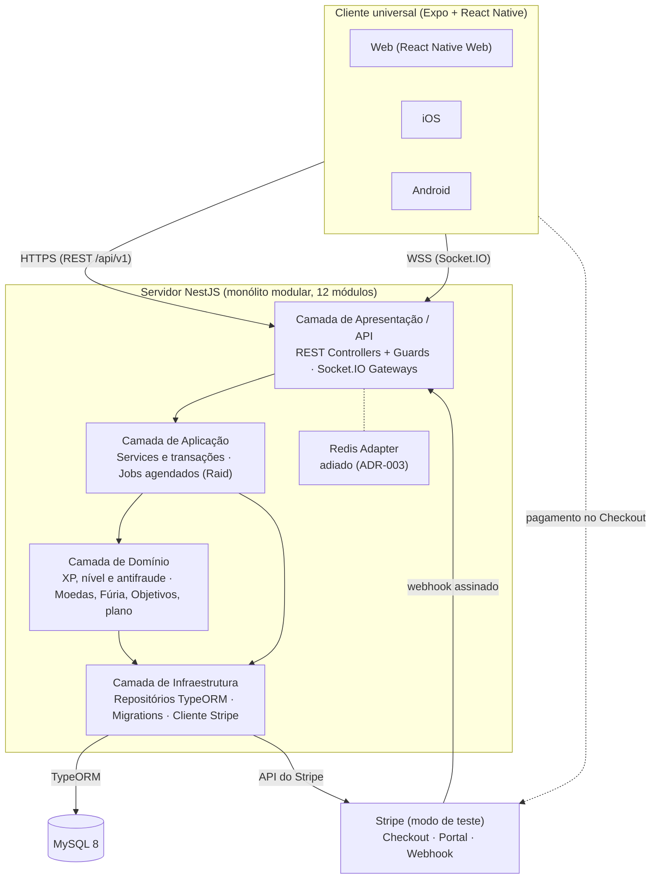

Universidade Católica de Brasília Escola de Exatas, Arquitetura e Meio Ambiente Curso de Engenharia de Software Disciplina de Arquitetura de Software — Grupo 2

PROJETO WISE WARRIOR

Documento de Arquitetura de Software WW – Wise Warrior

<table><tr><th>Equipe</th><th>Instituição</th></tr><tr><td>Grupo 2 Engenharia de Software</td><td>UCB 16/04/2026 (v1.0) · 27/10/2026 (v2.0) · 22/11/2026 (v2.1)</td></tr></table>

**Objetivo deste Documento**

Este documento tem como objetivo descrever as principais decisões de projeto tomadas pela equipe de desenvolvimento do Wise Warrior e os critérios considerados durante a tomada dessas decisões. Suas informações abrangem a estrutura lógica, física e tecnológica do sistema, contemplando componentes de software, comunicação e persistência.

A versão 2.1 descreve o sistema como ele está implementado na branch `develop` em 22/11/2026. Quando este documento e o PRD do repositório (`docs/PRD.md`) discordam, vale o PRD, e acima dos dois vale o código.

**Histórico de Revisão**

| Data | Demanda | Autor | Descrição | Versão |
|---|---|---|---|---|
| 16/04/2026 | WW-ARQ-001 | Grupo 2 | Versão inicial do documento de arquitetura do Wise Warrior. | 1.0 |
| 27/10/2026 | WW-ARQ-002 (issue #5) | Grupo 2 | Atualização com a implementação: cliente universal Expo para Web, iOS e Android (ADR-008); módulos reais do backend; Redis Adapter adiado (ADR-003); tecnologias e versões instaladas; novo diagrama. | 2.0 |
| 22/11/2026 | WW-ARQ-003 | Grupo 2 | Módulo `billing` e integração com o Stripe em modo de teste (ADR-015). Infraestrutura revisada: produção na Oracle Cloud (ADR-006) e homologação na AWS descrita em CloudFormation, no lugar do texto da versão 1.0 sobre ECS Fargate e CloudFront. | 2.1 |

**Sumário**

<nav class="sumario">

1. DESCRIÇÃO GERAL DA ARQUITETURA<b>3</b>

2. ESTILO ARQUITETURAL ADOTADO<b>3</b>

3. PRINCIPAIS COMPONENTES E RESPONSABILIDADES<b>4</b>

3.1 Camadas do Backend<b>4</b>

3.2 Módulos do Backend<b>4</b>

3.3 Frontend universal (Expo)<b>5</b>

4. DIAGRAMA DE ARQUITETURA<b>6</b>

5. TECNOLOGIAS UTILIZADAS<b>6</b>

6. JUSTIFICATIVA DAS DECISÕES ARQUITETURAIS<b>7</b>

</nav>

# 1. DESCRIÇÃO GERAL DA ARQUITETURA

O Wise Warrior é uma plataforma gamificada de foco e produtividade colaborativa, disponível na Web, no iOS e no Android, na qual usuários realizam sessões de estudo (Pomodoro), ganham XP e Moedas, sobem de nível, formam guildas e participam de raids semanais.

Do ponto de vista arquitetural, o sistema é composto por três partes principais e um serviço externo:

- **Cliente universal:** uma única aplicação Expo (React Native e TypeScript) que gera a versão Web, executada no navegador, e os aplicativos iOS e Android. É responsável pela interface gamificada: Forja (timer), Acampamento, Personagem, Guilda, Raid, Mercado, Crônicas e Configuração, incluindo a tela Plano.
- **Servidor de Aplicação (API + Tempo Real):** backend monolítico modular em NestJS que expõe uma API REST e um servidor WebSocket (Socket.IO). O REST é a fonte canônica do estado; o Socket.IO só avisa os dispositivos de que algo mudou.
- **Banco de Dados Relacional:** MySQL 8, responsável pela persistência de usuários, dispositivos conectados, sessões, progressão, cosméticos, moedas, guildas, raids, mensagens, assinaturas e pagamentos.
- **Stripe (externo):** processa, em modo de teste, a Assinatura premium e os Pacotes. O cliente é levado ao Checkout e ao Portal hospedados pelo Stripe, e o servidor só concede algo quando o webhook do Stripe confirma.

O Redis, previsto na versão 1.0 como adapter do Socket.IO para várias réplicas, está adiado (ADR-003): o backend roda em uma réplica com o adapter padrão do Socket.IO. O sistema é empacotado em containers Docker e acessado via HTTPS/WSS. O alvo de produção é uma VM Oracle Cloud Always Free com Docker Compose (ADR-006), ainda não provisionada; o ambiente de homologação roda na AWS, em uma instância EC2 atrás de um Application Load Balancer, com o banco no Amazon RDS.

# 2. ESTILO ARQUITETURAL ADOTADO

O Wise Warrior adota uma combinação de **Cliente-Servidor** com **Monólito Modular em Camadas**:

- **Cliente-Servidor:** descreve a distribuição física: clientes Web, iOS e Android consomem um servidor centralizado via HTTP e WebSocket.
- **Monólito Modular:** o backend é publicado como um único artefato (container Docker), mas internamente dividido em módulos coesos e de baixo acoplamento entre si.
- **Camadas:** a organização interna do código segue quatro camadas horizontais: Apresentação → Aplicação → Domínio → Infraestrutura.

**Por que não microsserviços?** Trata-se de um produto universitário de cerca de um ano, desenvolvido por uma equipe de 4 pessoas, cujo domínio é fortemente acoplado (sessão → XP → progressão → raid → guilda). Microsserviços trariam complexidade operacional desnecessária. A modularização interna mantém a porta aberta para extração futura sem reescrita (ADR-001).

# 3. PRINCIPAIS COMPONENTES E RESPONSABILIDADES

## 3.1 Camadas do Backend

| Camada | Responsabilidade |
|---|---|
| Apresentação / API | Receber requisições HTTP e WebSocket, validar DTOs, autenticar, serializar respostas e traduzir erros para RFC 7807. Ex.: `SessionsController`, `BillingController`, `RealtimeGateway`, `ChatGateway`, `JwtAuthGuard`, `HttpExceptionFilter`. |
| Aplicação | Orquestrar casos de uso, controlar transações e coordenar chamadas entre módulos. Ex.: `StudySessionStartService`, `StudySessionTransitionService`, `RaidsService`, `EconomyService`, `BillingService`, `RaidWeeklyScheduler`. |
| Domínio | Regras de negócio puras, sem acesso a banco, em `domain/` de cada módulo: cálculo de XP e nível, antifraude, Moedas por foco, Fúria do dragão, Objetivos, condições de desbloqueio e o plano derivado do status da assinatura. Ex.: `applyXp`, `levelForXp`, `validateSessionDuration`, `bossHealthXp`, `planTierForStatus`. |
| Infraestrutura | Persistência com entidades e repositórios TypeORM, migrations versionadas e adapters de terceiros (Socket.IO, agendador, cliente do Stripe). |

Tabela 1 — Camadas do backend e responsabilidades

**Regra de dependência:** controllers nunca acessam repositórios diretamente; sempre passam por um service da camada de aplicação. A camada de domínio não conhece infraestrutura, e suas regras são testadas sem banco.

## 3.2 Módulos do Backend

| Módulo | Responsabilidade principal |
|---|---|
| `auth` | Cadastro, login, refresh token rotativo por dispositivo, logout, credencial Web (cookie) e nativa, limite de 5 dispositivos. |
| `users` | Perfil, nome do guerreiro, plano (`plan_tier`), dispositivos conectados, catálogo e inventário de Cosmetic Items, equipagem e Marcos. |
| `progression` | Personagem, cálculo de XP e nível, desbloqueio de itens por nível e eventos de XP e level-up. |
| `sessions` | Study Session: Ciclos e Foco livre, prazo no servidor, pausa e retomada, idempotência, antifraude, histórico e métricas. |
| `economy` | Saldo de Moedas e Extrato, com uma entrada por origem. |
| `shop` | Loja de Missões e de Cosmetic Items À venda. |
| `objectives` | Crônicas: Objetivos diários e semanais pagos em Moedas e progresso dos Marcos. |
| `guilds` | Criação, descoberta, entrada e saída de guildas, membros e Líder. |
| `raids` | Raid semanal, Missões, participação, Contribuição, Ranking interno, Fúria do dragão, fechamento semanal e Recompensa. |
| `chat` | Mural da guilda em tempo real, presença online e avisos automáticos dos golpes, com retenção das mensagens mais recentes. |
| `billing` | Assinatura premium e Pacotes com o Stripe em modo de teste: abre o Checkout e o Portal, lista os Pacotes e recebe o webhook, que é o único caminho que muda o plano ou entrega os itens de um Pacote. |
| `realtime` | Gateway Socket.IO: autentica a conexão e mantém as salas `user:{id}` e `guild:{id}`; os outros módulos emitem eventos por ele. |
| `shared` | Filtro de erros RFC 7807, paginação por cursor, rate limit, hash, calendário de São Paulo e ferramentas de desenvolvedor. |

Tabela 2 — Módulos do backend e responsabilidades principais

O módulo `notifications` da versão 1.0 não existe como módulo separado. Os avisos de nível e de Raid encerrada saem de `progression` e `raids` pelo gateway de `realtime`. O convite de guilda não foi implementado, porque a entrada na guilda é aberta.

**Regra de acoplamento entre módulos:** a comunicação passa sempre pelo Service público do módulo de destino, inclusive dentro de uma transação, quando o Service recebe o `EntityManager` (ex.: `sessions` chama o Service de `progression` para conceder XP, nunca o repositório de personagens; `billing` muda o plano e o Inventário pelo `UsersService`). Ciclos entre módulos são resolvidos com `forwardRef`, como entre `auth`, `users` e `realtime`.

## 3.3 Frontend universal (Expo)

O frontend é uma única aplicação Expo com Expo Router e React Native Web, organizada assim:

- `src/app`: rotas do Expo Router, separadas em telas públicas e protegidas;
- `src/features`: telas e hooks por domínio (auth, dashboard, study-session, character, profile, guild, market, chronicles, settings);
- `src/core`: cliente Axios, autenticação (cookie na Web e SecureStore no celular), preferências do dispositivo, TanStack Query e cliente Socket.IO;
- `src/design-system`: componentes, tema Ouro/Índigo e navegação adaptativa (barra lateral na Web desktop, barra inferior no celular).

O TanStack Query guarda só o estado vindo do servidor. Um evento de tempo real não altera o cache diretamente: ele invalida as consultas afetadas, que são buscadas de novo pelo REST. Na cobrança, o aplicativo abre a página do Stripe e, ao voltar, relê o plano e o Inventário.

# 4. DIAGRAMA DE ARQUITETURA

Figura 1 — Diagrama de camadas da aplicação

**Descrição:** as setas entre camadas representam a direção permitida de dependência (de cima para baixo). Controllers e gateways delegam para services; services orquestram domínio e infraestrutura; o domínio não conhece infraestrutura. O Stripe fica fora do servidor: o usuário paga nas páginas dele, e o resultado chega ao servidor pelo webhook. O Redis aparece tracejado porque só entra quando houver uma segunda réplica do backend.

# 5. TECNOLOGIAS UTILIZADAS

| Camada / Função | Tecnologia |
|---|---|
| Linguagem (backend e frontend) | TypeScript (5.9 no backend, 6.0 no frontend) |
| Backend — runtime | Node.js 22.13 ou superior |
| Backend — framework | NestJS 10 (REST, Dependency Injection e estrutura modular) |
| Backend — tempo real | Socket.IO 4 (adapter padrão, uma réplica) |
| Backend — ORM | TypeORM 0.3 (migrations versionadas, `synchronize` desligado) |
| Backend — pagamentos | SDK `stripe` 23, em modo de teste |
| Frontend — framework | React 19, React Native 0.86, Expo SDK 57 e React Native Web |
| Frontend — roteamento | Expo Router |
| Frontend — estado remoto | TanStack Query 5 |
| Frontend — HTTP | Axios 1 |
| Frontend — WebSocket | socket.io-client 4 |
| Frontend — armazenamento seguro | Expo SecureStore (iOS e Android) |
| Frontend — i18n | Nenhuma biblioteca; interface só em pt-BR |
| Frontend — build | Metro, via expo export (Web) e Prebuild (iOS e Android); a Web é servida por nginx |
| Banco de dados | MySQL 8.0 em container no desenvolvimento e na CI; Amazon RDS for MySQL, uma zona, na homologação |
| Cache / Pub-Sub | Redis adiado (ADR-003) |
| Infraestrutura | Containers Docker com Docker Compose. Produção: VM Oracle Cloud Always Free (ADR-006), não provisionada. Homologação: AWS (EC2, Application Load Balancer, ECR, ACM e liga/desliga agendado), descrita em CloudFormation em `infra/` |
| Autenticação | JWT (access de 15 min + refresh rotativo por dispositivo), senhas com Argon2id |
| Transporte | HTTPS / WSS; na homologação, TLS terminado no Application Load Balancer |
| Testes | Jest 29, React Native Testing Library e Playwright 1.63 |
| Contratos de API | OpenAPI 3 e AsyncAPI 3, validados com Redocly CLI 2 |
| Integração contínua | GitHub Actions com MySQL 8.0 e E2E sobre Docker Compose |

Tabela 3 — Tecnologias utilizadas no projeto

# 6. JUSTIFICATIVA DAS DECISÕES ARQUITETURAIS

- **Monólito modular em vez de microsserviços.** Equipe pequena (4 pessoas), prazo curto (1 ano) e domínio fortemente acoplado. Microsserviços adicionariam complexidade de rede, observabilidade e orquestração sem benefício proporcional. A modularização interna preserva a possibilidade de extração futura.
- **TypeScript de ponta a ponta.** A mesma linguagem no backend (NestJS) e no frontend (React Native) reduz divergências de contrato e erros de integração.
- **NestJS como framework backend.** A estrutura opinativa baseada em módulos, providers e guards se alinha à separação em camadas e módulos exigida pela arquitetura. A injeção de dependência nativa facilita testes e substituição de implementações. O NestJS e o Socket.IO cobrem todos os casos de uso, por isso o Koa.js saiu da stack (ADR-002).
- **Expo e React Native no frontend.** A versão 1.0 previa uma SPA Web com React e Vite. O objetivo passou a incluir iOS e Android, e uma única aplicação Expo gera as três plataformas com as mesmas regras e contratos (ADR-008). Diferenças legítimas entre plataformas ficam em adaptadores, como o armazenamento do refresh token.
- **MySQL relacional em vez de NoSQL.** O domínio é inerentemente relacional: usuários possuem sessões, sessões geram XP e Moedas, XP compõe progressão, progressão habilita itens e títulos, usuários pertencem a guildas, guildas executam raids. Integridade referencial e transações ACID são requisitos do negócio: a conclusão de uma sessão grava XP, Moedas e dano na Raid numa única transação (ADR-005).
- **Timer no servidor.** O prazo de cada sessão é gravado no banco, e o servidor conclui a sessão no prazo mesmo sem o app aberto. O cliente nunca é fonte de verdade para duração, o que sustenta o antifraude por truncamento (ADR-011).
- **Socket.IO para tempo real, com REST canônico.** Mural da guilda, ranking ao vivo e avisos entre dispositivos exigem comunicação de baixa latência. Cada dispositivo entra na sala do usuário, e todos recebem os mesmos eventos (ADR-009). O evento só invalida dados no cliente, que os relê pelo REST. O Redis Adapter, obrigatório a partir de duas réplicas, fica adiado enquanto houver uma só (ADR-003).
- **Stripe hospedado, com o webhook como única fonte.** Checkout e Portal hospedados tiram os dados de cartão do servidor e do aplicativo. O plano e os itens de um Pacote só mudam quando o webhook, verificado pela assinatura do Stripe, confirma o pagamento; o servidor relê o objeto na API antes de aplicar, o que torna eventos repetidos ou fora de ordem inofensivos. Ir para cobrança real é configuração, não código novo (ADR-015).
- **Docker Compose em VM, com homologação na AWS.** O mesmo conjunto de containers roda no desenvolvimento, na CI e no servidor, o que mantém o deploy portável entre provedores. A produção mira a VM gratuita da Oracle para manter o projeto sem custo (ADR-006). A homologação usa a AWS por CloudFormation, com uma instância EC2, Application Load Balancer e RDS numa só zona, e liga e desliga em horário agendado para limitar o custo.
- **Arquitetura em camadas com módulos coesos.** Controllers nunca acessam repositórios diretamente; chamadas entre módulos passam pelo Service público do módulo destino. Essa disciplina protege o domínio de detalhes de infraestrutura e mantém a opção de extrair módulos no futuro, sem reescrever regras de negócio.
