

UNIVERSIDADE CATÓLICA DE BRASÍLIA CURSO DE ENGENHARIA DE SOFTWARE GRUPO 2

WISE WARRIOR

Documentação de Interfaces e Guia para Prototipação de Alta Fidelidade Versão 2.1

Brasília 2026

GRUPO 2

WISE WARRIOR

Documentação de Interfaces e Guia para Prototipação de Alta Fidelidade

Documentação de interfaces desenvolvida como atividade avaliativa da disciplina de Análise e Projeto de Software, sob orientação do Prof. Alexandre S. D. Santos. A versão 1.0 identificou as principais telas, o fluxo de navegação, os padrões de usabilidade e o guia de estilo para a prototipação de alta fidelidade. A versão 2.0, de 27/10/2026, atualizou o documento com as telas implementadas, a paleta e a tipografia do design system e os fluxos reais de navegação. A versão 2.1, de 22/11/2026, inclui a seção Pacotes do Mercado, a tela Plano com a Assinatura premium e os novos componentes do design system.

Brasília 2026

SUMÁRIO

<nav class="sumario">

1 INTRODUÇÃO<b>4</b>

2 IDENTIFICAÇÃO DAS PRINCIPAIS TELAS DO SISTEMA<b>4</b>

3 IDENTIDADE VISUAL E DESIGN SYSTEM<b>5</b>

3.1 Paleta de cores<b>5</b>

3.2 Tipografia<b>6</b>

3.3 Especificações de componentes<b>6</b>

3.4 Navegação adaptativa<b>7</b>

4 TELAS IMPLEMENTADAS<b>7</b>

4.1 Forja (sessão de estudos)<b>7</b>

4.2 Guilda<b>10</b>

4.3 Acampamento (Home / Dashboard)<b>12</b>

4.4 Autenticação<b>14</b>

4.5 Personagem (Perfil e Progressão)<b>15</b>

4.6 Raid<b>16</b>

4.7 Mercado<b>17</b>

4.8 Crônicas<b>19</b>

4.9 Configuração<b>20</b>

5 FLUXO DE NAVEGAÇÃO ENTRE TELAS<b>22</b>

5.1 Fluxo geral<b>22</b>

5.2 Fluxo da sessão de estudos<b>23</b>

5.3 Fluxo de Guilda<b>23</b>

5.4 Fluxo de pagamento<b>24</b>

6 DIRETRIZES COMPLEMENTARES DE DESIGN<b>25</b>

REFERÊNCIAS<b>26</b>

</nav>

# 1 Introdução

O presente documento descreve as interfaces do sistema Wise Warrior. A plataforma é um ambiente de produtividade gamificado e colaborativo no qual estudantes realizam sessões temporizadas de foco no estilo Pomodoro, acumulam pontos de experiência (XP) e Moedas, evoluem de nível e participam de desafios coletivos em guildas, denominados raids semanais.

A versão 1.0 cobria duas telas prototipadas no Figma, Sessão de Estudos e Guilda, e definia a identidade visual que guiaria os protótipos de alta fidelidade. A partir da versão 2.0, o documento descreve o aplicativo implementado: uma única aplicação Expo que roda na Web, no iOS e no Android. As figuras da seção 4 são capturas do aplicativo em execução, com dados de exemplo, na Web desktop (1440 px de largura) e no celular (390 × 844 px). A paleta e a tipografia da seção 3 são as do design system do código (`apps/frontend/src/design-system`), que substituíram as da versão 1.0. A versão 2.1 acrescenta a monetização: a seção Pacotes do Mercado e a tela Plano.

Quando este documento diverge do código ou do PRD do repositório (`docs/PRD.md`), vale o código, depois o PRD.

# 2 Identificação das principais telas do sistema

As telas T01 a T06 são as identificadas na versão 1.0. As telas T07 a T09 entraram depois, com a economia de Moedas (ADR-012), as Crônicas (ADR-014), a Configuração e a cobrança com o Stripe (ADR-015).

| ID | Tela | Rota | Descrição |
|---|---|---|---|
| T01 | Forja (Sessão de Estudos) | `/sessao` | Tela central de foco, com o cronômetro, a escolha de duração, matéria e modo (solo ou guilda), as pausas Pomodoro e o resultado da sessão. |
| T02 | Guilda | `/guilda` | Espaço social com a Raid da semana, o Mural em tempo real, os membros com presença online e o histórico de Raids. Sem guilda, mostra a busca de guildas e a criação de uma nova. |
| T03 | Acampamento (Home / Dashboard) | `/` | Painel principal com o herói, nível e XP, Moedas, constância, sessões e foco do dia, objetivos, cadência, card da Raid, próximo marco e atividade recente. |
| T04 | Autenticação | `/entrar`, `/cadastro` | Login e cadastro de um novo guerreiro. |
| T05 | Personagem (Perfil e Progressão) | `/perfil` | Herói em camadas, nível, título, XP, estatísticas e os itens equipados, com acesso ao inventário e à prévia. |
| T06 | Raid | `/guilda/raid` | Batalha da semana: cena com os membros e o chefe, vida do chefe, golpes da semana, Fúria do dragão e recompensas. |
| T07 | Mercado | `/mercado`, `/mercado/extrato` | Loja de Missões e de itens por Moedas, Pacotes pagos em dinheiro, saldo de Moedas e extrato. |
| T08 | Crônicas | `/cronicas` | Objetivos diários e semanais, marcos e diário de sessões da semana. |
| T09 | Configuração | `/configuracao` e uma rota por seção | Conta e segurança, preferências de foco, dispositivos conectados, acessibilidade, Plano (Assinatura premium) e, nas contas de teste, Desenvolvedor. |

Quadro 1 — Telas do sistema Wise Warrior

Fonte: Elaborado pelos autores (2026)

# 3 Identidade visual e design system

A identidade visual do Wise Warrior segue a estética dark RPG de plataformas de produtividade gamificadas, com referência ao Focumon (FOCUMON, 2026). A versão implementada usa o tema Ouro/Índigo, o único exposto ao usuário (ADR-008): fundos quase pretos com tom índigo, destaques em ouro e personagens em pixel art.

## 3.1 Paleta de cores

As cores são tokens semânticos definidos em `tokens/theme.ts`. Componentes usam sempre o nome do token, nunca o valor direto. O Quadro 2 lista os tokens por grupo.

| Grupo | Token | Valor |
|---|---|---|
| Fundos | `backgroundCanvas` / `backgroundRaised` / `backgroundOverlay` | `#07070c` / `#0c0c14` / `#12121c` |
| Superfícies | `surfaceCard`; `surfaceElevated` / `surfaceCardActive`; `surfaceInset` | `#181826`; `#1f1f2e`; `#0a0a12` |
| Bordas | `borderGhost`; `borderSubtle` / `borderSoft`; `borderEmphasis`; `borderFocus` | `rgba(212,168,90,0.08)`; `0.16`; `0.28`; `0.45` |
| Destaque | `accentPrimary`; `accentHighlight`; `accentMuted`; `accentGlow` | `#d4a85a`; `#f0c97a`; `#8a6a3a`; `rgba(212,168,90,0.35)` |
| Feedback | `feedbackDanger`; `feedbackInfo`; `feedbackSuccess`; `feedbackEnergy`; `feedbackArcane` | `#c44545`; `#5b7fc4`; `#4ea672`; `#d65a8a`; `#8a5bc4` |
| Texto | `textPrimary`; `textSecondary`; `textTertiary`; `textDisabled` | `#f3ead4`; `#b3a98e`; `#6b6555`; `#46412f` |

Quadro 2 — Paleta de cores do sistema Wise Warrior

Fonte: apps/frontend/src/design-system/tokens/theme.ts (2026)

Nas telas, o ouro (`accentPrimary`) marca o botão principal, o item ativo da navegação, a barra de XP e o cronômetro. O vermelho de perigo aparece em ações destrutivas, como Sair e Cancelar sessão, e o rosa de energia na constância. A paleta da versão 1.0 (azul naval `#0F1117` com acentos dourado `#F5A623`, verde-água e carmesim) não é mais usada.

## 3.2 Tipografia

O sistema tipográfico usa três famílias. A Cinzel, serifada, aparece em títulos de tela e no cronômetro e remete ao universo de fantasia medieval. A Inter garante legibilidade no corpo e nos rótulos. A JetBrains Mono é usada em números, tempos, preços e rankings, para alinhar valores em colunas. As fontes são empacotadas com o aplicativo.

| Variante | Família | Tamanho / altura de linha | Exemplo |
|---|---|---|---|
| display | Cinzel SemiBold | 32 / 40 px | Forja |
| title | Cinzel Bold | 24 / 32 px | Vigília da Aurora |
| subtitle | Cinzel SemiBold | 18 / 26 px | Ordem do Pergaminho |
| subtitleStrong | Inter Bold | 18 / 26 px | Sessão concluída |
| body | Inter Regular | 16 / 24 px | Madrugue com a guilda e acenda as primeiras luzes. |
| label | Inter SemiBold | 14 / 20 px | Nome do guerreiro |
| caption | Inter Medium, espaçamento 2 | 12 / 16 px | VIDA DO BOSS |
| mono / monoEmphasis | JetBrains Mono Medium / SemiBold | 14 / 20 px | +250 XP · 25 min |

Quadro 3 — Sistema tipográfico do Wise Warrior

Fonte: tokens/theme.ts (2026)

## 3.3 Especificações de componentes

Os componentes ficam no design system e são consumidos pelo barrel `src/design-system/index.ts`. O espaçamento segue a escala 0, 4, 8, 12, 16, 20, 24, 32, 40, 48 e 64 px; os raios de borda são 3, 5, 8, 12 e 999 px; as bordas têm 1 ou 2 px; os ícones têm 16, 24 ou 32 px; e as durações de movimento são 0, 120, 180 e 240 ms. O conteúdo tem largura máxima de 1200 px e a barra lateral, 248 px.

| Componente | Especificação |
|---|---|
| WiseText | Variantes do Quadro 3; a cor é sempre um token semântico. |
| WiseButton | Variantes primary, secondary, ghost e danger; tamanhos medium e large; estados desabilitado e carregando. |
| WiseCard | Superfície não interativa nas variantes default, elevated e ornamented. |
| WiseField | Rótulo obrigatório, ajuda ou erro associado ao campo e anunciado por leitores de tela. |
| WiseIcon | Ícones Wise e Ionicons em 16, 24 ou 32 px; ícone informativo exige rótulo acessível. |
| ProgressBar | Modo determinado, com valor e intervalo, ou indeterminado, ambos com semântica de progresso. É a base das barras de XP e de vida do chefe. |
| FeedbackMessage | Variantes info, success, warning e error, com título opcional e região anunciada. |
| ResourcePill | Metadado compacto, como o saldo de Moedas; quando acionável, exige ação e rótulo acessível. |
| WiseDialog | Janela modal das confirmações: cartão centralizado no desktop e painel que sobe do rodapé no celular; fecha pelo fundo, pela tecla Esc na Web e pelo voltar do Android. |
| WiseSwitch | Interruptor de 44 × 26 px das preferências, com rótulo acessível obrigatório; sem animação quando o movimento está reduzido. |
| Screen | Título obrigatório, áreas seguras do celular, margens, rolagem e acomodação do teclado. |

Quadro 4 — Especificações dos principais componentes de interface

Fonte: apps/frontend/README.md (2026)

## 3.4 Navegação adaptativa

A mesma lista de destinos alimenta duas composições. Na Web, a partir de 900 px de largura, uma barra lateral mostra os sete destinos: Acampamento, Forja, Personagem, Guilda, Mercado, Crônicas e Configuração. Abaixo dessa largura, e no iOS e no Android, uma barra inferior mostra Acampamento, Forja, Personagem e Guilda, e o menu Mais reúne Mercado, Crônicas e Configuração.

# 4 Telas implementadas

As seções a seguir descrevem cada tela como está no aplicativo. As capturas usam uma conta de exemplo, Eldoria, Líder da guilda Ordem do Pergaminho, com sessões de estudo do dia.

## 4.1 Forja (sessão de estudos)

A Forja é o hub de foco. Antes de começar, no estado Pronta, o usuário escolhe a duração (15, 25 ou 50 minutos, ou Livre), uma matéria opcional, com sugestões das matérias recentes, e o modo solo ou guilda. O cronômetro ocupa o centro, com o herói abaixo dele e a estimativa de XP, a constância e o foco do dia. À direita ficam as regras da Forja.

<figure>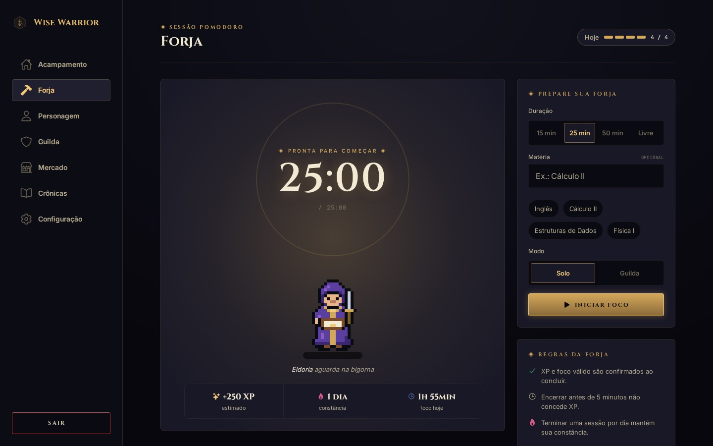</figure>

Figura 1 — Forja no estado Pronta (Web desktop)

Fonte: Elaborado pelos autores (2026)

Durante a sessão, o cronômetro mostra o tempo restante e o foco válido. O card Sessão atual mostra matéria, duração, foco válido e número de pausas, com os botões de pausar e cancelar. O selo Sincronizado indica que o estado veio do servidor: o tempo é contado lá, e a sessão pode ser controlada de qualquer dispositivo do usuário.

<figure>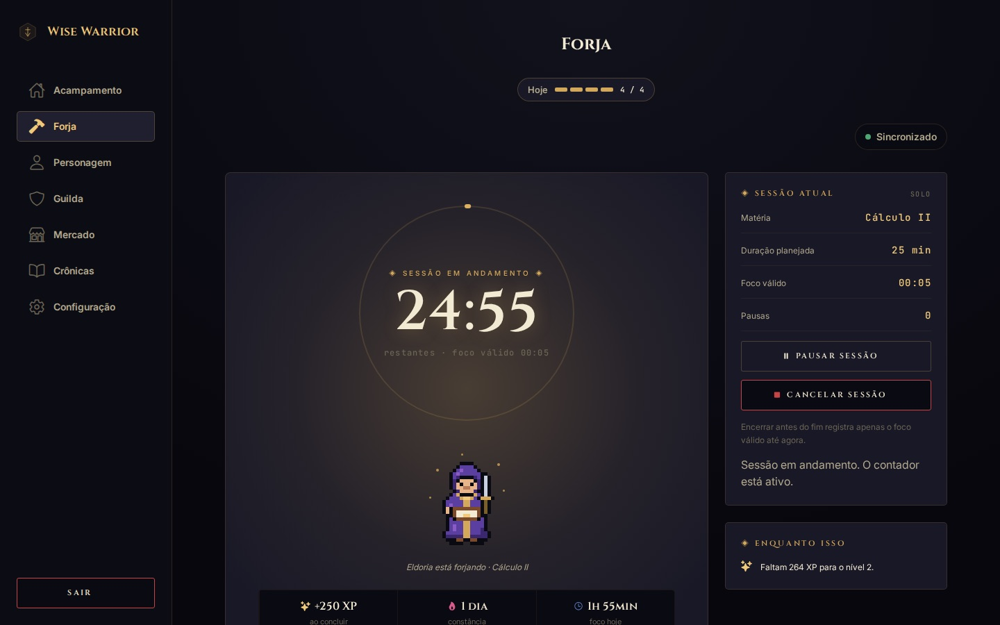</figure>

Figura 2 — Forja com sessão em andamento (Web desktop)

Fonte: Elaborado pelos autores (2026)

No celular, a navegação vai para a barra inferior e os botões de pausar e cancelar ficam fixos acima dela, para que o cronômetro continue visível.

<figure>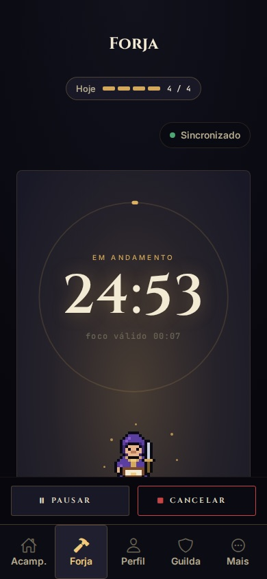</figure>

Figura 3 — Forja com sessão em andamento (celular)

Fonte: Elaborado pelos autores (2026)

## 4.2 Guilda

A Guilda é o hub social. O cabeçalho mostra o emblema, o nome, o nível, o número de membros, quantos estão online e, para o Líder, o selo correspondente. Na Web, a coluna principal traz o card da Raid da semana, com a cena da Missão, a vida do chefe, a sequência de dias de estudo da guilda e a contribuição do usuário; a coluna lateral traz o Mural e os membros. O Mural recebe mensagens e avisos automáticos de cada golpe em tempo real.

<figure>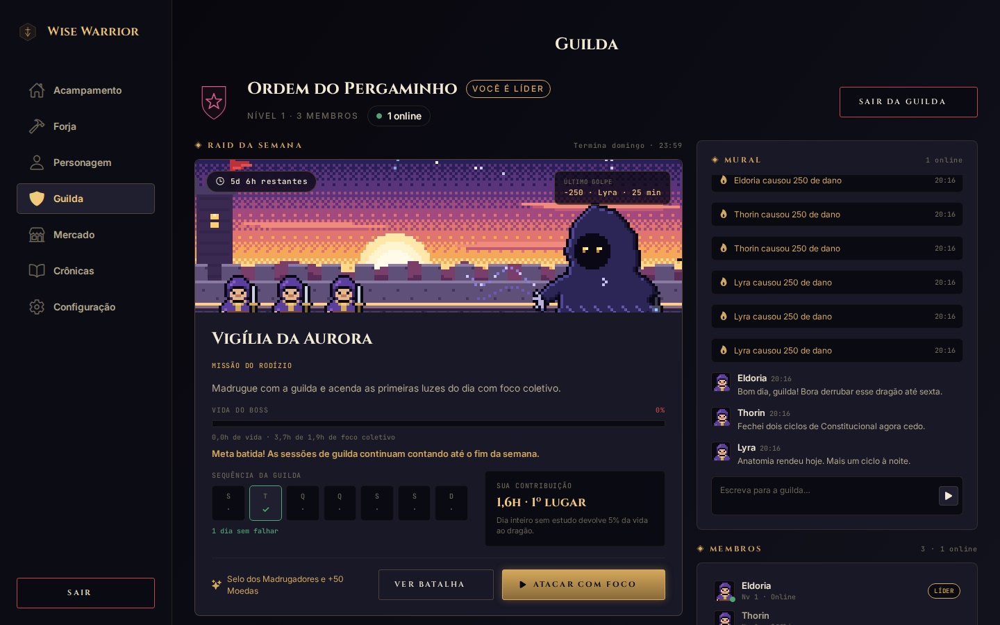</figure>

Figura 4 — Guilda (Web desktop)

Fonte: Elaborado pelos autores (2026)

No celular, o conteúdo se divide em quatro abas: Raid, Mural, Membros e Histórico. Quem não tem guilda vê a busca de guildas e o formulário para fundar uma nova.

<figure>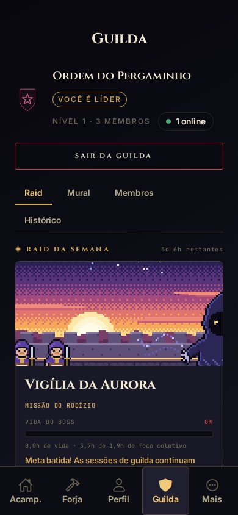</figure>

Figura 5 — Guilda na aba Raid (celular)

Fonte: Elaborado pelos autores (2026)

## 4.3 Acampamento (Home / Dashboard)

O Acampamento abre o aplicativo depois do login. O cabeçalho mostra o herói, o título equipado, o saldo de Moedas e o botão para iniciar ou retomar o foco, com a posição no ciclo Pomodoro. Abaixo vêm a progressão de nível com as matérias da semana; constância, sessões de hoje e foco válido de hoje; os objetivos do dia; e a cadência do guerreiro. A coluna lateral mostra o card da Raid, o próximo marco e a atividade recente.

<figure>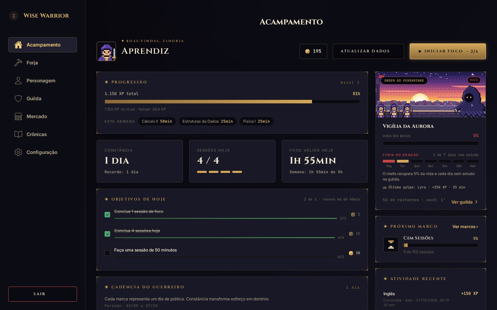</figure>

Figura 6 — Acampamento (Web desktop)

Fonte: Elaborado pelos autores (2026)

<figure>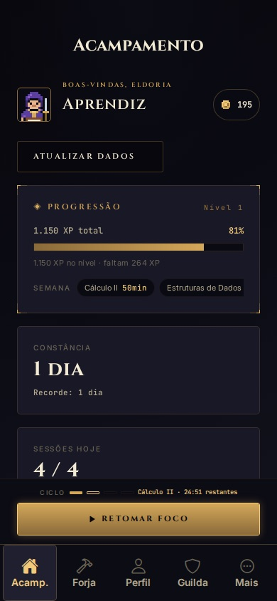 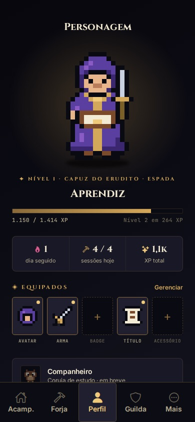</figure>

Figura 7 — Acampamento e Personagem (celular)

Fonte: Elaborado pelos autores (2026)

## 4.4 Autenticação

A tela de login pede e-mail e senha. O cadastro pede o nome do guerreiro, o e-mail, a senha e a confirmação da senha e cria o personagem. Depois do login, o usuário vai para o Acampamento ou, se tem uma sessão ativa, para a Forja. Na Web, o refresh token fica num cookie protegido; no celular, no armazenamento seguro do sistema.

<figure>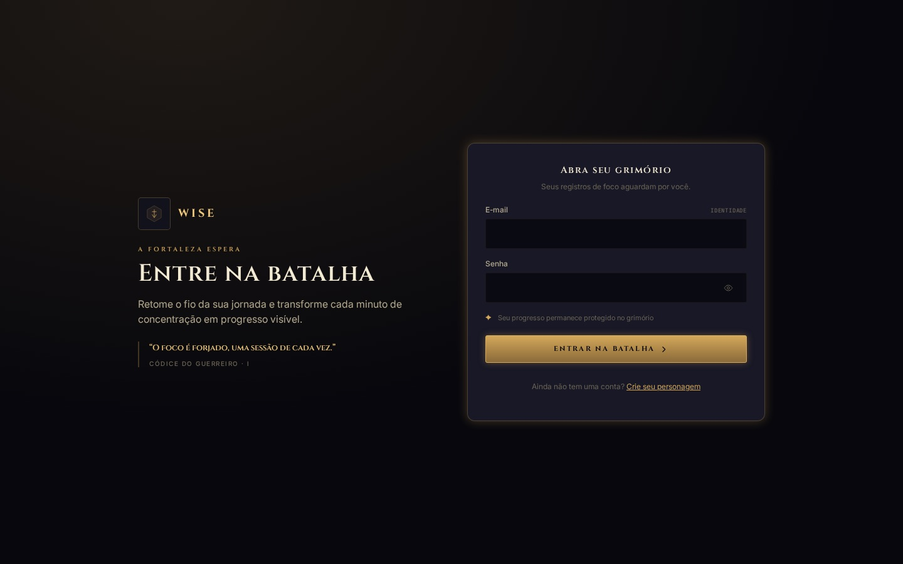</figure>

Figura 8 — Tela de login (Web desktop)

Fonte: Elaborado pelos autores (2026)

<figure>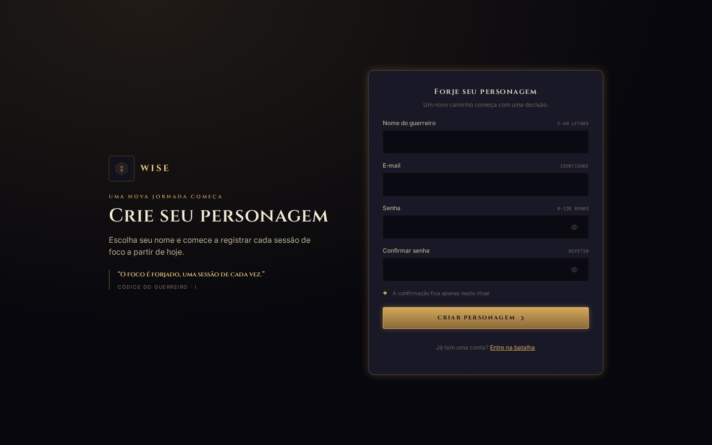</figure>

Figura 9 — Tela de cadastro (Web desktop)

Fonte: Elaborado pelos autores (2026)

## 4.5 Personagem (Perfil e Progressão)

O Personagem mostra o herói em tamanho grande, composto em camadas pelo corpo base e pelos itens equipados de Avatar, Arma e Acessório (ADR-013). Abaixo ficam o nível, o título, a barra de XP e as estatísticas de constância, sessões e XP total. À direita, os cinco espaços de equipamento (Avatar, Arma, Badge, Título e Acessório) abrem o inventário, onde o usuário vê a prévia e equipa ou desequipa cada item. Itens premium aparecem com o sinal ✦ e só podem ser equipados com a Assinatura ativa; itens de Pacote aparecem como "Do Pacote do Dragão". O Companheiro aparece como item da Fase 2 (ADR-004).

<figure>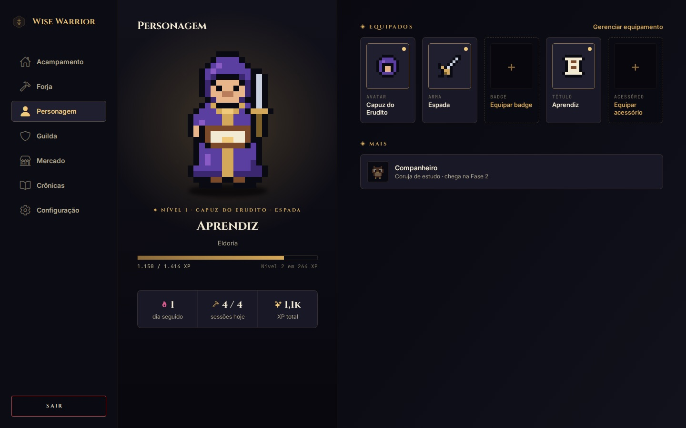</figure>

Figura 10 — Personagem (Web desktop)

Fonte: Elaborado pelos autores (2026)

## 4.6 Raid

A tela da Raid mostra a batalha da semana em uma cena de pixel art própria de cada Missão, com os participantes à esquerda e o chefe à direita. Cada golpe aparece sobre o chefe com o dano, o autor e os minutos de foco. Abaixo ficam os golpes da semana, em forma de ranking, a regra da Fúria do dragão, que devolve vida ao chefe a cada dia sem estudo, e as recompensas ao derrotar o chefe.

<figure>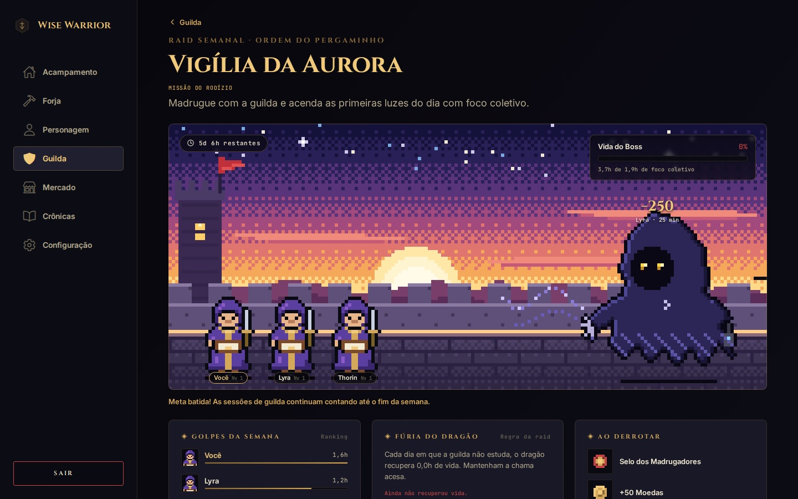</figure>

Figura 11 — Raid (Web desktop)

Fonte: Elaborado pelos autores (2026)

## 4.7 Mercado

O Mercado mostra o saldo de Moedas, com acesso ao extrato, e três abas: Missões, que a guilda pode usar nas próximas Raids, Itens para o herói e Pacotes. Cada Missão mostra a cena, a descrição, as recompensas e o preço; quando o saldo não basta, o card mostra quantas Moedas faltam e quantos focos de 25 minutos cobrem a diferença.

<figure>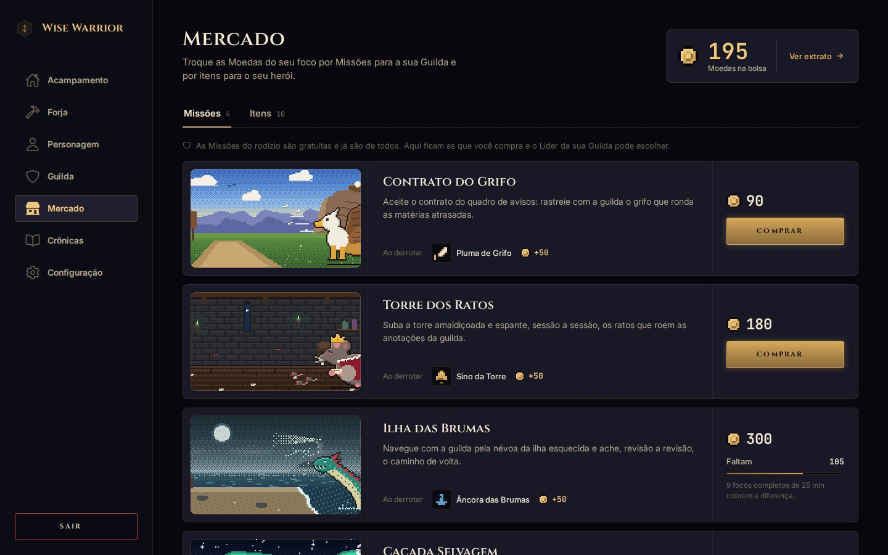</figure>

Figura 12 — Mercado na aba Missões (Web desktop)

Fonte: Elaborado pelos autores (2026)

A aba Pacotes vende conjuntos de itens por dinheiro, não por Moedas. O Pacote do Dragão traz três itens (Elmo de Escamas, Presa do Dragão e Amuleto de Brasa) por R$ 4,90, em pagamento único. Ao lado, uma prévia mostra os itens no herói sem equipá-los. O botão de compra abre o Checkout do Stripe; os itens entram no Inventário assim que o pagamento é confirmado e ficam com o usuário em qualquer plano. Depois de pago, o card mostra que o Pacote já é do usuário.

<figure>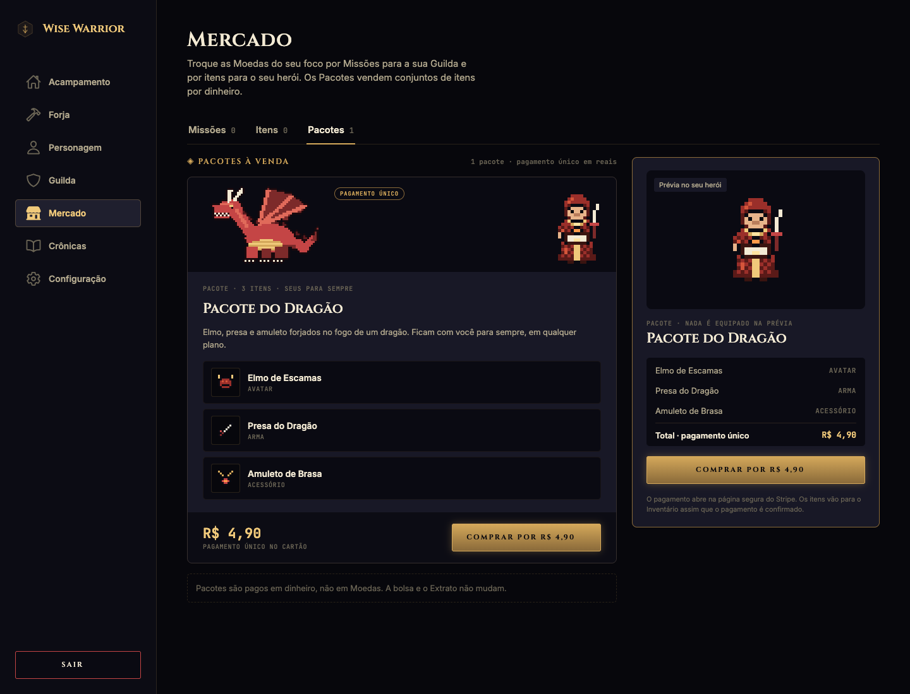</figure>

Figura 13 — Mercado na aba Pacotes (Web desktop)

Fonte: Elaborado pelos autores (2026)

## 4.8 Crônicas

As Crônicas têm duas visões, Objetivos e Diário. Objetivos mostra os três objetivos diários, os três semanais e o progresso dos marcos. O Diário lista as sessões da semana por dia, com filtros de concluídas, truncadas e descartadas, e resume a semana com foco válido, sessões, XP e o tempo por matéria.

<figure>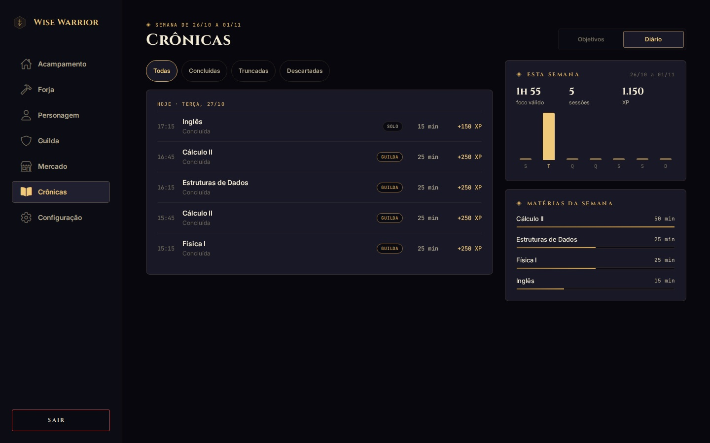</figure>

Figura 14 — Crônicas na visão Diário (Web desktop)

Fonte: Elaborado pelos autores (2026)

## 4.9 Configuração

A Configuração tem uma seção por assunto: Conta e segurança, onde o usuário muda o nome do guerreiro; Foco, com a duração padrão da Forja, a sugestão de matérias recentes e a confirmação antes de parar; Dispositivos, com a lista de dispositivos conectados e a opção de encerrar os outros; Acessibilidade, com a opção de reduzir movimento; e Plano. As preferências de Foco e Acessibilidade valem só para o dispositivo em uso. No desktop, o menu fica à esquerda e a seção à direita; no celular, cada seção abre sobre a lista.

<figure>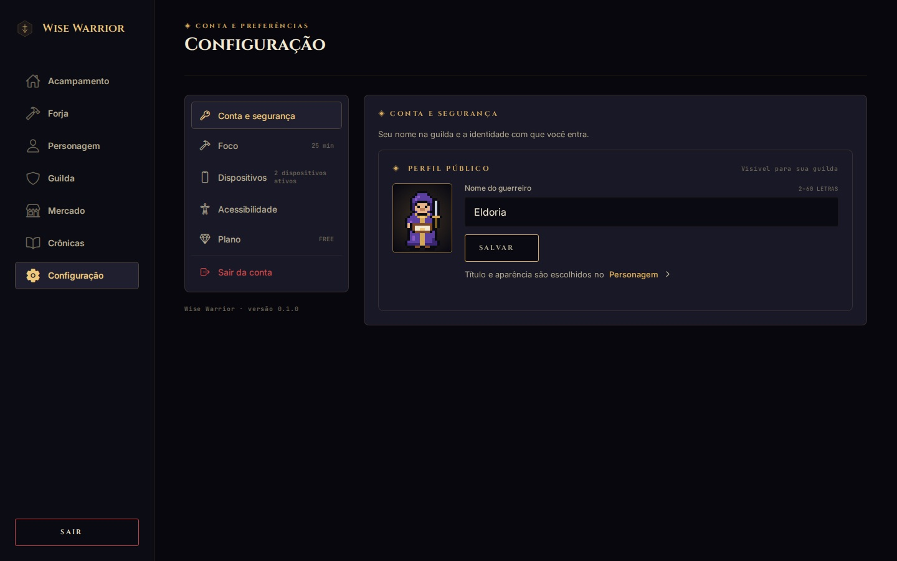</figure>

Figura 15 — Configuração em Conta e segurança (Web desktop)

Fonte: Elaborado pelos autores (2026)

A seção Plano mostra o plano atual. No plano free, mostra que o premium libera três Itens premium ✦ por R$ 9,90 por mês e o botão Assinar premium, que abre o Checkout do Stripe. Com a Assinatura ativa, mostra a data de renovação, os Itens premium ✦ liberados no herói e o botão Gerenciar assinatura, que abre o Portal do Stripe para trocar o cartão ou cancelar. Com o pagamento pendente, avisa que a última cobrança não passou e oferece Atualizar cartão; o premium continua enquanto isso. Se a Assinatura foi cancelada, mostra até quando o premium vale. Nas contas de teste da equipe, a seção Desenvolvedor cancela a Assinatura de teste na hora, para repetir a demonstração do zero.

<figure>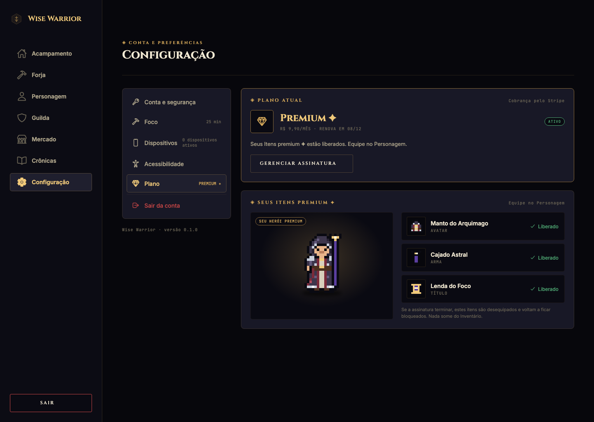</figure>

Figura 16 — Configuração em Plano, com a Assinatura premium ativa (Web desktop)

Fonte: Elaborado pelos autores (2026)

# 5 Fluxo de navegação entre telas

## 5.1 Fluxo geral

Sem login, só as telas de autenticação ficam acessíveis; qualquer outra rota leva ao login. Depois do login, todos os destinos ficam a um toque pela navegação da seção 3.4.

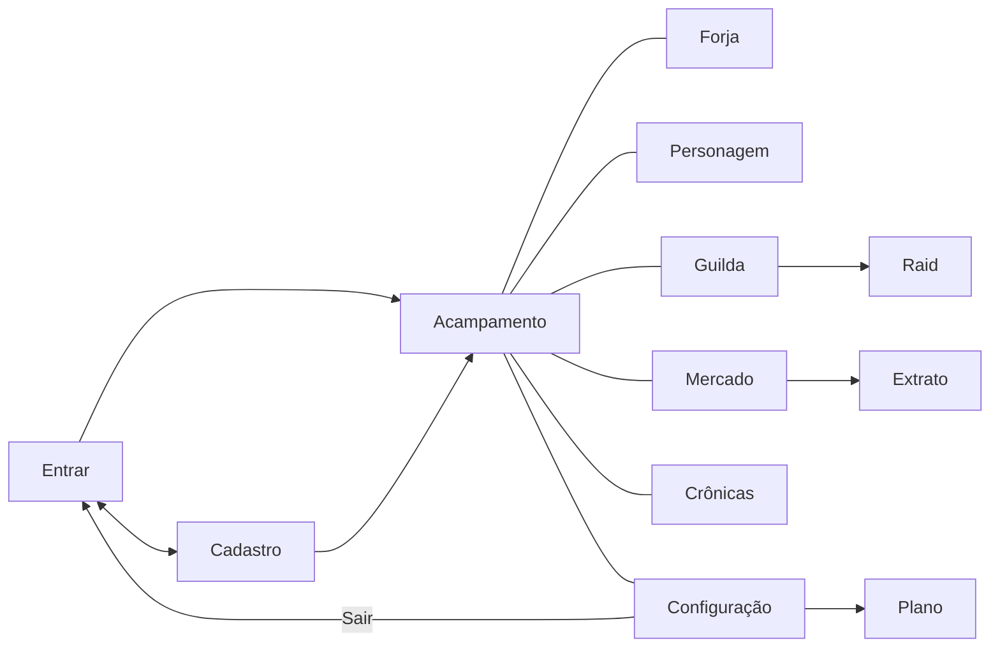

Figura 17 — Fluxo geral de navegação entre telas

Fonte: Elaborado pelos autores (2026)

## 5.2 Fluxo da sessão de estudos

A sessão começa online e o servidor guarda o prazo. Pausar e retomar exigem conexão. Cancelar só é possível antes de cinco minutos de foco e não gera XP; depois disso, encerrar antes do fim registra o foco válido até ali. O Ciclo conclui sozinho no prazo, mesmo com o aplicativo fechado. O Foco livre conta para cima até o usuário parar, ou até o teto do antifraude. No Ciclo, a conclusão leva à pausa Pomodoro, curta ou longa, que roda só no dispositivo e não gera XP.

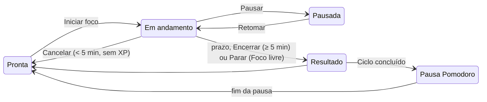

Figura 18 — Fluxo da sessão de estudos na Forja

Fonte: Elaborado pelos autores (2026)

## 5.3 Fluxo de Guilda

Cada usuário participa de no máximo uma guilda. Quem não tem guilda encontra uma e entra, ou funda a sua e vira Líder. Dentro da guilda, o membro entra na Raid da semana e ataca com foco: a Forja abre no modo guilda, e cada sessão concluída vira um golpe no chefe, visto na Raid e no Mural. O Líder também escolhe a Missão da próxima Raid. Sair da guilda volta à tela sem guilda.

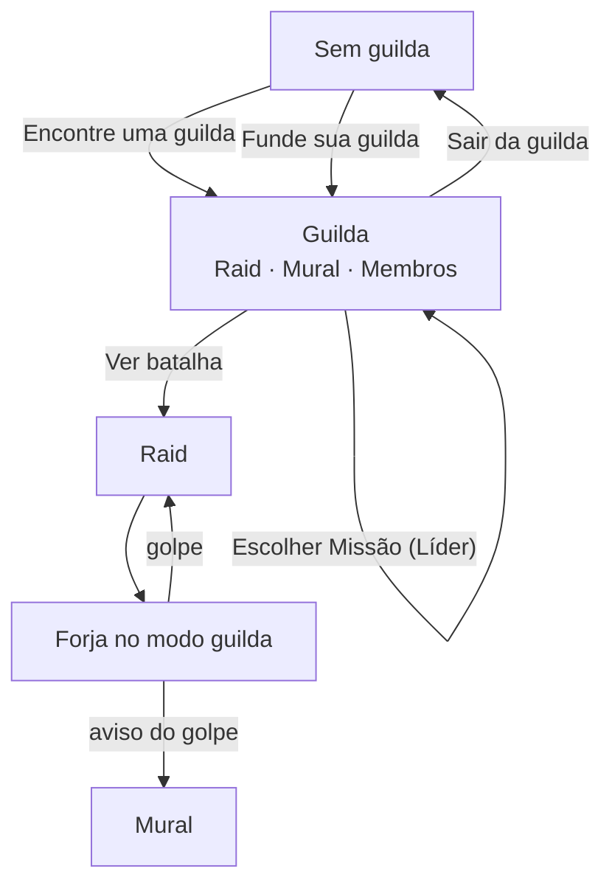

Figura 19 — Fluxo de Guilda

Fonte: Elaborado pelos autores (2026)

## 5.4 Fluxo de pagamento

A Assinatura e os Pacotes seguem o mesmo caminho. O botão abre o Checkout do Stripe, fora do aplicativo; o usuário paga com cartão (em modo de teste) e volta para a tela de origem. O plano ou os itens só mudam quando o Stripe confirma o pagamento ao servidor, e o aplicativo então relê o estado. Cancelar no Checkout volta à tela sem mudar nada. Gerenciar a Assinatura abre o Portal do Stripe; o cancelamento vale até o fim do período pago.

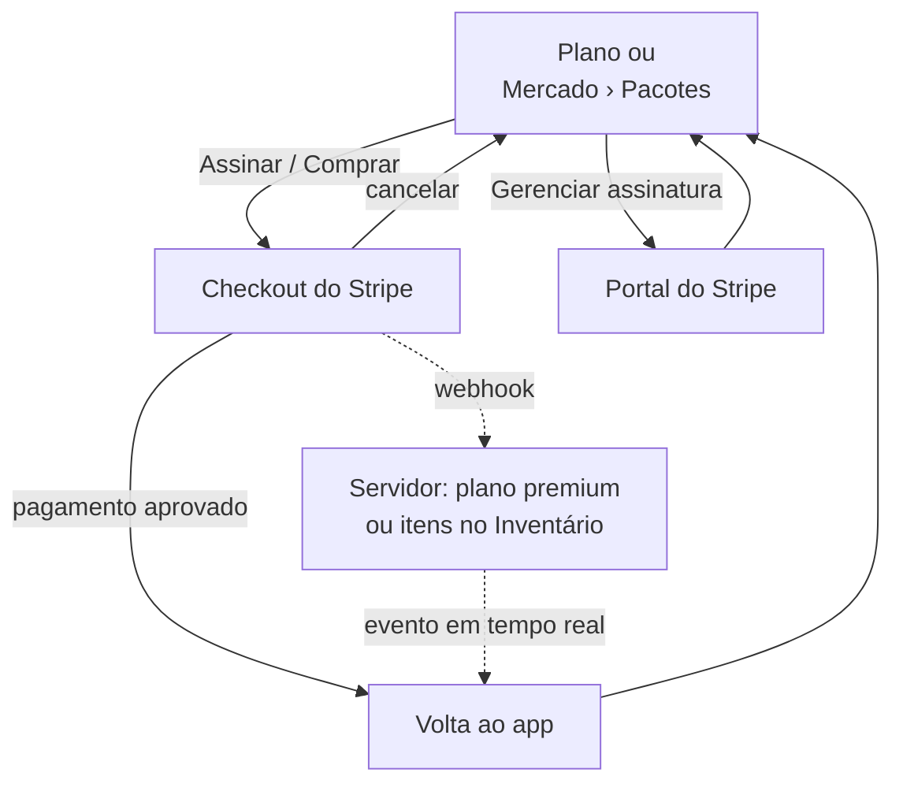

Figura 20 — Fluxo de pagamento da Assinatura e dos Pacotes

Fonte: Elaborado pelos autores (2026)

# 6 Diretrizes complementares de design

As diretrizes a seguir valem para todas as telas e para novos protótipos do Wise Warrior:

- **Cores e tipografia:** use só os tokens do design system (seções 3.1 e 3.2). Valores de cor, fonte, espaçamento ou duração fora do tema não entram em componentes compartilhados.
- **Arte:** personagens, chefes, cenas de Missão e ícones de itens são pixel art. O herói é sempre composto em camadas sobre o mesmo corpo base, na grade de 16 × 24 pixels.
- **Ícones:** Ionicons e ícones próprios do Wise, em 16, 24 ou 32 px. Ícones que informam algo têm rótulo acessível.
- **Movimento:** transições de 120 a 240 ms. Quando o sistema pede movimento reduzido, ou quando o usuário liga "Reduzir movimento" na Configuração, as animações são trocadas por transições de opacidade ou omitidas.
- **Som:** o fim de um foco ou de uma pausa toca um alarme em repetição. O aplicativo não tem áudio ambiente.
- **Dinheiro e Moedas:** preços em reais aparecem com "R$" e a indicação de pagamento único ou mensal; Pacotes não alteram o saldo de Moedas nem o Extrato. Itens premium levam o sinal ✦.
- **Acessibilidade:** contraste mínimo WCAG AA nos textos; área de toque mínima de 44 × 44 px no celular; foco visível na Web; rótulos acessíveis no cronômetro, nas barras de progresso e nos botões só com ícone. A validação completa das telas T01 a T06 segue aberta (issue #23).
- **Plataformas:** as regras de negócio e os contratos são os mesmos na Web, no iOS e no Android. Diferenças de plataforma ficam em adaptadores, como o armazenamento da credencial, e não mudam o que a tela mostra.

# Referências

ASSOCIAÇÃO BRASILEIRA DE NORMAS TÉCNICAS. **NBR 14724**: Informação e documentação — Trabalhos acadêmicos — Apresentação. Rio de Janeiro: ABNT, 2024.

EXPO. **Expo documentation**. Disponível em: &lt;https://docs.expo.dev&gt;. Acesso em: out. 2026.

FOCUMON. **Focumon**: a gamified focus app. Disponível em: &lt;https://www.focumon.com&gt;. Acesso em: abr. 2026.

GRUPO 2. **Documento de Arquitetura de Software — Wise Warrior**. Versão 2.1. [S.l.: s.n.], 2026. Documento interno.

GRUPO 2. **Documento de Visão — Wise Warrior**. Versão 2.1. [S.l.: s.n.], 2026. Documento interno.

GRUPO 2. **Wise Warrior — PRD**. Repositório do projeto, docs/PRD.md, 2026. Documento interno.

IONIC. **Ionicons**. Disponível em: &lt;https://ionic.io/ionicons&gt;. Acesso em: out. 2026.

METTZER. **Normas ABNT**: guia de formatação para 2026. Disponível em: &lt;https://blog.mettzer.com/normas-abnt/&gt;. Acesso em: abr. 2026.

STRIPE. **Stripe documentation**. Disponível em: &lt;https://docs.stripe.com&gt;. Acesso em: nov. 2026.

W3C. **Web Content Accessibility Guidelines (WCAG) 2.2**. Disponível em: &lt;https://www.w3.org/TR/WCAG22/&gt;. Acesso em: out. 2026.
