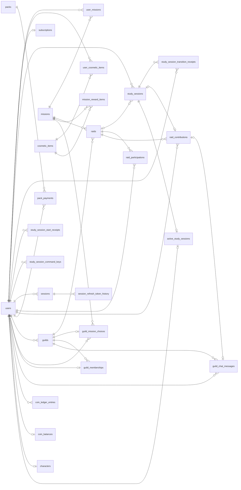
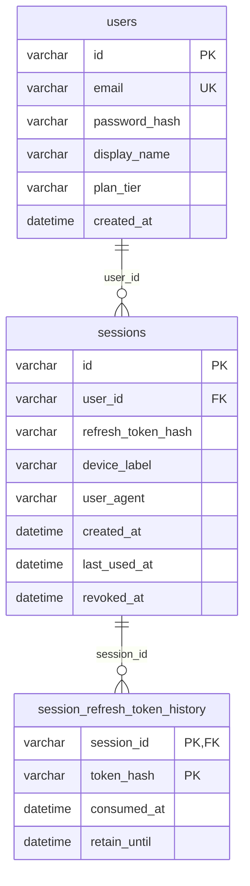
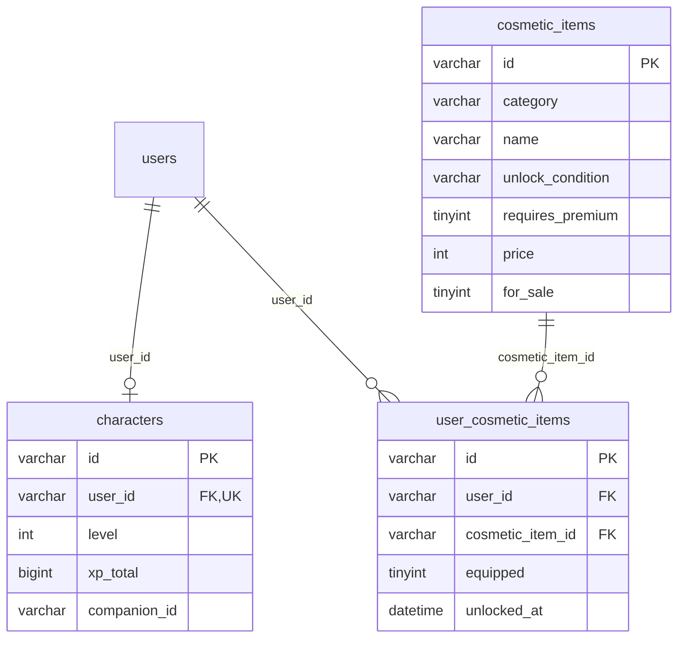
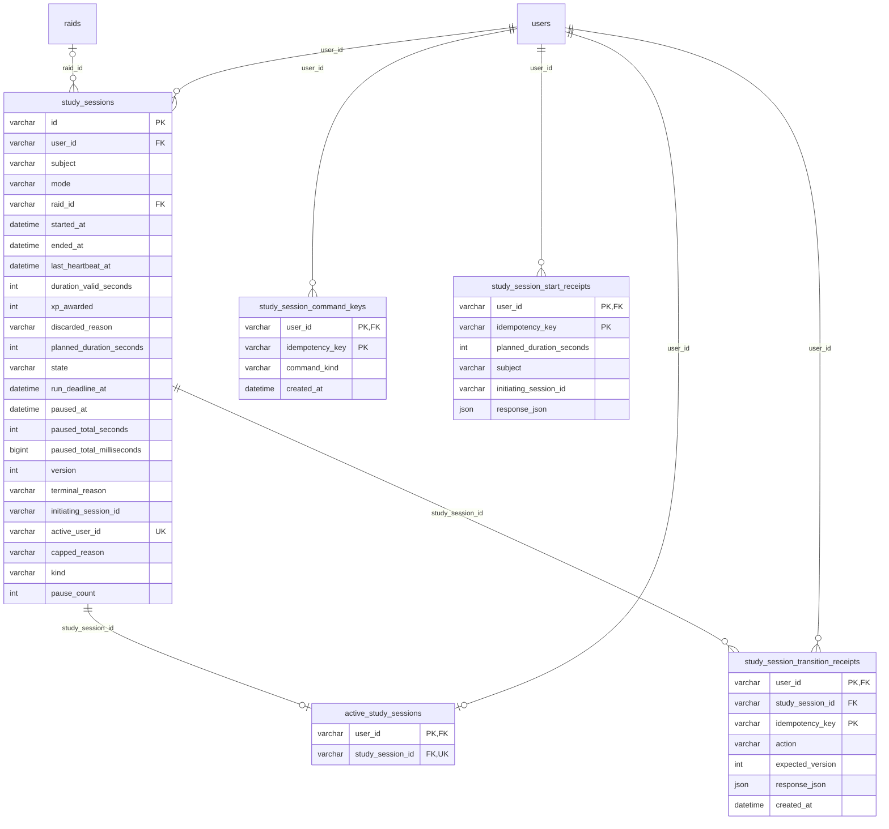
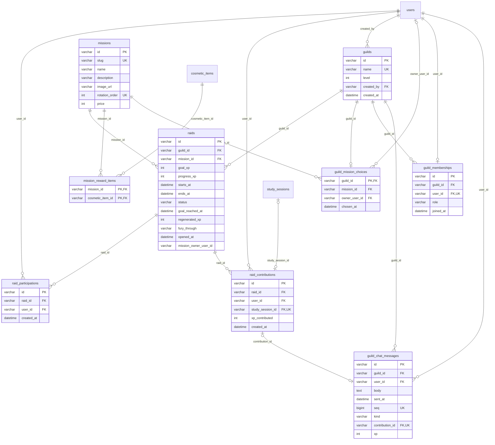
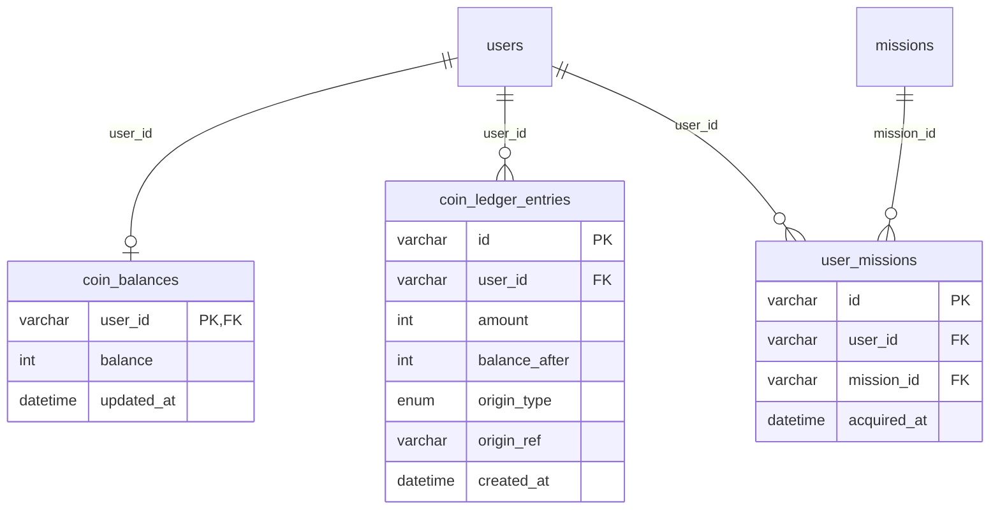
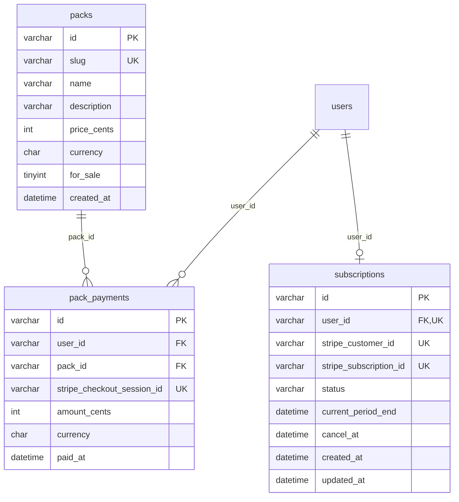

# Wise Warrior: modelo de dados

Versão de 22/11/2026, gerada do esquema da branch `develop` (36 migrations aplicadas).

## 1. Visão geral

O Wise Warrior guarda todos os dados num único banco relacional MySQL 8.0. O banco é a única fonte de verdade: a API REST lê e altera o estado, e o canal de tempo real só avisa os dispositivos de que algo mudou.

O esquema tem 26 tabelas, em seis grupos:

| Grupo | Tabelas | Para quê |
|---|---|---|
| Conta e dispositivos | `users`, `sessions`, `session_refresh_token_history` | Cadastro, plano e login em até 5 dispositivos |
| Personagem e cosméticos | `characters`, `cosmetic_items`, `user_cosmetic_items` | Nível, XP, Inventário e itens equipados |
| Sessões de estudo | `study_sessions`, `active_study_sessions` e três tabelas de recibos | Timer contado no servidor, com comandos idempotentes |
| Guildas, Raids e Mural | `guilds`, `guild_memberships`, `guild_chat_messages`, `missions`, `mission_reward_items`, `guild_mission_choices`, `raids`, `raid_participations`, `raid_contributions` | Estudo cooperativo e chat da Guilda |
| Economia e Loja | `coin_balances`, `coin_ledger_entries`, `user_missions` | Moedas, Extrato e Compras |
| Cobrança | `subscriptions`, `packs`, `pack_payments` | Assinatura premium e Pacotes pagos |

## 2. Convenções

- **Definição oficial:** as migrations TypeORM em `apps/backend/src/migrations`. O esquema nunca é sincronizado automaticamente; cada mudança é uma migration testada em subida e descida.
- **Chaves:** quase todas as tabelas usam UUID em `varchar(36)` como chave primária. As tabelas de recibos usam chave composta (`user_id`, `idempotency_key`).
- **Motor e texto:** InnoDB, `utf8mb4` com collation `utf8mb4_0900_ai_ci`.
- **Datas:** `datetime` em UTC; colunas que precisam de ordem fina usam precisão de milissegundos ou microssegundos.
- **Dono de cada tabela:** cada tabela pertence a um módulo do backend, e outro módulo só a altera pelo Service do dono (ADR-001).
- **Regras no banco:** chaves únicas garantem no máximo uma Guilda por usuário, uma sessão ativa por usuário, um lançamento no Extrato por origem e um Pagamento por usuário e Pacote.

## 3. Diagrama entidade-relacionamento

Gerado do banco depois de aplicar todas as migrations. O arquivo editável, com todas as tabelas e colunas num único diagrama, é `dados/modelo-er.mmd` (Mermaid). Nos diagramas por grupo, PK é chave primária, FK é chave estrangeira e UK é coluna única; tabelas de outros grupos aparecem sem colunas.

### 3.1 Visão geral dos relacionamentos

Todas as tabelas, sem colunas. `users` é o centro do modelo: quase todo dado pertence a um usuário.

### 3.2 Conta e dispositivos

### 3.3 Personagem e cosméticos

### 3.4 Sessões de estudo

### 3.5 Guildas, Raids e Mural

### 3.6 Economia e Loja

### 3.7 Cobrança

## 4. Dicionário de dados

Tipos como estão no MySQL 8. A coluna Chave usa PK, FK (com a tabela referenciada) e UK.

### 4.1 Conta e dispositivos

Cadastro, plano e sessões de login por dispositivo (ADR-009).

#### `users`

Conta do usuário: e-mail, hash Argon2id da senha, nome do guerreiro e plano (`plan_tier`: free ou premium).

| Coluna | Tipo | Nulo | Chave |
|---|---|---|---|
| `id` | varchar(36) | não | PK |
| `email` | varchar(255) | não | UK |
| `password_hash` | varchar(255) | não |  |
| `display_name` | varchar(255) | não |  |
| `plan_tier` | varchar(255) | não |  |
| `created_at` | datetime(6) | não |  |

#### `sessions`

Um dispositivo conectado: hash do refresh token, rótulo do dispositivo, último uso e revogação. Até 5 por usuário.

| Coluna | Tipo | Nulo | Chave |
|---|---|---|---|
| `id` | varchar(36) | não | PK |
| `user_id` | varchar(36) | não | FK → `users` |
| `refresh_token_hash` | varchar(255) | não |  |
| `device_label` | varchar(255) | sim |  |
| `user_agent` | varchar(255) | sim |  |
| `created_at` | datetime(6) | não |  |
| `last_used_at` | datetime | não |  |
| `revoked_at` | datetime | sim |  |

#### `session_refresh_token_history`

Hashes de refresh tokens já usados, guardados por um tempo para detectar reuso.

| Coluna | Tipo | Nulo | Chave |
|---|---|---|---|
| `session_id` | varchar(36) | não | PK, FK → `sessions` |
| `token_hash` | varchar(255) | não | PK |
| `consumed_at` | datetime(6) | não |  |
| `retain_until` | datetime | não |  |

Índices compostos: `IDX_session_refresh_token_history_session_id_retain_until` (session_id, retain_until).

### 4.2 Personagem e cosméticos

Progressão RPG e Inventário do Herói em camadas (ADR-010, ADR-013).

#### `characters`

Personagem do usuário: nível e XP total. Um por usuário.

| Coluna | Tipo | Nulo | Chave |
|---|---|---|---|
| `id` | varchar(36) | não | PK |
| `user_id` | varchar(36) | não | FK → `users`, UK |
| `level` | int | não |  |
| `xp_total` | bigint | não |  |
| `companion_id` | varchar(36) | sim |  |

#### `cosmetic_items`

Catálogo de itens (Avatar, Arma, Acessório, Título ou Badge): condição de desbloqueio, se é premium, preço em Moedas e se está À venda.

| Coluna | Tipo | Nulo | Chave |
|---|---|---|---|
| `id` | varchar(36) | não | PK |
| `category` | varchar(255) | não |  |
| `name` | varchar(255) | não |  |
| `unlock_condition` | varchar(255) | não |  |
| `requires_premium` | tinyint(1) | não |  |
| `price` | int unsigned | sim |  |
| `for_sale` | tinyint(1) | não |  |

#### `user_cosmetic_items`

Inventário: itens que cada usuário tem e quais estão equipados.

| Coluna | Tipo | Nulo | Chave |
|---|---|---|---|
| `id` | varchar(36) | não | PK |
| `user_id` | varchar(36) | não | FK → `users` |
| `cosmetic_item_id` | varchar(36) | não | FK → `cosmetic_items` |
| `equipped` | tinyint(1) | não |  |
| `unlocked_at` | datetime(6) | não |  |

Índices compostos: `UQ_user_cosmetic_items_user_id_cosmetic_item_id` (user_id, cosmetic_item_id) único.

### 4.3 Sessões de estudo

Timer contado pelo servidor, com comandos idempotentes e antifraude (ADR-011).

#### `study_sessions`

Sessão de estudo: matéria, modo (solo ou guilda), tipo (Ciclo ou Foco livre), estado, prazo, pausas, foco válido, XP concedido e motivo de truncamento ou descarte.

| Coluna | Tipo | Nulo | Chave |
|---|---|---|---|
| `id` | varchar(36) | não | PK |
| `user_id` | varchar(36) | não | FK → `users` |
| `subject` | varchar(255) | sim |  |
| `mode` | varchar(255) | não |  |
| `raid_id` | varchar(36) | sim | FK → `raids` |
| `started_at` | datetime(6) | não |  |
| `ended_at` | datetime(3) | sim |  |
| `last_heartbeat_at` | datetime | sim |  |
| `duration_valid_seconds` | int | não |  |
| `xp_awarded` | int | não |  |
| `discarded_reason` | varchar(255) | sim |  |
| `planned_duration_seconds` | int | sim |  |
| `state` | varchar(24) | sim |  |
| `run_deadline_at` | datetime(3) | sim |  |
| `paused_at` | datetime(3) | sim |  |
| `paused_total_seconds` | int | não |  |
| `paused_total_milliseconds` | bigint unsigned | não |  |
| `version` | int | não |  |
| `terminal_reason` | varchar(120) | sim |  |
| `initiating_session_id` | varchar(36) | sim |  |
| `active_user_id` | varchar(36) | sim | UK |
| `capped_reason` | varchar(24) | sim |  |
| `kind` | varchar(8) | não |  |
| `pause_count` | int | não |  |

Índices compostos: `IDX_study_sessions_user_id_ended_at_id` (user_id, ended_at, id); `IDX_study_sessions_user_id_started_at` (user_id, started_at).

#### `active_study_sessions`

Ponteiro para a única sessão ativa de cada usuário.

| Coluna | Tipo | Nulo | Chave |
|---|---|---|---|
| `user_id` | varchar(36) | não | PK, FK → `users` |
| `study_session_id` | varchar(36) | não | FK → `study_sessions`, UK |

#### `study_session_start_receipts`

Recibo do comando de início, por chave de idempotência, para repetir a mesma resposta.

| Coluna | Tipo | Nulo | Chave |
|---|---|---|---|
| `user_id` | varchar(36) | não | PK, FK → `users` |
| `idempotency_key` | varchar(128) | não | PK |
| `planned_duration_seconds` | int | sim |  |
| `subject` | varchar(255) | sim |  |
| `initiating_session_id` | varchar(36) | não |  |
| `response_json` | json | não |  |

#### `study_session_transition_receipts`

Recibo de pausa, retomada, parada e conclusão, por chave de idempotência.

| Coluna | Tipo | Nulo | Chave |
|---|---|---|---|
| `user_id` | varchar(36) | não | PK, FK → `users` |
| `study_session_id` | varchar(36) | não | FK → `study_sessions` |
| `idempotency_key` | varchar(128) | não | PK |
| `action` | varchar(16) | não |  |
| `expected_version` | int | não |  |
| `response_json` | json | não |  |
| `created_at` | datetime(3) | não |  |

#### `study_session_command_keys`

Chaves de idempotência já usadas por usuário, em qualquer comando de sessão.

| Coluna | Tipo | Nulo | Chave |
|---|---|---|---|
| `user_id` | varchar(36) | não | PK, FK → `users` |
| `idempotency_key` | varchar(128) | não | PK |
| `command_kind` | varchar(16) | não |  |
| `created_at` | datetime(3) | não |  |

### 4.4 Guildas, Raids e Mural

Estudo cooperativo: Raid semanal contra o chefe da Missão e chat da Guilda.

#### `guilds`

Guilda: nome, nível e criador.

| Coluna | Tipo | Nulo | Chave |
|---|---|---|---|
| `id` | varchar(36) | não | PK |
| `name` | varchar(255) | não | UK |
| `level` | int | não |  |
| `created_by` | varchar(36) | não | FK → `users` |
| `created_at` | datetime(6) | não |  |

#### `guild_memberships`

Membros de cada Guilda e o papel (Líder ou membro). No máximo uma Guilda por usuário.

| Coluna | Tipo | Nulo | Chave |
|---|---|---|---|
| `id` | varchar(36) | não | PK |
| `guild_id` | varchar(36) | não | FK → `guilds` |
| `user_id` | varchar(36) | não | FK → `users`, UK |
| `role` | varchar(255) | não |  |
| `joined_at` | datetime(6) | não |  |

Índices compostos: `UQ_guild_memberships_guild_id_user_id` (guild_id, user_id) único.

#### `guild_chat_messages`

Mensagens do Mural e avisos automáticos dos golpes da Raid, em sequência por Guilda.

| Coluna | Tipo | Nulo | Chave |
|---|---|---|---|
| `id` | varchar(36) | não | PK |
| `guild_id` | varchar(36) | não | FK → `guilds` |
| `user_id` | varchar(36) | não | FK → `users` |
| `body` | text | não |  |
| `sent_at` | datetime(6) | não |  |
| `seq` | bigint | não | UK |
| `kind` | varchar(16) | não |  |
| `contribution_id` | varchar(36) | sim | FK → `raid_contributions`, UK |
| `xp` | int | sim |  |

Índices compostos: `IDX_guild_chat_messages_guild_id_seq` (guild_id, seq).

#### `missions`

Missões de Raid: nome, descrição, arte, ordem no rodízio e preço na Loja.

| Coluna | Tipo | Nulo | Chave |
|---|---|---|---|
| `id` | varchar(36) | não | PK |
| `slug` | varchar(255) | não | UK |
| `name` | varchar(255) | não |  |
| `description` | varchar(140) | não |  |
| `image_url` | varchar(255) | sim |  |
| `rotation_order` | int | sim | UK |
| `price` | int unsigned | sim |  |

#### `mission_reward_items`

Itens que cada Missão dá como recompensa.

| Coluna | Tipo | Nulo | Chave |
|---|---|---|---|
| `mission_id` | varchar(36) | não | PK, FK → `missions` |
| `cosmetic_item_id` | varchar(36) | não | PK, FK → `cosmetic_items` |

#### `guild_mission_choices`

Missão escolhida pelo Líder para a próxima Raid.

| Coluna | Tipo | Nulo | Chave |
|---|---|---|---|
| `guild_id` | varchar(36) | não | PK, FK → `guilds` |
| `mission_id` | varchar(36) | não | FK → `missions` |
| `owner_user_id` | varchar(36) | sim | FK → `users` |
| `chosen_at` | datetime(6) | não |  |

#### `raids`

Raid semanal de uma Guilda: Missão, meta, progresso, vida regenerada pela Fúria do dragão, datas e situação.

| Coluna | Tipo | Nulo | Chave |
|---|---|---|---|
| `id` | varchar(36) | não | PK |
| `guild_id` | varchar(36) | não | FK → `guilds` |
| `mission_id` | varchar(36) | não | FK → `missions` |
| `goal_xp` | int | não |  |
| `progress_xp` | int | não |  |
| `starts_at` | datetime | não |  |
| `ends_at` | datetime | não |  |
| `status` | varchar(255) | não |  |
| `goal_reached_at` | datetime(3) | sim |  |
| `regenerated_xp` | int | não |  |
| `fury_through` | varchar(10) | sim |  |
| `opened_at` | datetime(3) | sim |  |
| `mission_owner_user_id` | varchar(36) | sim |  |

#### `raid_participations`

Usuários que entraram em cada Raid.

| Coluna | Tipo | Nulo | Chave |
|---|---|---|---|
| `id` | varchar(36) | não | PK |
| `raid_id` | varchar(36) | não | FK → `raids` |
| `user_id` | varchar(36) | não | FK → `users` |
| `created_at` | datetime(6) | não |  |

Índices compostos: `UQ_raid_participations_raid_id_user_id` (raid_id, user_id) único.

#### `raid_contributions`

Contribuição de cada sessão de estudo para a Raid (base do Ranking interno).

| Coluna | Tipo | Nulo | Chave |
|---|---|---|---|
| `id` | varchar(36) | não | PK |
| `raid_id` | varchar(36) | não | FK → `raids` |
| `user_id` | varchar(36) | não | FK → `users` |
| `study_session_id` | varchar(36) | sim | FK → `study_sessions`, UK |
| `xp_contributed` | int | não |  |
| `created_at` | datetime(6) | não |  |

Índices compostos: `IDX_raid_contributions_raid_id_user_id` (raid_id, user_id).

### 4.5 Economia e Loja

Moeda do jogo, ganha com foco, Raids e Objetivos e gasta na Loja (ADR-012).

#### `coin_balances`

Saldo de Moedas de cada usuário.

| Coluna | Tipo | Nulo | Chave |
|---|---|---|---|
| `user_id` | varchar(36) | não | PK, FK → `users` |
| `balance` | int unsigned | não |  |
| `updated_at` | datetime(3) | não |  |

#### `coin_ledger_entries`

Extrato: cada crédito e débito de Moedas, uma vez por origem, com o saldo resultante.

| Coluna | Tipo | Nulo | Chave |
|---|---|---|---|
| `id` | varchar(36) | não | PK |
| `user_id` | varchar(36) | não | FK → `users` |
| `amount` | int | não |  |
| `balance_after` | int unsigned | não |  |
| `origin_type` | enum('study-session','raid-win','purchase','signup','migration','objective') | não |  |
| `origin_ref` | varchar(64) | não |  |
| `created_at` | datetime(3) | não |  |

Índices compostos: `IDX_coin_ledger_entries_user_id_created_at_id` (user_id, created_at, id); `UQ_coin_ledger_entries_user_id_origin_type_origin_ref` (user_id, origin_type, origin_ref) único.

#### `user_missions`

Missões compradas por cada usuário na Loja.

| Coluna | Tipo | Nulo | Chave |
|---|---|---|---|
| `id` | varchar(36) | não | PK |
| `user_id` | varchar(36) | não | FK → `users` |
| `mission_id` | varchar(36) | não | FK → `missions` |
| `acquired_at` | datetime(6) | não |  |

Índices compostos: `UQ_user_missions_user_id_mission_id` (user_id, mission_id) único.

### 4.6 Cobrança

Assinatura premium e Pacotes pagos com Stripe em modo de teste (ADR-015).

#### `subscriptions`

Assinatura premium do usuário no Stripe: Customer, assinatura, status e fim do período.

| Coluna | Tipo | Nulo | Chave |
|---|---|---|---|
| `id` | varchar(36) | não | PK |
| `user_id` | varchar(36) | não | FK → `users`, UK |
| `stripe_customer_id` | varchar(255) | não | UK |
| `stripe_subscription_id` | varchar(255) | sim | UK |
| `status` | varchar(32) | sim |  |
| `current_period_end` | datetime | sim |  |
| `cancel_at` | datetime | sim |  |
| `created_at` | datetime(6) | não |  |
| `updated_at` | datetime(6) | não |  |

#### `packs`

Pacotes de itens vendidos por dinheiro (ex.: Pacote do Dragão, R$ 4,90).

| Coluna | Tipo | Nulo | Chave |
|---|---|---|---|
| `id` | varchar(36) | não | PK |
| `slug` | varchar(64) | não | UK |
| `name` | varchar(80) | não |  |
| `description` | varchar(255) | não |  |
| `price_cents` | int | não |  |
| `currency` | char(3) | não |  |
| `for_sale` | tinyint(1) | não |  |
| `created_at` | datetime(6) | não |  |

#### `pack_payments`

Pagamento de um Pacote por um usuário, um por sessão do Checkout.

| Coluna | Tipo | Nulo | Chave |
|---|---|---|---|
| `id` | varchar(36) | não | PK |
| `user_id` | varchar(36) | não | FK → `users` |
| `pack_id` | varchar(36) | não | FK → `packs` |
| `stripe_checkout_session_id` | varchar(255) | não | UK |
| `amount_cents` | int | não |  |
| `currency` | char(3) | não |  |
| `paid_at` | datetime | não |  |

Índices compostos: `UQ_pack_payments_user_id_pack_id` (user_id, pack_id) único.
